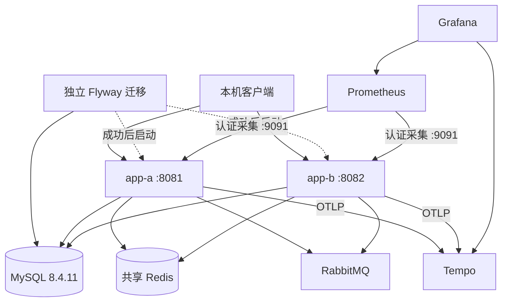

# 当前架构与阶段验收

## Day 24 部署结构（2026-11-12）

Day 22 改期与 Day 23 取消已经完成业务回归。Day 24 将应用与中间件放入同一 Compose 网络，双实例使用同一 JAR 镜像和共享数据库。下面早期阶段说明保留历史背景；最新部署入口见 [部署手册](deployment.md)，实测状态见 [Day 24 报告](../qa/reports/day24-deployment-test.md)。



`core` 有两个应用、MySQL、Redis、RabbitMQ 和一次性迁移任务；`observability` 有 Prometheus、Grafana 和 Tempo。两个应用均运行 Outbox Relay、消费者及数据库补偿扫描。跨实例正确性由 MySQL 事务锁、唯一约束、任务租约与共享 Redis 原子操作协调；没有新增依赖进程内锁的交易保障。

取消接口的立即门禁与分批善后沿用 Day 23 实现。应用使用非 root 用户、只读根文件系统和独立临时目录。业务中间件的持久化卷按 Compose 项目隔离；固定 RabbitMQ 节点名保证重建容器后继续使用原数据目录。

迁移进程不启动 Web、消费者或定时任务。应用等待迁移成功，Docker profile 的 Flyway 自动启动关闭，避免双实例启动时争抢迁移。版本升级先停止写入、备份并运行迁移，再启动同版本两个实例。

## 业务模块与演进记录

[Product/SKU](api/products.md) 支持独立商品名单及 ACTIVITY/SESSION 有效票资格。商品下单、支付、履约、部分售后和资格变化联动均已接入；支付与退票通过资格保护行协调，支付事务重新检查当前资格。商品单允许同一发布者跨活动合单、拒绝跨发布者合单，规则与成交价格保存在订单明细中。响应提供 `orderItemId`，客户端可直接继续发货、收货与售后。

本页记录身份、活动配置、名单、票务、预约、商品及异步基础设施。场次改期和取消已完成，分别见 [改期设计](day22-reschedule-design.md) 和 [取消设计](day23-cancellation-design.md)。下述 Day 编号表示最初实现阶段，不是当前功能边界。

Day 5 的 [票单 API](ticket-orders.md)已接通生产端点与业务事务，资格判断、创建窗口、资源归属、价格快照、只读预检查、按原明细比较的幂等重放及本人订单详情已实现。

Day 6 的[支付资源组件](payment-resources.md)已接入 Day 7 [模拟支付 API](api/ticket-payments.md)，包括订单行锁、当前资格复查、原子限购和库存、两种配座、Ticket 签发、PAID 条件更新与幂等重放。缺货关闭在支付回滚后的独立事务完成。

Day 9 的[免费预约 API](api/reservations.md)直接生成 ACTIVE 记录并占用一份独立名额。取消在场次开始前条件生效、只返还一次；重新预约新建记录并重新检查当前资格。

Day 11 的[普通门票退款](ticket-refunds.md#day-11-原子退款处理)使用受理时的逐票报价，原子恢复资源并更新订单汇总。Day 12 的 [GIFT 分配](gift-inventory.md)使用 V7 保存发布者操作与实际座位历史，已接入权限、独立资源事务、幂等、PAID/GIFT 隔离、历史列表与详情；当前资源操作仅提供 ALLOCATE。三类容量巡检和最终矩阵见 [Day 12 完成验收](../qa/reports/day12-completion.md)。

## 请求与可信身份

Day 13 已完成固定 fixture 的跨模块阶段回归，修复退款申请时间与出票时间不同源导致的偶发误拒绝，并补全统一不变量和孤儿巡检。最终 1529 项测试全部通过，环境、AT-01～AT-10/AT-16 映射及缺陷记录见 [阶段测试报告](../qa/reports/test-report.md)。

HTTP 请求经过 Spring Security Resource Server 验证 Bearer JWT，再由 Controller 调用 Service。MyBatis Mapper 通过 DataSource 访问 MySQL。MockMvc 验收启用真实 Security 过滤链。

`CurrentUserProvider` 从认证上下文取得用户 ID，再查询 `app_user` 确认账号为 `ACTIVE`。当前请求的购买者、参与者和发布者身份均以该上下文为依据。

`/publisher/**` 要求 `ROLE_PUBLISHER`。参与资格对 `USER` 和 `PUBLISHER` 使用同一规则，发布者身份不能绕过白名单。

## 模块职责与资源关系

| 组件 | 职责 |
|---|---|
| `ActivityOwnershipService` | 沿 Seat、Zone、Session 的已存父子关系追溯 Activity，锁定根记录并核对所属发布者 |
| 已有活动的配置 Service | 在同一事务中取得 Activity 根记录锁，确认 `DRAFT` 后校验并写入配置 |
| `PublisherActivityPublishService` | 锁定 Activity，完成跨表完整性校验，最后条件更新为 `PUBLISHED` |
| `PublisherWhitelistService` | 管理活动与场次名单，允许所属活动为 `DRAFT` 或 `PUBLISHED` |
| `QualificationService` | 确认账号、活动及场次关系，按当前适用名单判断资格 |
| `FreeReservationService` | 创建与取消使用独立事务，协调当前资格、数据库时间、quota 行锁、预约唯一键和历史保留 |
| `TicketOrderService` | 在创建事务之外协调按购买者作用域的重放、首次创建与冲突恢复 |
| `TicketOrderCreationService` | 在独立事务中检查新下单条件，原子写入主表与全部明细 |
| `TicketOrderReplayService` | 在独立只读事务中比较原订单购买意图，返回原单或幂等冲突 |
| `TicketOrderQueryService` | 确认当前账号有效并核对 `buyer_id`，只返回本人的订单与明细 |
| `TicketPaymentService` | 在事务外协调完整支付，以及明确缺货失败后的独立关闭 |
| `TicketPaymentTransactionService` | 独立 READ_COMMITTED 事务，先锁订单；检查当前身份、资格与期限，取得资源、签票并条件更新 PAID；PAID 重放只读原结果 |
| `TicketPaymentFailureService` | 支付回滚后另开短事务重锁订单，只关闭仍待支付的缺货单，不覆盖已支付结果 |
| `PaymentTelemetry` | 在支付协调入口记录最终尝试结果、固定原因分类、总耗时及脱敏日志；指标标签不含请求或账号 ID |
| `TicketIssuanceService` | 按明细价格快照签发 Ticket，逐明细核对数量与价格，加入支付事务 |
| `TicketPaymentResourceService` | 加入已有事务，安全初始化及原子占用限购额度，检查库存条件扣减影响行数 |
| `SeatAllocator` | 在已有 READ_COMMITTED 事务中锁齐 Zone，选择候选，按全单 Seat ID 升序条件占用 |
| `SelectedSeatAllocator`、`AutoSeatAllocator` | 校验指定座位或按已确认的连座偏好计算候选，实际写入由统一协调器完成 |
| `GiftAllocationService`、`GiftAllocationTransactionService` | 事务外协调幂等冲突；独立事务条件占用 GIFT Seat、扣库存并保存完整操作历史 |
| `GiftOwnershipService` | 在业务事务内锁定账号、Activity、Session 和 Zone，复查当前发布者权限与父子关系 |
| `GiftAllocationQueryService`、`GiftOperationReader` | 共享 Zone 锁协调分配，以操作及逐座明细返回历史分页或详情，不从当前 Seat 状态重建历史 |

数据库不声明物理外键。资源归属链为 `session_seat.zone_id` → `session_zone.session_id` → `activity_session.activity_id` → `activity.publisher_id`。配置接口只接收路径指定的父资源 ID，拒绝请求体中额外的父子 ID。Service 根据数据库关系确定祖先，不能仅以 ID 存在作为归属依据。

`GET /ticket-orders/{orderId}` 的归属依据为订单的 `buyer_id` 与 `CurrentUserProvider` 当前有效账号 ID。查询参数不提供身份，发布者拥有活动也不授予读取其他买家订单的权限。详情读取不重跑下单资格检查，不更新状态或期限；错误与测试入口见 [本人订单详情](ticket-orders.md#本人订单详情)。

## 白名单与业务事务

`whitelist_config` 是否存在决定作用域是否已配置。成员为空也保留这一配置事实。场次配置存在时完全覆盖活动配置，只有场次未配置时才继承活动规则。字段及组合规则见 [schema.md 第 10 节](schema.md#103-配置状态与资格语义)，六项决策见 [Whitelist semantics](decisions.md#whitelist-semantics)。

资格入口的契约如下：

| 方法 | 使用位置 | 返回与事务要求 |
|---|---|---|
| `check(activityId, sessionId)` | 当前创建票单及免费预约创建 | 从 `CurrentUserProvider` 取得账号，返回通过资格校验的可信用户 ID，要求已有业务事务 |
| `checkAgain(activityId, sessionId)` | 当前待支付订单支付 | 使用订单持久化的活动与场次 ID，重新检查当前资格，要求已有业务事务 |
| `canParticipate(userId, activityId, sessionId)` | 内部布尔查询 | 调用方提供可信用户 ID，独立调用使用 `READ_COMMITTED`，不能把结果带到另一个事务当作支付授权 |

两个业务入口使用 `Propagation.MANDATORY`，未处于业务事务时抛出 `IllegalTransactionStateException`。资格不通过抛出 `QualificationDeniedException`，HTTP 响应为 `403 QUALIFICATION_DENIED`。资格通过后，业务 Service 仍须校验状态、窗口、库存、限购和幂等性。

名单管理取得 Activity 排他锁，资格查询取得共享锁，并使用锁定读查询当前账号、作用域、配置及成员。锁保持到外层事务提交或回滚。配置不存在的状态也由 Activity 根记录协调，具体顺序见 [locking.md](locking.md)。

名单维护只改变配置和成员，不撤销既有交易。每次新增资格行为及待支付订单支付时复查当前名单。D12 已完成活动与场次名单的 A–D 回归，见 [名单变化验收](../qa/reports/day12-whitelist-regression.md)。

创建请求重放仅返回既有订单，不是新增资格行为，不重跑销售窗口、名单与库存预检查，也不更新价格或有效期。调用者仍须为有效账号，支付继续复查当前资格。订单创建独立提交，不能作为外围事务的可回滚子步骤。幂等载荷及事务决策见 [ADR-003](decisions.md#adr-003创建票单按原明细实现请求幂等)。

## AT-04 与 AT-16 的阶段验收

验收依据是 [requirements.md 的验收用例](requirements.md#15-第一阶段验收案例)及 [Day 4 计划](schedule.md)。当前范围与证据如下：

| 要求 | 当前验收范围 | 自动化证据 |
|---|---|---|
| AT-04：场次显式空名单 | 拒绝普通用户、活动所有者及其他发布者，即使活动名单包含这些账号也拒绝 | `QualificationEntryPointMySqlIntegrationTest.emptySessionListRejectsAllConsumerRolesAndRemovingItRestoresInheritance` |
| AT-04：场次未配置 | 继承活动名单，两级未配置则公开；场次配置存在时不回退 | `QualificationEntryPointMySqlIntegrationTest.bothBusinessEntriesUseTheSixQualificationRules`、`WhitelistManagementMySqlIntegrationTest` |
| AT-16：票价、容量、座位冻结 | 发布后普通修改被拒绝，数据库值保持不变；新增座位返回 `409 ACTIVITY_NOT_DRAFT` | `ActivityPublishingMySqlIntegrationTest.ordinaryEditsLeaveEveryPublishedCoreFieldUnchanged`、`publishedActivityRejectsAdditionalSeatsInTheDatabase` |
| AT-16：场次时间 | 普通 PUT、PATCH 请求修改 `startTime`、`endTime` 被拒绝，数据库值保持不变 | 同一发布测试的 `frozenOrdinaryEdits` 参数矩阵 |
| 白名单维护例外 | 已发布活动及其场次仍允许所属发布者启用、增删成员、取消配置 | `WhitelistManagementMySqlIntegrationTest.draftAndPublishedOwnersCanManageMembersWithoutConfusingEmptyAndUnconfigured` |

AT-04 的资格业务入口由测试专用消费者调用，验证真实 JWT、Security、Service 事务、MyBatis 和 MySQL。测试消费者不提供预约或支付功能。

AT-16 当前没有通用核心资源 PUT、PATCH、DELETE 编辑入口，相应请求返回 `404` 或 `405`。这证明当前普通 HTTP 请求无法修改已发布数据，尚不代表完整编辑功能已经实现。后续增加普通编辑入口时，仍须在 Activity 根记录锁内检查 `DRAFT`。专用改期 API、变更历史、特殊退款与自动保留已经实现，并保持原座位和成交价快照。

项目根目录中，在已配置 MySQL 连接、`DB_PASSWORD` 且 `mvn` 可用的 PowerShell 进程中执行：

```powershell
mvn '-Dtest=QualificationEntryPointMySqlIntegrationTest,ActivityPublishingMySqlIntegrationTest,WhitelistManagementMySqlIntegrationTest' test
```

2026-10-24 的本阶段复跑结果：资格入口 29 个、发布冻结 44 个、名单管理 41 个，共 114 个用例，失败、错误、跳过均为零。该记录仅覆盖上述三个测试类。

测试源码：[资格入口](../src/test/java/com/limitactivitysystem/activity/integration/QualificationEntryPointMySqlIntegrationTest.java)、[发布冻结](../src/test/java/com/limitactivitysystem/activity/integration/ActivityPublishingMySqlIntegrationTest.java)、[名单管理](../src/test/java/com/limitactivitysystem/whitelist/integration/WhitelistManagementMySqlIntegrationTest.java)。执行结果以本次 `target/surefire-reports/TEST-*.xml` 的计数、时间和失败记录为准，不能将跳过的 MySQL 测试计作通过。

## Redis 缓存与失效

`ActivityQueryService`、`SeatLayoutQueryService` 和 `ProductQueryService` 通过 `CacheAsideService` 读取公开缓存。缓存未命中时由 MySQL 加载。商品读取把数据库事务隔离在独立的 `ProductQueryTransactionService` 中，缓存命中不会开启 MySQL 事务。

`CacheInvalidationRecorder` 在业务事务内递增 MySQL generation 并写入失效任务。`CacheInvalidationListener` 在提交后立即删除 Redis Key。后台扫描器重试未完成任务。回填与失效使用 Redis Lua 脚本比较版本，正缓存从回源开始计算 TTL，最长保留 35 秒。

商品库存和座位可售状态不由缓存决定。支付、退款、资格、限购、订单状态与库存仍由 MySQL 事务保护。Redis 去重只抑制短时间内重复请求，MySQL 幂等和业务状态仍决定交易结果。指标与 Key 约束见 [缓存参考](cache.md)。

## 事务 Outbox 与 RabbitMQ

订单创建、支付与退款在各自的 MySQL 业务事务内写入 `outbox_event`。业务记录与事件记录一起提交或回滚。下单仍不预占库存；订单过期事件只安排异步检查。

Outbox Relay 在短事务里通过 `FOR UPDATE SKIP LOCKED` 领取到期记录并设置带 token 的租约，提交后才访问 RabbitMQ。只有 Publisher Confirm 为 ACK 且没有 Publisher Return 时才把记录改为 `SENT`。租约过期后其他 Worker 可以接手，发布重试继续使用原 `event_id`。

消费者在一个独立 MySQL 事务内写入 `consumer_process` 并完成业务效果；事务 Service 返回、提交完成后 Listener 才发送 RabbitMQ ACK。重复投递由 `(consumer_name, event_id)` 唯一键和业务状态条件更新拦截。订单超时以 MySQL `expires_at` 为准；RabbitMQ TTL/DLX 用于唤醒消费者，Day 8 的扫描作业继续补偿延迟或丢失的触发。拓扑、重试与故障边界见 [消息处理说明](messaging.md)。

Ticket 退款成功时在原事务追加 `TICKET_QUALIFICATION_CHANGED`。RabbitMQ Consumer 按订单明细登记 `ticket_qualification_after_sale_task`，持有 Day 14 资格 Guard 并重读当前 Ticket；任务随后在独立商品事务中复用 Day 17 `ProductAfterSaleService`。Ticket 退款与商品售后允许分别提交：售后失败只留下可查询、可重试的任务，不回滚门票退款。明细唯一约束确保不同消息也不会重复退款、返还 SKU 或恢复商品限购。指标、重试和 AT-15 对账见 [Day 20 报告](../qa/reports/day20-linkage-test.md)。
