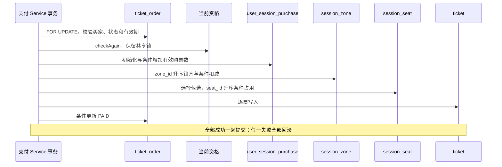

# Locking strategy

## Activity configuration and publication

已有活动的核心配置写入与发布使用同一条 `activity` 根记录协调生命周期。所有核心配置写入都要求 `Activity.status = DRAFT`。

涉及多个层级的行锁时，获取顺序为：

1. `activity`
2. `activity_session`
3. `session_zone`
4. `session_seat`

当前核心配置与发布仅对 `activity` 执行显式锁定查询。Zone、Seat 配置可以先通过普通归属查询确定 `activity_id`，这些查询不获取上述行锁。后续新增对子资源的锁定查询时，也遵守此顺序。

### 事务与状态

核心配置写入在同一个 Service 事务中执行以下操作：

1. 调用 `ActivityMapper.findByIdForUpdate()`，通过 `SELECT ... FOR UPDATE` 锁定活动根记录。
2. 确认活动存在、当前发布者拥有该活动，且状态为 `DRAFT`。
3. 校验配置并写入子资源。
4. 提交或回滚事务，释放根记录锁。

发布事务同样先锁定根记录，再校验全部配置，最后更新状态。`PublisherActivityPublishService.publishActivity()` 使用 `READ_COMMITTED`，获取根记录锁后的配置查询可以读取先前配置事务已提交的数据。

`ActivityMapper.updateStatus(activityId, "PUBLISHED")` 的更新条件包含 `activity_id = #{id} AND status = 'DRAFT'`。Service 要求影响行数为 `1`，否则发布失败。配置校验失败或状态更新失败都会回滚发布事务。

活动发布后冻结核心配置，包括活动类型、开放与关闭时间、场次容量、限购、选座模式、区域价格与容量，以及座位配置。场次时间变更只允许通过后续专用改期流程处理。

### 适用范围与并发验证

本节的根记录排他锁规则适用于核心配置与发布。购票支付不采用每笔交易排他锁整个 `activity` 根记录的方式。资格检查的共享锁规则见下文，库存、订单等后续业务的锁顺序随对应实现单独记录。

白名单属于可变参与资格，不属于本节冻结的核心配置。配置状态语义见 [schema.md 第 10 节](schema.md#10-白名单配置与成员v23-新增)。

[发布并发 MySQL 集成测试](../src/test/java/com/limitactivitysystem/activity/integration/ActivityPublicationConcurrencyMySqlIntegrationTest.java) 使用独立事务验证两种提交顺序：配置先提交时，发布校验读取新配置；发布先提交时，等待锁的配置事务读取到 `PUBLISHED` 并拒绝写入。

## Whitelist management

`PublisherWhitelistService` 的活动级与场次级管理操作使用 `READ_COMMITTED` 事务，按以下顺序获取锁或写入：

1. `activity`：`ActivityOwnershipService` 调用 `findByIdForUpdate()` 锁定所属活动根记录，核对当前发布者归属。取得锁后要求活动状态为 `DRAFT` 或 `PUBLISHED`。
2. `whitelist_config`：按 `(scope_type, scope_id)` 执行 `FOR UPDATE`，配置不存在时创建，或按操作语义返回未配置。
3. `whitelist_member`：添加或删除成员，取消配置时先删除全部成员，再删除配置。

场次的普通归属查询发生在根记录加锁前，不获取场次行锁。根记录锁协调配置尚不存在时的启用、取消及成员管理，避免仅依赖不存在的配置记录加锁。

启用配置、添加成员、删除成员、取消配置均只允许在活动为 `DRAFT` 或 `PUBLISHED` 时执行。活动为 `CANCELLED`、`FINISHED` 或其他状态时，操作返回 `409 WHITELIST_NOT_EDITABLE`，配置与成员保持不变。此检查同样适用于幂等请求，以及配置尚不存在的情况。

状态检查使用根记录锁定查询返回的当前值，先于白名单配置与成员操作。Activity 根记录锁和配置行锁均保持到外层事务提交或回滚。生命周期变更先提交时，等待的名单操作取得锁后检查新状态。名单修改先取得锁时，生命周期变更等待该修改事务结束。后续取消、结束流程也先锁定同一条 Activity 根记录。

删除最后一个成员保留配置，取消配置则删除配置与全部成员。名单管理允许维护已发布活动的参与资格，核心静态配置仍要求 `DRAFT`。

名单管理不会修改已有 Ticket、预约或订单。完整支付和免费预约创建已在各自事务中接入当前资格检查；取消免费预约不要求重新通过白名单。

[名单管理测试](../src/test/java/com/limitactivitysystem/whitelist/integration/WhitelistManagementMySqlIntegrationTest.java)覆盖两级白名单在 `DRAFT`、`PUBLISHED` 下的完整维护，以及 `CANCELLED`、`FINISHED` 下四种操作被拒绝且数据不变。[名单并发测试](../src/test/java/com/limitactivitysystem/activity/integration/WhitelistQualificationConcurrencyMySqlIntegrationTest.java)使用独立连接，验证取消先提交时名单操作拒绝新状态，以及名单修改先持锁时取消等待外层事务结束。该历史切片以测试事务模拟取消；Day 23 已提供取消业务接口及真实竞争验收，见 F12。

## Qualification reads

`QualificationService.check(activityId, sessionId)` 是预约与创建票单的业务入口。`checkAgain(activityId, sessionId)` 是支付时的复查入口。两个方法都从 `CurrentUserProvider` 取得当前账号 ID，通过相同的资格判断后返回可信用户 ID。未通过资格检查时抛出 `QualificationDeniedException`，统一返回 `403 QUALIFICATION_DENIED`。

两个业务入口均使用 `Propagation.MANDATORY`，要求调用方已有事务。没有业务事务时抛出 `IllegalTransactionStateException`，避免方法返回后释放资格锁、后续写入却未受保护。调用方的 `@Transactional` Service 必须通过 Spring 代理执行。

业务写入使用可信身份上下文中的用户 ID，`check` 也返回该 ID 供调用方复用。当前创建票单先通过 `CurrentUserProvider` 确认账号，再在同一上下文调用 `check`。支付从数据库中已加载的订单取得活动和场次 ID，再调用 `checkAgain`。订单归属、活动与场次状态、时间窗口、库存、限购和支付幂等仍由对应业务 Service 校验。

`canParticipate(userId, activityId, sessionId)` 保留为内部布尔查询，显式用户 ID 必须由可信调用方提供。它与两个业务入口共用同一实现，每次通过 `FOR SHARE` 读取当前数据。独立调用使用 `READ_COMMITTED` 事务，已有事务时加入外层事务。业务入口的锁保持到外层事务提交或回滚，方法返回不提前释放锁。

资格检查的锁顺序为：

1. `app_user`：共享锁读取当前账号状态。
2. `activity`：共享锁读取活动，并与名单管理的 Activity 排他锁协调。
3. `activity_session`：共享锁读取场次，确认所属活动。
4. `whitelist_config`：先查询场次配置，只有未配置时才查询活动配置。
5. `whitelist_member`：共享锁查询适用配置中当前账号的成员记录。

同层多个资源需要加锁时按主键升序处理。当前方法只处理一个活动与一个场次，配置与成员按上述继承路径访问。所有锁定查询禁用二级缓存并清空 MyBatis 本地缓存，实际执行 SQL。

多个资格检查可以同时持有 Activity 共享锁。名单管理需要 Activity 排他锁，因此无法在资格检查所属事务提交前改变配置或成员。即使配置尚不存在，也由已存在的 Activity 根记录协调新增配置，不能只锁一条不存在的配置记录。

并发结果按先取得 Activity 锁的事务决定：

- 名单管理先取得排他锁：资格检查等待名单事务结束，再读取已提交的新名单。
- 资格检查先取得共享锁：名单管理等待业务事务结束，再改变后续业务动作的资格。

这些查询是锁定读。即使外层 `REPEATABLE_READ` 事务此前已建立旧快照，也读取锁定记录的当前值。`updated_at` 和此前返回的资格布尔值均不作为支付授权。

创建票单、支付待支付票单、创建预约及取消后重新参与，都在各自事务中主动调用资格检查。创建在资格检查后 INSERT 新订单；支付按下文规则先锁定已存订单，再取得资格共享锁，随后取得限购、库存和座位写锁。业务拒绝时回滚该事务。退款、关闭、取消等后续路径也必须协调订单优先的顺序，不能持有 Activity 排他锁后反向等待支付所持的订单锁。

独立调用返回后只说明本次检查时通过，不能把返回值带到另一个支付事务直接使用。已支付门票、已成功预约不会因后来名单变更而自动失效。完整业务回归属于 D12，今日并发实验只验证资格与名单事务的协调。

[统一入口 MySQL 测试](../src/test/java/com/limitactivitysystem/activity/integration/QualificationEntryPointMySqlIntegrationTest.java)通过测试专用消费者验证身份、资格错误响应、强制事务边界和支付阶段重新检查当前名单。测试专用消费者不实现预约、订单或支付业务。

[资格并发 MySQL 测试](../src/test/java/com/limitactivitysystem/activity/integration/WhitelistQualificationConcurrencyMySqlIntegrationTest.java)验证两种锁竞争顺序、并行共享读取、未配置时创建空名单，以及旧快照下的当前资格读取。测试使用独立随机 schema，仅加载 V1 和 V3，不执行带有固定 `USE` 的 V2 seed。

参考：[MySQL 8.4 锁定读](https://dev.mysql.com/doc/refman/8.4/en/innodb-locking-reads.html)、[MySQL 8.4 事务隔离](https://dev.mysql.com/doc/refman/8.4/en/innodb-transaction-isolation-levels.html)。

## Ticket order creation

`TicketOrderCreationService.createOrder` 使用独立的 `REQUIRES_NEW`、`READ_COMMITTED` 事务，先普通查询场次与所属活动以确定资格作用域，再调用 `QualificationService.check`。资格共享锁按前述顺序取得，并保持到整个创建事务结束。获取锁后重新读取 Activity、Session 并复核生命周期，避免等待名单事务后沿用旧状态。

Zone、指定 Seat 和当前有效购票计数只做普通查询。Service 将同 Zone 数量合计后与当前余量比较，将全单数量与当前有效票数合计后检查限购。这些预检查不占用库存、座位或限购额度，不初始化计数行，也不签发 Ticket。

全部校验后插入新订单与明细。订单写入使用数据库时间条件 INSERT，检查 `[open_time, close_time)` 且早于场次开始时间，避免校验期间跨过创建边界。资格共享锁协调名单及生命周期，不代表创建成功即可取得可售资源。

Service 的锁保持到订单与明细一起提交或回滚。[创建 MySQL 测试](../src/test/java/com/limitactivitysystem/activity/integration/TicketOrderCreationMySqlIntegrationTest.java)验证真实写入后的回滚，以及多个待支付订单不扣减余量、不改变座位或有效购票计数。Day 6 的支付资源组件及锁顺序见下文，完整支付事务在后续阶段接通。

该测试还在主表写入后、第一条明细写入后、全部明细写入后三处注入运行时异常。测试通过真实 Service 代理调用，在业务事务内观察到主表一行，以及各故障位置对应的零条、一条、两条明细。回滚后主表和明细均为零。库存、座位、既有购票计数及 Ticket 的快照在故障前后均不变。故障拦截器仅由测试配置注册，详细验证范围见 [订单事务原子性](ticket-orders.md#主表与全部明细的原子性)。

## Product order preview and creation

Day 15 的预览与建单使用 READ_COMMITTED。`ProductOrderService.confirm` 在无外层事务下先由独立事务按认证买家和 requestId 查询幂等结果；新单经 `ProductOrderCreationService.create` 的 REQUIRES_NEW 事务重新读取商品与 SKU、资格、库存、限购和当前价格。请求体不接受 buyerId、Publisher、单价、总额或资格结果。

### Day 15 实际 SQL 与锁

| 步骤 | 实际调用 / SQL | 锁与写入事实 |
|---|---|---|
| 幂等预查 | `ProductOrderMapper.findByBuyerAndRequestId`：`SELECT ... WHERE buyer_id=? AND request_id=?` | 普通一致性读，不锁既有订单；`UNIQUE(buyer_id, request_id)` 是并发创建的最终保护。唯一冲突后，创建事务先回滚，再由新事务读取并比较明细。 |
| 商品/SKU 候选 | `ProductMapper.orderCandidate`：`sku JOIN product WHERE sku_id=?` | 普通查询，无 `FOR UPDATE`/`FOR SHARE`；读取当前售价、余量和状态用于预检查，不承诺库存。 |
| 当前资格 | `ProductQualificationService.check` → `AppUserMapper.findByIdForShare` → `ProductScopeService.resolve` 中 Activity/Session 的 `findByIdForShare` 及 `ProductMapper.share`；`isMember`、`validTickets` 为普通查询 | 建单会持有账号、Activity、可选 Session 和 Product 的共享锁，以复核当前状态与配置。它不获取资格 Guard，也不承诺支付时资格仍成立。 |
| Product 限购 | `ProductOrderMapper.findValidCount`：`SELECT COALESCE((SELECT valid_count ...),0)` | 普通读取；不锁、不初始化、不插入、不更新 `user_product_purchase`。 |
| 库存 | 使用 `orderCandidate` 读取的 `remains_stock` 与请求数量比较 | 不锁、不扣减 `sku.remains_stock`。缺货拒绝/预览仅反馈该 SKU，不替换规格。 |
| 持久化 | `ProductOrderMapper.insert` 插入主表，再 `insertItems` 批量插入明细 | 仅在校验完毕后写新主表和明细。任一明细失败，`rollbackFor=Exception.class` 回滚主表与所有明细。数据库默认生成 `created_at` 和 `expires_at`；`paid_at` 留空。 |

预览只执行上述读取，不写订单或资源。订单创建不扣 SKU 库存、不占 Product 限购；创建前后的 `remains_stock` 与 `valid_count` 应在 MySQL 集成测试中逐行相等。订单快照保存服务端当前 `unit_price`、Product/SKU 名称、Activity/资格范围及售后模板/版本；主单 `total_amount` 是服务端逐项求和。

### Day 16 商品支付实际顺序

```text
ProductOrder（先锁原待支付订单）
→ buyer / publisher Account（user_id ASC）
→ Activity（activity_id ASC）→ SESSION 资格所需 Session（session_id ASC）
→ Product 资格与归属配置（product_id ASC）
→ 仅 TICKET_REQUIRED 明细对应的 user_activity_qualification_guard（activity_id ASC）
→ user_product_purchase（product_id ASC）
→ SKU（sku_id ASC）
→ 原 ProductOrder 条件更新为 PAID（复用最初订单锁）
```

`ProductOrder` 锁住重复支付；Activity、Session 和 Product 共享锁稳定商品归属与资格配置。只对持票资格取得 Guard，公开商品和商品白名单商品不锁 Guard。全部当前资格通过后，按 Product 汇总并条件增加共享限购计数，再按 SKU 汇总、升序锁定并条件扣库存。任何库存失败都回滚之前的限购与 SKU 更新。最终 PAID 更新再次使用数据库时间检查订单期限；失败事务不保留资源写入。

商品支付使用当前 `ProductQualificationService.check` 重查 PUBLIC、商品名单和持票资格；SESSION 持票查询带指定 sessionId。历史订单明细保存的价格快照用于金额真相，不按当前 SKU 价格重算。SKU 缺货信息在支付事务回滚后返回，并用新事务重锁订单，仅当仍为 PENDING_PAYMENT 时标记 `CLOSED/OUT_OF_STOCK`。过期扫描使用独立有界查询和每单 REQUIRES_NEW 关闭；死锁与明确的锁等待超时最多启动三次完整新事务，业务拒绝和缺货不重试。

## Ticket payment resources

支付与退款处理共享以下资源顺序。退款处理的完整规则见本文末尾的 Ticket refund processing：

`ticket_order → ticket_refund_request / ticket_refund_item → user_session_purchase → session_zone (zone_id ASC) → session_seat (seat_id ASC) → ticket (ticket_id ASC)`。

支付跳过退款表；账号和资格共享锁仍在限购锁之前取得。订单退款汇总最后更新，但使用事务开始时已取得的 Order 锁。

两条完整路径为：

| 路径 | 取锁及最终写入顺序 |
|---|---|
| Payment | Order → Quota → Zone → Seat → Ticket → Order |
| Refund | Order → Refund Request 及 Item → Quota → Zone → Seat → Ticket → Order |

全部 Zone 按 `zone_id ASC`，全部 Seat 按 `seat_id ASC`。退款已有 Ticket 按 `ticket_id ASC` 逐票锁定；支付新增 Ticket 通过自增主键逐条插入，取得的 Ticket ID 递增。最后的 Order UPDATE 复用最先取得的锁。Refund 的最终成功写入也复用既有退款行锁，不反向取得新的锁。

固定顺序只降低死锁概率，不能替代整事务重试。支付保留 Day 8 的 `PaymentRetryExecutor`，每次失败完整回滚后再进入新事务。退款当前由调用方复用原 `refundId` 重试，每次也从 `REQUIRES_NEW` 重新锁定、校验并恢复资源，不在失败事务中继续执行剩余步骤。

支付写路径统一使用以下顺序，同层多个资源按主键升序获取：

1. `ticket_order`：按主键 `findByIdForUpdate` 锁定订单，核对买家、状态、数据库有效期及场次生命周期。随后调用 `QualificationService.checkAgain`，按账号、Activity、Session、配置、成员的内部顺序取得当前资格共享锁。
2. `user_session_purchase`：安全初始化计数行，再用条件 UPDATE 原子占用额度，要求影响一行。
3. `session_zone`：先按 `zone_id` 升序锁齐本单全部 Zone，核对场次和 `PAID` 类型，再按同一顺序条件扣减库存，要求各影响一行。
4. `session_seat`：在 Zone 协调锁保护下读取当前可用座位并选择候选；所有候选确定后，全单按 `seat_id` 升序逐一条件占用。不能按区域分组后交替取得 Zone 和 Seat 锁。
5. `ticket`：为每个已占用座位写入对应订单明细的 Ticket。
6. `ticket_order`：在原订单锁仍持有时，条件更新最终状态为 `PAID`，再次检查数据库有效期并要求影响一行，然后整笔提交。



`TicketPaymentService.pay(orderId)` 在事务外协调。`TicketPaymentTransactionService.pay` 通过独立 `REQUIRES_NEW`、`READ_COMMITTED` 事务完成上述全路径，包括 Ticket 签发和 PAID 条件更新。`TicketPaymentResourceService`、`SeatAllocator`、`TicketIssuanceService` 使用 `MANDATORY` 加入它。`POST /ticket-orders/{orderId}/pay` 已开放，接口见 [模拟支付 API](api/ticket-payments.md)。

订单锁取得后，先检查买家和 ACTIVE 账号。已经 PAID 时读取原 Ticket 并返回，不重新取得资源或检查名单；其他非待支付状态拒绝。待支付分支才执行当前资格和期限检查。

### Order and quota coordination

先锁订单可使同一订单的支付尝试围绕同一状态串行检查，避免两个支付事务同时把它视为待支付订单；以后关闭、退款等状态转换也需遵守这个协调点。买家核验先于状态错误返回，避免向其他买家泄露支付状态。订单锁本身不能替代最终 PAID 条件更新或完整支付幂等。

同一账号在同一场次的不同订单还会竞争同一个限购计数行。先占用额度，再取得 Zone 和 Seat 锁，使这些订单按一致顺序竞争；无法满足限购的事务在取得热门库存锁前退出。额度与后续资源操作在同一事务内，后续失败会恢复原计数。

支付使用数据库当前时间，要求 `now < order.expires_at` 且 `now < session.start_time`。活动必须仍为 `PUBLISHED`，场次必须为 `SCHEDULED`，当前账号为 `ACTIVE`，`checkAgain` 必须通过当前名单。在资格等待后和配座后再次检查期限。`activity.close_time` 只限制创建新单，停售前创建且仍有效的旧单可以继续尝试支付。

### Conditional updates and affected rows

| SQL 操作 | 条件与影响行数要求 |
|---|---|
| 限购行初始化 | `INSERT ... ON DUPLICATE KEY UPDATE valid_count = valid_count` 只保证行存在，不重置计数；不把其驱动相关影响行数当作额度取得结果 |
| 限购增加 | `quantity > 0`、限购为正、`valid_count <= limit - quantity`；`affectedRows == 1`，否则 `PURCHASE_LIMIT_EXCEEDED` |
| Zone 库存减少 | `zone_id` 匹配、类型为 `PAID`、数量为正、`remains_amount >= quantity`；必须影响一行，否则 `INSUFFICIENT_INVENTORY` |
| Seat 占用 | `seat_id`、`zone_id` 匹配且状态为 `AVAILABLE`，才更新为 `SOLD`；必须影响一行，否则 `SEAT_NOT_AVAILABLE` |
| 订单最终 PAID | `markPaidIfPayable` 在原订单锁内检查 PENDING_PAYMENT、数据库创建/过期时间、场次状态与开始时间及活动状态；必须影响一行 |
| 缺货后的关闭 | 失败支付完全回滚后，独立事务重新锁单，仅条件关闭 PENDING_PAYMENT；必须影响一行，不覆盖 PAID 或其他状态 |

资源条件更新影响零行即抛异常，回滚此前取得的额度、库存及 Seat。不能吞掉异常继续成交或只重试单条 SQL。

### Payment SQL and indexes

以下索引名来自当前 Flyway Schema。主写路径顺序为 `ticket_order → user_session_purchase → session_zone ASC → session_seat ASC → ticket INSERT → ticket_order PAID`。资格共享锁在 Order 锁后、额度写入前取得，具体内部顺序见前文。

| 阶段与 Mapper | SQL 定位或约束 | 索引 | 失败与影响行数 |
|---|---|---|---|
| 1. `findByIdForUpdate` | `WHERE order_id = ? FOR UPDATE` | `ticket_order.PRIMARY(order_id)` | 无行则 ORDER_NOT_FOUND；返回行后在锁内核对买家、状态和期限 |
| 2. `ensureExists` | `INSERT ... ON DUPLICATE KEY UPDATE valid_count = valid_count` | `user_session_purchase.PRIMARY(user_id, session_id)` | 只初始化，不重置计数；不将重复初始化的影响行数当作买票结果 |
| 2. `tryIncrease` | 两个主键列相等，`valid_count <= limit - quantity`，数量和限购均为正 | 同一复合 PRIMARY | 必须影响 1 行，0 行则 PURCHASE_LIMIT_EXCEEDED |
| 3. Zone 锁定及 `decreaseStock` | `zone_id = ?`，扣减还要求 PAID 与余量足够 | `session_zone.PRIMARY(zone_id)` | 先升序锁齐全单 Zone；每个条件扣减必须影响 1 行，否则全部回滚 |
| 4. `occupySeat` | `seat_id = ? AND zone_id = ? AND allocation_status = 'AVAILABLE'` | `session_seat.PRIMARY(seat_id)` | 全单 seat_id 升序；必须影响 1 行，0 行则 SEAT_NOT_AVAILABLE |
| 5. `TicketMapper.insert` | `order_item_id`、实际 `seat_id`、明细快照单价、VALID | `ticket.PRIMARY(ticket_id)` 与 `uq_ticket_active_seat(active_seat_id)` 唯一校验 | 每张必须插入 1 行；插入异常、数量或价格不一致均回滚 |
| 6. `markPaidIfPayable` | Order 主键、待支付状态、数据库期限；JOIN Session 与 Activity 检查生命周期 | Order、Session、Activity 各自 PRIMARY | 必须影响 1 行；0 行按时间复查给出具体错误或 ORDER_PAYMENT_CONFLICT；返回后再检查时间 |

核心条件 SQL 与生产 Mapper 一致：

```sql
UPDATE user_session_purchase SET valid_count = valid_count + :quantity
WHERE user_id = :user_id AND session_id = :session_id
	AND :quantity > 0 AND :limit > 0 AND valid_count <= :limit - :quantity;

UPDATE session_zone SET remains_amount = remains_amount - :quantity
WHERE zone_id = :zone_id AND zone_type = 'PAID'
	AND :quantity > 0 AND remains_amount >= :quantity;

UPDATE session_seat SET allocation_status = 'SOLD'
WHERE seat_id = :seat_id AND zone_id = :zone_id AND allocation_status = 'AVAILABLE';
```

上述冒号参数用于文档表示绑定参数，MyBatis 实际使用 `#{...}`。最终 PAID SQL 见 [TicketOrderMapper](../src/main/java/com/limitactivitysystem/ticketorder/mapper/TicketOrderMapper.java)，测试直接读取其 MappedStatement 生成 EXPLAIN，不维护另一个最终更新副本。

Zone 先全部锁定、Seat 再全单升序，避免输入为相反区域顺序或 Seat ID 在多个区域间交错时形成反向等待。限购在热门库存前协调同账号同场次订单，Order 在最前协调重复支付与关闭。候选位置优先序不等于取写锁的顺序。

自动配座的可用查询可使用 `idx_seat_zone_availability_priority(zone_id, allocation_status, allocation_priority, seat_id)` 过滤。该索引不包含完整的 `row_no, seat_no` 排序键，不能宣称它消除全部排序。当前十座夹具的 EXPLAIN 选择 `ALL` 与 `Using filesort`；Order、额度、Zone 与 Seat 条件写入实际使用 PRIMARY。可用 Seat 查询发生在 Zone 锁保护下，实际占用仍按 Seat ID 升序。

`paymentSqlPlansAndDeclaredIndexesAreRecordedFromTheRealDatabase` 保存实时计划和 Ticket 索引清单到 `target/verification/payment-sql-index-plans.json`。优化器选择依赖数据量与统计信息，该观察不代表所有环境都采用相同候选查询计划。

### Transaction boundary and current reads

订单和 Zone 的 `FOR UPDATE` 必须由真实业务事务调用，锁保持至同一事务提交或回滚。组件使用 `MANDATORY` 加入调用方事务，不能在 Controller 查询一次后换连接继续操作。支付资源事务使用 `READ_COMMITTED`，配座入口拒绝其他隔离级别，避免在已有 `REPEATABLE_READ` 旧快照里选择过时座位。可用 Seat 查询禁用缓存，Zone 锁持有期间所有配座写路径都必须遵守同样的协调规则。

普通 `SELECT` 用于读取，不持有等价的更新锁。`SELECT ... FOR UPDATE` 锁的是 InnoDB 索引记录，不是 Java 对象；其他连接申请冲突锁需要等待事务结束。精确主键查询与范围扫描的锁范围不同，不能把锁范围只理解为 SQL 返回的对象数。依据：[MySQL 8.4 锁定读](https://dev.mysql.com/doc/refman/8.4/en/innodb-locking-reads.html)、[不同语句设置的锁](https://dev.mysql.com/doc/refman/8.4/en/innodb-locks-set.html)。

### Seat selection and lock order

自动配座候选按 `allocation_priority`、`row_no`、`seat_no`、`seat_id` 升序排列。依次将候选作为起点，寻找同排连续 `seat_no` 的完整块，使用第一个符合数量的块。找不到连座且已存 `accept_non_adjacent = true` 时，才取优先序中的前 N 个空闲座位；不接受非连座时返回 `ADJACENT_SEATS_UNAVAILABLE`。可用座位总数不足返回 `SEAT_REQUIREMENT_NOT_SATISFIED`。同一订单多条明细不得重复选择同一座位。选座优先序用于确定购买位置，实际条件占用始终按全单 `seat_id` 升序执行。

自主选座读取全部指定 Seat，核对 PAID Zone 和 Session 归属、数量和模式，再全单按 Seat ID 升序条件占用。区域锁与条件占用共同保护候选到实际取得之间的窗口。组件只返回明细、区域和实际 Seat 的对应关系，后续支付用它签发 Ticket；不在创建订单阶段调用。

`TicketOrderMapper.findByIdForUpdate`、Zone 锁定查询、限购初始化及原子写入 Mapper 方法均拒绝无事务调用。自主选座的指定 Seat 不存在或属于其他 Zone 时返回 `INVALID_SEAT_RELATION`。方法、完整错误码与测试入口见 [支付资源组件](payment-resources.md)。

真实锁等待使用 `performance_schema.data_lock_waits` 观察两个连接在 `ticket_order.PRIMARY` 上的等待，再释放持有者事务，验证等待者继续。另有 Zone 竞争、首次计数行竞争、限购不超限及 Seat 部分写入后整笔回滚测试。观察结果和复现命令见 [行锁等待实验](payment-resources.md#行锁等待实验)。

### Deadlocks and rollback evidence

固定锁顺序降低死锁概率，不能保证此后不会死锁。InnoDB 也会因索引维护及其他事务路径取得锁；互相等待可能形成环并导致事务被回滚。后续退款、取消等路径仍需检查顺序。依据：[MySQL 8.4 死锁处理](https://dev.mysql.com/doc/refman/8.4/en/innodb-deadlocks-handling.html)。

本阶段遇到死锁或锁超时退出并回滚整个 Spring 事务，不在事务内局部重试。Day 8 再实现事务外的可控重试；业务拒绝（名单、限购、库存、连座等）不应被当作死锁重试。

[支付 MySQL 测试](../src/test/java/com/limitactivitysystem/activity/integration/TicketPaymentMySqlIntegrationTest.java)通过真实 Service 代理观察：原计数 2、库存 10，在第一把 Seat 已写入时为计数 4、库存 8、Seat 为 `SOLD`；第二把 Seat 的条件 UPDATE 影响零行后，同一连接的支付事务回滚，计数恢复 2、库存恢复 10、第一把 Seat 恢复 `AVAILABLE`。独立竞争事务占用的第二把 Seat 保持 `SOLD`。证据为 `target/verification/ticket-payment-failure-rollback.json`。

测试在限购初始化、额度增加、库存扣减、占座、Ticket 插入与 PAID 更新前后注入故障，确认主订单和全部资源无局部提交。最终条件更新前或之后跨过订单期限、场次开始边界，也回滚全部写入。

七个指定故障点还逐一记录事务内已发生的计数、库存、座位、Ticket 和订单状态，证明异常发生在真实写入之后。回滚后执行 [payment_invariants.sql](../tests/sql/payment_invariants.sql)，要求没有任何违规行。四组核心并发、缺货关闭竞争和锁等待跨期实验都在工作线程事务结束后自动执行这份 SQL。矩阵、指标及验证范围见[支付对账与可观测性](../qa/reports/payment-verification.md)。

### Database time and failure closure

`markPaidIfPayable` 使用 `CURRENT_TIMESTAMP(3)` 同时写 `paid_at` 与检查期限。该函数返回语句开始时的时间，不能把锁等待前取得的时间当成等待后的时间。支付在取得 Order 锁后、资格检查后、资源操作后重新取数据库时间，并在最终 UPDATE 返回后再复核期限，覆盖最终语句等待跨界的情况。依据：[MySQL 时间函数](https://dev.mysql.com/doc/refman/8.4/en/date-and-time-functions.html)。

仅 `INSUFFICIENT_INVENTORY` 进入 ORD-05 关闭分支。支付代理退出并完成回滚后，协调入口调用 `TicketPaymentFailureService`，另开短事务：Order FOR UPDATE → 重查买家及状态 → 若仍待支付则条件 CLOSED。另一支付已经 PAID 时直接读取原结果，不能覆盖为 CLOSED。其他业务拒绝及技术异常不执行缺货关闭。

两个状态转换继续竞争同一 Order 锁。关闭先提交时，等待的支付读取 CLOSED 并拒绝；另一次支付先提交时，关闭事务读取 PAID 并返回原 Ticket。缺货关闭与支付之间的间隙有真实并发测试，证据为 `target/verification/payment-wins-before-stock-failure-close.json`。

## Free reservation schema contract

FreeReservationService 已按下述协议接入，创建与取消均通过 Spring 代理运行独立 REQUIRES_NEW / READ_COMMITTED 事务。创建先按当前资格顺序读取账号、Activity、Session、白名单配置与成员，再取得 free_session_quota 写锁，最后写 free_reservation。名额初始化、条件扣减和新预约 INSERT 在同一事务；唯一键冲突回滚名额扣减。

取消可先普通读取预约确定作用域，再取得账号与生命周期共享锁、quota 写锁、reservation 条件状态写锁。不能先锁 reservation 再反向锁 quota。只在 ACTIVE → CANCELLED 成功一行后返还一份名额，返还失败回滚状态变更。资格与生命周期锁保持至事务结束；等待后重新检查数据库时间。

quota 使用独立行，避免资格已持 Session 共享锁后再更新 Session 计数。完整初始化、有效唯一键与对账契约见[免费预约 Schema](free-reservations.md)。

## Payment concurrency retries

支付的死锁与锁等待超时由 `PaymentRetryExecutor` 在事务外协调。`TicketPaymentService.pay` 和重试入口均使用 `NOT_SUPPORTED`，每次调用 `TicketPaymentTransactionService.pay` 的 `REQUIRES_NEW` 代理。失败必须先退出代理并完成整笔回滚，再执行短退避；最多三次总尝试。缺货关闭仍在重试入口外处理，不能把业务缺货转换为技术重试。

同层主键升序是所有路径需要共同遵守的协议，不能据此假定系统不会再发生死锁。新增写入口、其他表或索引锁、外部事务仍可能引入等待环。MySQL 建议保持统一访问顺序，同时准备在死锁后重新执行事务；参见 [InnoDB 死锁处理](https://dev.mysql.com/doc/refman/8.4/en/innodb-deadlocks-handling.html)。本项目的实际双订单死锁、升序对照和支付重试记录见[支付重试验证](../qa/reports/payment-retry-verification.md)。

## Ticket order idempotency

`TicketOrderService.createOrder` 使用 `NOT_SUPPORTED` 协调首次创建与重放，调用方已有事务时挂起它。`TicketOrderReplayService` 使用独立只读 `REQUIRES_NEW`、`READ_COMMITTED` 事务，普通查询 `(buyer_id, request_id)` 对应订单与明细，比较完整购买意图。重放不排他锁 Activity 或库存，也不产生资源占用。

两个初次查询都未命中时，创建事务竞争 `UNIQUE(buyer_id, request_id)`。唯一键冲突者等待创建者完成写入；发生重复键后退出整个创建事务，回滚并释放所有资格锁，然后再通过独立重放事务读取已提交原单。禁止在失败事务中吞掉异常继续写入或依赖旧事务快照重查。

如果迟到请求在 INSERT 前遇到新下单的窗口或资格错误，协调入口也在回滚后重查一次，处理并发创建者已经提交的结果。没有原单时继续返回原业务错误。重放仍检查账号有效性；实际支付的当前资格检查留在支付事务。

首次创建独立提交；外部调用方之后回滚不会撤销订单。此边界用于完整的创建入口，不能在组合业务中假设它加入外围事务。主表与明细的内部原子性保持不变。

[幂等并发 MySQL 测试](../src/test/java/com/limitactivitysystem/activity/integration/TicketOrderIdempotencyConcurrencyMySqlIntegrationTest.java)通过 barrier 控制两个真实连接同时竞争唯一键，观察创建事务提交与回滚、回滚后重放使用新的事务资源，并验证外围旧快照及窗口或名单变化下的重放结果。完整比较规则见 [ADR-003](decisions.md#adr-003创建票单按原明细实现请求幂等)。

## Published configuration freeze

冻结范围覆盖当前应用的所有普通配置写入口。新增 Session、Zone、Seat 的 Service 均在 Activity 根记录排他锁后检查 `DRAFT`，发布后返回 `409 ACTIVITY_NOT_DRAFT`。

| 配置 | 发布后的普通修改 |
|---|---|
| `activity.type`、`open_time`、`close_time` | 冻结 |
| `activity_session.capacity`、`max_tickets_per_user`、`seat_mode` | 冻结 |
| `activity_session.start_time`、`end_time` | 普通编辑冻结，未来仅由改期专用流程处理 |
| `session_zone.total_amount`、`price` | 冻结，当前票价配置位于 `session_zone.price` |
| Seat 行列、编号、分配优先级及座位增删 | 冻结 |
| 活动与场次白名单配置及成员 | 所属活动为 `DRAFT` 或 `PUBLISHED` 时允许当前所属发布者维护 |

当前没有核心资源的通用 PUT、PATCH、DELETE 编辑入口，相应请求返回 `404` 或 `405`。这些入口不能绕过冻结；后续增加普通编辑能力时，仍需在同一根记录锁事务中校验 `DRAFT`。不能把白名单维护套用为核心配置编辑。

[发布 MySQL 集成测试](../src/test/java/com/limitactivitysystem/activity/integration/ActivityPublishingMySqlIntegrationTest.java)逐字段验证普通修改被拒绝且数据库值不变，并验证发布后不能新增 Session、Zone、Seat。[名单管理测试](../src/test/java/com/limitactivitysystem/whitelist/integration/WhitelistManagementMySqlIntegrationTest.java)验证发布后仍能维护活动和场次名单。

## Ticket refund application

退款申请协调入口 NOT_SUPPORTED，受理代理 REQUIRES_NEW / READ_COMMITTED。锁顺序为 Order → Account 共享锁 → Activity 共享锁 → Session 共享锁 → Ticket 主键升序 → 新申请与明细。遵守现有支付的 Order 优先协议；本阶段不取得 Zone、Seat 或限购计数的写锁。

每张票先沿 OrderItem、Order 检查关联，再只锁 Ticket 行并重新核对关联链和 VALID。任一票不合法时整笔受理回滚。同一订单上的请求由 Order 行串行协调；跨订单复用同买家 requestId 的竞争由唯一键处理。主表唯一键冲突退出并回滚后，重新进入独立事务读取原单，不能吞掉异常继续写失败事务。

requested_at 在等待上述锁之前从 DatabaseRefundClock 读取一次数据库时间，该普通时间查询不取得业务行锁，与出票共用时间源。政策与金额保存为快照，锁等待跨过政策边界不更换申请时间。主申请 INSERT 后、首条明细 INSERT 后故障均有真实事务回滚测试。模型、复跑命令与记录见 [退款申请契约](ticket-refunds.md)。

## Ticket refund processing

`TicketRefundExecutionService.process` 在事务外协调，调用 `TicketRefundProcessingService.process` 的 `REQUIRES_NEW / READ_COMMITTED` 事务。处理使用已受理申请，不调用退款政策或购票资格检查，也不根据处理时间、当前活动状态或当前场次时间拒绝原申请。

取锁顺序固定如下：

1. 普通读取 Refund Request，仅发现 `order_id` 并初步校验买家，不获取行锁。
2. `ticket_order FOR UPDATE`，校验订单买家。
3. `ticket_refund_request FOR UPDATE`，重查买家、订单引用和状态。
4. 当前账号共享锁。`SUCCEEDED` 返回原结果；`PROCESSING` 及非技术失败的 `FAILED` 返回 `REFUND_NOT_PENDING`。
5. `ticket_refund_item FOR UPDATE`，使用 `(refund_id, ticket_id)` 唯一索引按 Ticket ID 升序读取。技术失败重试先将原 `FAILED` 明细和申请恢复为 `PENDING`，金额与业务键不变。恢复明细时重新取得同票唯一占用；另一个申请已占用该票时整笔回滚，返回 `REFUND_ALREADY_REQUESTED`。普通申请的全部明细必须为 `PENDING`。
6. `user_session_purchase FOR UPDATE`，不创建缺失计数行。
7. 全部 `session_zone FOR UPDATE`，按 `zone_id ASC`。
8. 全部 `session_seat FOR UPDATE`，按全申请 `seat_id ASC`。
9. 全部 `ticket FOR UPDATE`，按 `ticket_id ASC`。

Ticket、OrderItem、Order 的普通关联查询仅用于发现要锁定的 Zone 和 Seat。锁票后再次核对关联，防止依据过时引用恢复错误资源。逐票检查 `VALID`、原订单归属、原成交价及 Seat 唯一性；Zone 必须属于订单场次，Seat 必须属于对应 Zone 且为 `SOLD`。

所有校验通过后，申请和明细进入 `PROCESSING`。条件更新依次减少限购计数、按 Zone 汇总恢复库存、按 Seat ID 释放座位、按 Ticket ID 转换为 `REFUNDED` 并完成对应明细。所有资源早已持锁，写入阶段不反向取得共同资源锁。每条条件更新必须影响一行。

额度更新要求 `valid_count >= quantity`；Zone 更新要求恢复后不超过 `total_amount`；Seat 仅允许 `SOLD → AVAILABLE`；Ticket 仅允许 `VALID → REFUNDED`。全部成功后，以订单当前剩余 `VALID` Ticket 数更新 `PARTIALLY_REFUNDED` 或 `REFUNDED`，最后完成主申请。票、明细和申请保存同一个数据库处理时间，金额始终来自受理快照。

同一订单的不同申请由最先取得的 Order 锁串行处理。不能先锁申请再等待 Order，也不能先锁 Ticket 再等待 Zone。受理事务虽在锁 Ticket 后 INSERT 新退款行，但它已经持有同一 Order 锁，处理事务不可能同时持有该订单退款行并等待受理所持的 Ticket。

任何异常都退出处理代理并完整回滚。资源变更不会与失败结果一起提交。业务拒绝直接返回原领域错误，数据库技术异常由事务外协调器交给 `TicketRefundFailureService.record` 的独立短事务记录。

失败记录事务仍按普通发现订单、Order 排他锁、Request 排他锁、Item 升序取锁的顺序执行。它重新校验归属及当前 `PENDING` 状态；另一个处理已经成功时直接结束，不覆盖 `SUCCEEDED`。它仅将主申请及全部明细标为 `FAILED`，写入 `TECHNICAL_FAILURE`、处理时间和逐票异常类型，不修改限购、Zone、Seat 或 Ticket。

原事务回滚后、失败记录前的间隙允许另一个处理成功，这正是重新读取状态的原因。失败记录自身出错也完整回滚，原始技术异常继续抛出，记录异常作为 suppressed exception 保留。技术失败可使用原 `refundId` 重试并重新竞争同票唯一键。已受理申请的时间和金额始终不重新计算。

真实并发实验在支付先持锁、退款先持锁两种情况下观察 `user_session_purchase.PRIMARY` 等待，解除持有者后双方成功。SQL 追踪核对双方均先 Quota、再全部 Zone、再 Seat，同层按 ID 升序。AT-09、AT-10 与故障矩阵见 [退款验收](../qa/reports/day11-refund-verification.md)。

InnoDB 锁保持到事务提交或回滚；统一顺序降低死锁概率，无法排除其他路径和索引锁引起的死锁。依据：[MySQL 死锁处理](https://dev.mysql.com/doc/refman/8.4/en/innodb-deadlocks-handling.html)。运行时异常触发 Spring 默认整笔回滚，依据：[Spring 声明式事务回滚](https://docs.spring.io/spring-framework/reference/data-access/transaction/declarative/rolling-back.html)。

## GIFT allocation

`GiftAllocationService` 在事务外协调，`GiftAllocationTransactionService` 使用 REQUIRES_NEW / READ_COMMITTED。每次尝试只处理一个 GIFT Zone，取锁顺序为：

1. 当前 app_user 共享锁，确认 ACTIVE、PUBLISHER。
2. Zone、Session 普通发现查询，不取得子资源锁。
3. Activity 共享锁，确认当前发布者归属。
4. Session 共享锁，重查父记录关系。
5. session_zone 排他锁，重查 Session 归属及 GIFT 类型。
6. 读取原操作键；新分配按优先级选择候选，再按 seat_id ASC 条件占用 Seat。
7. 条件扣减已锁定 Zone 的 remains_amount，写新操作及升序 Seat 明细。
8. 复查数据库时间及生命周期，提交所有资源和历史。

候选顺序是 allocation_priority、row_no、seat_no、seat_id。候选查询不按优先级取得 Seat 写锁，Zone 锁保护选择窗口，真正占用始终按 Seat ID 升序。共同资源保持 Zone 在 Seat 之前；不取得 Order、Quota 或普通 Ticket 的锁，也不改变这些资源。

账号、Activity 和 Session 共享锁保持到事务结束，与发布者权限、生命周期及名单管理的相应排他锁协调。GIFT 不调用参与者资格检查。新分配在取得 Zone 锁后及全部写入后检查 Session 未开始，真实锁等待跨过 start_time 时整笔回滚。

同 Zone 请求由 Zone 排他锁串行协调，原键重放先于库存和生命周期的新操作检查。跨 Zone 竞争同发布者请求键由唯一索引处理，失败必须退出并回滚原事务，才进入 REQUIRES_NEW 重放读取。重放不分配新资源，仍检查当前归属，内容不一致返回冲突。固定顺序不排除其他索引或路径造成的死锁；技术失败可使用原 requestId 重新尝试完整事务。

当前没有 RELEASE 路径。后续释放必须记录原操作和具体 Seat 来源，并检查与上述共同资源顺序兼容。接口及证据见 [GIFT 资源操作](gift-inventory.md)。

## GIFT history queries

`GiftAllocationQueryService` 的列表和详情查询使用 REQUIRES_NEW / READ_COMMITTED。与分配共用 `GiftOwnershipService`，顺序为当前账号共享锁 → Activity 共享锁 → Session 共享锁 → GIFT Zone 共享锁 → 普通读取操作及明细。列表每页最多 100 个操作，按 operation_id 升序读取。

详情先普通读取操作以发现 Zone，不取得操作行锁；取得上述父资源共享锁后重新读取并核对操作关联。不能先锁操作、再反向等待 Zone。查询不锁 Seat，不取得 Order、Quota、Ticket 的锁，也不写业务资源。

分配在修改资源及写历史前必须取得同一 Zone 排他锁，查询在结束前持有 Zone 共享锁，因此同次查询不会读到应用分配事务尚未提交的半组操作或明细。账号与父资源共享锁同时协调当前权限变更。历史读取不检查新分配的时间窗口或生命周期。

真实 MySQL 实验在历史查询持有 Zone 共享锁时启动分配，观察 `session_zone` 的锁等待；查询完成释放后分配成功，前后操作历史与容量对账一致。证据见 [Day 12 完成验收](../qa/reports/day12-completion.md)。固定顺序降低死锁风险，支付已有的整事务重试继续保留；GIFT 技术失败后使用原 requestId 重试完整事务。

## Day 13 code and SQL audit

[Phase1JourneyMySqlIntegrationTest](../src/test/java/com/limitactivitysystem/activity/integration/Phase1JourneyMySqlIntegrationTest.java) 记录实际 Mapper ID、SQL 及 Zone/Seat ID。主链断言 Payment 和 Refund 的 Order、Quota、Zone、Seat、Ticket 顺序，GIFT 的 Zone、Seat、Operation 顺序，以及 Reservation 的 Quota、Reservation 顺序。多个 Zone 必须全部先于首个 Seat，同层实际 ID 必须升序。

数据库追踪与上述文档一致，未发现先持 Seat 再获取新 Zone 的业务路径。共同资源等待与整笔回滚同时由支付/退款、预约和 GIFT 原有真实并发测试复核。退款新增数据库时间查询发生在业务锁之前，只取一次时间，不改变行锁顺序。实际 SQL 证据与源码对照见 [Phase 1 锁审计](../qa/reports/test-report.md#lock-order-audit)。

## Product qualification and payment design

V10、商品支付、票务支付和票务退款共同使用账号 × 活动资格 Guard。Guard 只负责把有效 Ticket 的读取与写入串行化；它不缓存资格真值，也不替代商品支付中的当前 Ticket 查询。Day 20 的联动售后通过 Outbox 和独立消费者处理，具体锁顺序见下文。详见 [ADR-011/012](decisions.md#adr-011商品域资格限购与订单边界)。

### 共同锁层级

1. 当前业务的 Order。票单、商品单是不同表；不得持有一类订单锁后再反向等待另一类订单。
2. 退款处理继续按既有顺序取得 Refund Request/Item。
3. 账号共享锁；Activity、相关 Session 和 Product 资格/归属配置共享锁在 Guard 前获取，同类资源按 ID 升序。
4. 仅资格依赖有效 Ticket 的业务锁 `user_activity_qualification_guard`，按 `(user_id, activity_id)` 升序。公开或商品白名单限定商品不需要 Guard。
5. 当前域计数：票务 `user_session_purchase`；商品 `user_product_purchase` 按 `product_id ASC`。两个计数域不在同一事务嵌套。
6. 商品 SKU 按 `sku_id ASC` 锁定并扣减；票务按 Zone ASC → Seat ASC → Ticket。退款同样在 Guard 后依次锁 Quota、Zone、Seat、Ticket。
7. 更新起始已锁订单；退款更新已持有的 Request/Item，不反向取得另一业务域订单。

guard 惰性初始化使用 PK no-op，不能覆盖 qualification_version，也不能在已持 Quota、Product、SKU、Zone、Seat、Ticket 写锁后才插入或获取它。首次使用历史账号时 version=0 不表示无票，资格必须查真实 Ticket。

### 商品支付 Mapper 路径

```text
ProductOrder
→ buyer/publisher Account → Activity → optional Session → Product（各 ID 升序）
→ TICKET_REQUIRED 对应的 qualification guards（activityId ASC）
→ Product quota（productId ASC）
→ all SKUs, skuId ASC
→ original ProductOrder PAID
```

商品订单行和 Product 关系先从持久化订单发现；随后锁定并核对 Product、Activity、Session 与 Publisher 关联。V8 的首次上架冻结商品核心资格配置，因此该关系不会在支付中被合法修改。所有 Guard 和 Product 额度在 SKU 锁前获取；SKU 全部按 ID 升序锁定。Product 额度用 `valid_count <= purchase_limit - quantity` 条件更新并要求影响一行，库存用 `remains_stock >= quantity` 条件更新并要求影响一行。

持票资格在 guard 内用 READ_COMMITTED 当前查询，并禁用旧缓存结果；不 FOR UPDATE 全部 Ticket，也不锁 TicketOrder。商品支付明细保存 Guard 版本快照以供后续识别资格变化，但资格判断仍读取真实有效 Ticket。Ticket 出票与退款各在真实写事务中增加版本；失败回滚不增加版本。只读资格预览不持有 Guard，不能作为后续支付授权。

Product 名单管理按 Account/Activity → Product 排他锁 → Member；不再获取 guard、额度或订单。商品支付持有 Product 共享锁再查询成员，名单为空也由 Product 行协调。Product/SKU 管理按父 Product 后子 SKU，禁止先 SKU 后 Product。

### 商品履约与售后实际顺序（Day 17）

商品发货、收货和退款均从当前业务 `ProductOrder` 根行开始，并在同一 `READ_COMMITTED` 事务执行。完整顺序为：

```text
ProductOrder（FOR UPDATE）
→ 操作者 Account（FOR SHARE）
→ 该订单全部 product_order_item（order_item_id ASC，FOR UPDATE）
→ product_after_sale_request / product_after_sale_item（售后写入）
→ user_product_purchase（product_id ASC，条件减少）
→ 需要恢复库存的 SKU（sku_id ASC，FOR UPDATE）
→ 更新已锁订单汇总
```

发货、收货分别由 `ProductFulfillmentService` 的独立 REQUIRES_NEW 事务实现；售后申请、模拟退回/验收、退款生效和资源恢复由 `ProductAfterSaleTransactionService` 的单个 REQUIRES_NEW 事务完成。事务方法由独立 Service Bean 代理调用，不依赖 Spring 代理内自调用。售后先按 `order_item_id ASC` 使用 `refund_pending_quantity` 条件更新并要求每行影响 1，再按 Product ID 升序减少共享限购，最后按 SKU ID 升序恢复可再售库存。任一步失败整笔回滚，包含申请和先前资源改动。

发货和收货也先锁 ProductOrder，再锁操作者账号，最后锁该订单全部明细。发布者必须匹配订单 `publisher_id`；买家确认收货必须匹配 `buyer_id`。发货条件更新与售后数量预留竞争同一个明细行，且发货要求 `refund_pending_quantity = 0`，因此不会在申请处理中把相同数量转为已发货。收货要求明细状态为 `SHIPPED`，一次收齐已发货数量。

主退款事务失败后，售后门面在主事务完成回滚后调用独立 REQUIRES_NEW 失败记录事务。失败记录仍按 ProductOrder → Account → 全部订单明细升序获取锁，再插入 FAILED 申请和明细；该事务不恢复限购或库存，也不保留退款数量。相同 requestId 重试会先持有同一 ProductOrder 根锁，再按相同明细顺序重新验证和预留，因此与发货仍互斥。

商品支付保持 Day 16 的 `Order → Account → Activity/Session/Product → Qualification Guard → user_product_purchase ASC → SKU ASC`。售后不锁 Activity、Session、Product 或 Qualification Guard，也不在取得 Quota/SKU 后回头锁这些行；支付、发货、收货和售后对同一商品订单由根订单行协调，其他订单之间的限购与库存竞争保持相同 `Quota → SKU` 顺序。SKU 库存只在未发货退款或已退回且验收为可再售时增加。退款无论是否可再售都会按数量减少共享限购。

七日检查使用数据库当前时间和订单明细 `received_at` 快照，边界为 `[received_at, received_at + INTERVAL 7 DAY)`。时刻正好等于终点时拒绝。时间校验在明细锁内完成，不能使用客户端时间。

参考：[MySQL 8.4 锁定读](https://dev.mysql.com/doc/refman/8.4/en/innodb-locking-reads.html)、[Spring 声明式事务代理](https://docs.spring.io/spring-framework/reference/data-access/transaction/declarative/annotations.html)。

### 票务接入实际顺序

票务支付路径为 Order → Account → Activity → Session → 当前资格配置检查 → Guard → 票务 Quota → Zone ASC → Seat ASC → 新 Ticket → Order PAID。退款处理沿 Order → Refund/Item → Account → Activity → Session → Guard → Quota → Zone ASC → Seat ASC → Ticket ASC → 原汇总更新。退款只锁对应的父 Activity/Session 行作为资格范围门禁，不排他锁整个 Activity，也不按每次商品支付扫锁所有 Activity。

父行协调用于稳定关系，不让已受理退款因为场次开始、名单删除或活动终态再次失效。Ticket 实际变动与 guard version 增加同事务完成；重放不增加版本，故障完整回滚。

V10 的 Guard 迁移与以上出票、退款、商品支付路径同步接入。待新增有效 Ticket 的事务也遵守 Guard；普通退款申请只记录请求，不改变资格事实，因此不提前锁 Guard。

### 最后有效票的可靠交接

商品支付、票务退款和联动售后三条路径通过同一 `(buyer_id, activity_id)` Guard 排他行协调。Guard 在读取有效 Ticket 前取得；SESSION 商品在该 Guard 下按指定场次检查，ACTIVITY 商品检查该活动下所有场次。

| 事务 | 锁顺序摘要 | Guard 后的资格与写入 |
|---|---|---|
| 商品支付 | `ProductOrder X → buyer Account S → Activity/Session/Product S → Guard X (activityId ASC)` | 读取当前有效 Ticket；之后 `user_product_purchase (productId ASC) → SKU (skuId ASC) → PAID` |
| Ticket 退款 | `TicketOrder X → Refund/RefundItem → buyer Account S → Activity/Session S → Guard X → Quota/Zone/Seat/Ticket` | 退票、资源返还、Guard version 和 `TICKET_QUALIFICATION_CHANGED` Outbox 同事务提交 |
| 消费者登记任务 | `ProductOrder X (orderId ASC) → 全部 OrderItem X (orderItemId ASC) → Product S → Guard X` | 从 Ticket / TicketOrderItem / TicketOrder / Session 关系按 ACTIVITY 或 SESSION 范围重查当前有效票，再写唯一 OrderItem 任务 |
| 联动售后处理 | `ProductOrder X → task X → 全部 OrderItem X (orderItemId ASC) → Product S → Guard X` | 再查当前有效票；仍有资格则跳过，否则复用 Day 17 的明细售后、Product quota 和 SKU 路径 |
| 发货/收货 | `ProductOrder X → 操作者 Account S → 全部 OrderItem X (orderItemId ASC)` | 与消费及售后竞争同一个订单根锁和明细锁；发货先完成时售后任务等待退回，售后预留先完成时发货条件更新被拒 |

商品支付先提交时，持票退款随后取得 Guard 并提交；已成交的订单及明细保留，事务内写资格变化事件。退票先提交时，商品支付随后取得同一 Guard 并用当前 Ticket 状态拒绝资格已失效的支付。不存在“读取旧资格后无协调扣 SKU”的窗口。

Ticket 退款不取得 `product_order` 锁。它只提交本业务域的 Ticket、资源、Guard version、退款结果和 Outbox；消费者收到事件后在独立事务中锁商品订单并重查资格。这样避免票务事务跨域持有商品订单锁，也避免商品支付已持有商品订单后等待 Guard、而退款反向等待该订单形成循环。售后失败仅更新联动任务的失败与重试状态，不能回滚已提交的 Ticket 退款。

商品支付与票务退款的两个 Guard 竞争先后用例位于 [ProductCatalogMySqlIntegrationTest](../src/test/java/com/limitactivitysystem/activity/integration/ProductCatalogMySqlIntegrationTest.java)。Day 20 消费及发货竞态在同一测试类中使用真实 MySQL 事务和 RabbitMQ 队列验证。固定锁顺序可降低死锁概率，但不能消除死锁；商品支付在事务完全回滚后，对明确的 InnoDB 死锁/锁等待超时最多重试三次。MySQL 8.4 指引：[减少与处理死锁](https://dev.mysql.com/doc/refman/8.4/en/innodb-deadlocks.html)、[InnoDB 错误处理](https://dev.mysql.com/doc/refman/8.4/en/innodb-error-handling.html)。

## Product catalog implementation (V8)

当前 [ProductManagementService](../src/main/java/com/limitactivitysystem/product/service/ProductManagementService.java) 使用 REQUIRES_NEW / READ_COMMITTED；ProductScopeService 加入同一事务。Mapper 的目录 SQL 要求已有事务，锁定读关闭缓存并清空本地缓存。

| 当前入口 | 实际顺序 |
|---|---|
| 创建草稿 | 当前账号 S → Activity S → 可选资格 Session S → Product INSERT。 |
| 创建/修改 SKU、上架/下架 | 当前账号 S → 普通发现 Product 关系 → Activity S → 可选 Session S → Product X → SKU 写入或 Product 条件状态写入。 |
| 商品名单变更 | 当前发布者账号 S → Activity/Session S → Product X → 目标账号 S（添加时检查 ACTIVE）→ Member INSERT/DELETE。不更新目标账号。 |
| 公开展示 | 普通发现关系 → Activity/Session S → Product S → SKU 普通查询；只返回可见商品和 ACTIVE SKU。 |
| 当前资格 | 当前目标账号 S → Activity/Session S → Product S → 独立成员查询或真实 Ticket COUNT。 |

名单查询在 Product S 持有期间读取，因此 Product X 同时协调存在成员和空成员两种情况。真实实验暂停资格读者、启动成员删除，performance_schema 观察到 product.PRIMARY 的 X 锁等待；读者结束后删除完成，再次查询资格拒绝，见 [Day 14 验证](../qa/reports/day14-products.md)。

只读资格 preview 中的 Ticket COUNT 是 READ_COMMITTED 的一次读取；preview 不锁票单或 Guard，也不保证返回后资格不变。内部 check 可独立建立事务或加入已有 RC 事务，明确拒绝加入 RR；商品支付在独立付款事务中取得 Guard 后重新查询。目录查询、订单创建或资格预览都不能直接作为支付授权。

SKU 配置写入只匹配从未上架的 DRAFT，Product X 与查询 Product S 协调，条件 SQL 再次校验状态。任何写入失败整笔回滚，没有资格计数、SKU 支付扣减或商品订单副作用。

目录拒绝发生在 SKU 写入前，同一 Publisher 的 Product 路径也不能修改其他 Product 的 SKU。商品支付已执行 Order → Guard → Product quota ASC → Product ASC → SKU ASC，整单回滚及跨域资格竞争由商品集成测试验证，见 Day 26/28 报告。

## F11 改期与票务生命周期

公告使用 REQUIRES_NEW / READ_COMMITTED，取锁为 Publisher Account S → Activity S → Session X。同一事务保存事件、已支付有效票快照、PENDING 响应、场次新时间、缓存失效任务及 Outbox。快照读取不逐单加 Order 锁。

支付和退款执行已有 Session S：先取得共享锁并完成的交易在公告取得 X 后可见；等待公告释放 X 的支付属于公告后的新购票。退款先提交时，已退票不进入快照；公告先提交时，快照保留当时有效票事实，之后的退款不删除历史。真实等待证据按 waitingConnectionId、blockingConnectionId、表及锁模式保存。

特殊退款受理先按 ID 升序锁齐所选订单，再按 Account S → Activity S → Session S → Ticket ID ASC X 取锁。全部票的归属、快照、状态和已有退款占用检查通过后，读取数据库 Clock 决定本次受理。批次、逐订单申请、逐票报价一次提交；任何票冲突整批回滚。执行仍沿用原 Order → Refund → Account → Activity/Session → Guard → 限购 → Zone → Seat → Ticket 协议。

确认和自动保留不修改订单、库存或座位。先取得 Activity S、Session S 和全部所选 Ticket S，再对 Response 条件更新；MQ 的最多 100 张票也先锁齐 Ticket，避免持有前一 Response 时再等待后一 Ticket。退款占用在 Ticket 锁保护下重新检查，已退款或已受理退款的票不能被自动保留。截止后已受理申请的执行不依赖本次窗口。

取消入口应先更新生命周期门禁，提交后再处理订单批次，不能持 Activity/Session X 逐单取得 Order X。Day 22 测试用受控取消门禁事务验证改期等待与拒绝，没有提前实现 Day 23 取消批次。

## F12 取消入口与分项退款

取消入口：Publisher Account S → Activity X → Session X（整体取消为范围内 Session 更新）。单场次取消也取 Activity X，以协调只持 Activity S 的活动范围持票商品支付。短事务内写事件、Session 范围、CANCELLED、空批次、Outbox 和缓存失效任务；不获取 Order、Ticket、Zone 或 Seat 写锁。

任务认领：Item X / SKIP LOCKED → 保存新令牌、30 秒租约并提交。执行在新事务中锁 Item X 并校验令牌及租约，再按业务锁序处理。票务为 Order X → Buyer Account S → Activity S → Session S → 退款申请/明细 → Qualification Guard → 场次限购 → Zone ASC → Seat ASC → Ticket ASC。内部退款执行加入当前任务事务，退款效果与 Item SUCCEEDED 一次提交。普通退款和取消退款共享 Order 锁及唯一 Ticket claim。

免费预约为 Account S → Activity S → Session S → Quota X → Reservation X；赠票为 Activity S → Session S → Zone X → Seat X → 分配明细更新。业务事务仅在自有 Item 锁后执行这些序列，其他业务不反向获取该 Item。

分页生成只锁 Batch，不锁业务 Order；处理事务不更新 Batch。汇总在处理事务返回后另开事务，避免 Batch → Item 与 Item → Batch 环路。扫描器同时修复最后一项提交后、汇总前的崩溃。租约仅用于恢复，实际并发互斥由行锁与令牌共同保证。

Day 23 的并发验收实际读取 performance_schema.data_lock_waits，保存等待与持有连接、主键和 S/X 模式；不通过增加 innodb_lock_wait_timeout 掩盖阻塞。

场次名单维护在 Activity X 后重新读取 Session S，要求 SCHEDULED；不能复用获取 Activity 根锁前发现的场次状态。Day 23 覆盖名单编辑等待取消根锁后被拒绝，且对启用、添加、移除、禁用四种操作保持同一规则。
