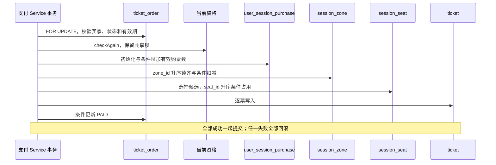

# Locking strategy

## Activity configuration and publication

已有活动的核心配置写入与发布使用同一条 `activity` 根记录协调生命周期。所有核心配置写入都要求 `Activity.status = DRAFT`。

涉及多个层级的行锁时，获取顺序为：

1. `activity`
2. `activity_session`
3. `session_zone`
4. `session_seat`

当前核心配置与发布仅对 `activity` 执行显式锁定查询。Zone、Seat 配置可以先通过普通归属查询确定 `activity_id`，这些查询不获取上述行锁。后续新增对子资源的锁定查询时，也遵守此顺序。

### 事务与状态

核心配置写入在同一个 Service 事务中执行以下操作：

1. 调用 `ActivityMapper.findByIdForUpdate()`，通过 `SELECT ... FOR UPDATE` 锁定活动根记录。
2. 确认活动存在、当前发布者拥有该活动，且状态为 `DRAFT`。
3. 校验配置并写入子资源。
4. 提交或回滚事务，释放根记录锁。

发布事务同样先锁定根记录，再校验全部配置，最后更新状态。`PublisherActivityPublishService.publishActivity()` 使用 `READ_COMMITTED`，获取根记录锁后的配置查询可以读取先前配置事务已提交的数据。

`ActivityMapper.updateStatus(activityId, "PUBLISHED")` 的更新条件包含 `activity_id = #{id} AND status = 'DRAFT'`。Service 要求影响行数为 `1`，否则发布失败。配置校验失败或状态更新失败都会回滚发布事务。

活动发布后冻结核心配置，包括活动类型、开放与关闭时间、场次容量、限购、选座模式、区域价格与容量，以及座位配置。场次时间变更只允许通过后续专用改期流程处理。

### 适用范围与并发验证

本节的根记录排他锁规则适用于核心配置与发布。购票支付不采用每笔交易排他锁整个 `activity` 根记录的方式。资格检查的共享锁规则见下文，库存、订单等后续业务的锁顺序随对应实现单独记录。

白名单属于可变参与资格，不属于本节冻结的核心配置。配置状态语义见 [schema.md 第 10 节](schema.md#10-白名单配置与成员v23-新增)。

[发布并发 MySQL 集成测试](../src/test/java/com/limitactivitysystem/activity/integration/ActivityPublicationConcurrencyMySqlIntegrationTest.java) 使用独立事务验证两种提交顺序：配置先提交时，发布校验读取新配置；发布先提交时，等待锁的配置事务读取到 `PUBLISHED` 并拒绝写入。

## Whitelist management

`PublisherWhitelistService` 的活动级与场次级管理操作使用 `READ_COMMITTED` 事务，按以下顺序获取锁或写入：

1. `activity`：`ActivityOwnershipService` 调用 `findByIdForUpdate()` 锁定所属活动根记录，核对当前发布者归属。取得锁后要求活动状态为 `DRAFT` 或 `PUBLISHED`。
2. `whitelist_config`：按 `(scope_type, scope_id)` 执行 `FOR UPDATE`，配置不存在时创建，或按操作语义返回未配置。
3. `whitelist_member`：添加或删除成员，取消配置时先删除全部成员，再删除配置。

场次的普通归属查询发生在根记录加锁前，不获取场次行锁。根记录锁协调配置尚不存在时的启用、取消及成员管理，避免仅依赖不存在的配置记录加锁。

启用配置、添加成员、删除成员、取消配置均只允许在活动为 `DRAFT` 或 `PUBLISHED` 时执行。活动为 `CANCELLED`、`FINISHED` 或其他状态时，操作返回 `409 WHITELIST_NOT_EDITABLE`，配置与成员保持不变。此检查同样适用于幂等请求，以及配置尚不存在的情况。

状态检查使用根记录锁定查询返回的当前值，先于白名单配置与成员操作。Activity 根记录锁和配置行锁均保持到外层事务提交或回滚。生命周期变更先提交时，等待的名单操作取得锁后检查新状态。名单修改先取得锁时，生命周期变更等待该修改事务结束。后续取消、结束流程也先锁定同一条 Activity 根记录。

删除最后一个成员保留配置，取消配置则删除配置与全部成员。名单管理允许维护已发布活动的参与资格，核心静态配置仍要求 `DRAFT`。

名单管理不会修改已有 Ticket、预约或订单。完整支付和免费预约创建已在各自事务中接入当前资格检查；取消免费预约不要求重新通过白名单。

[名单管理测试](../src/test/java/com/limitactivitysystem/whitelist/integration/WhitelistManagementMySqlIntegrationTest.java)覆盖两级白名单在 `DRAFT`、`PUBLISHED` 下的完整维护，以及 `CANCELLED`、`FINISHED` 下四种操作被拒绝且数据不变。[名单并发测试](../src/test/java/com/limitactivitysystem/activity/integration/WhitelistQualificationConcurrencyMySqlIntegrationTest.java)使用独立连接，验证取消先提交时名单操作拒绝新状态，以及名单修改先持锁时取消等待外层事务结束。取消状态变更由测试事务模拟，尚未提供取消业务接口。

## Qualification reads

`QualificationService.check(activityId, sessionId)` 是预约与创建票单的业务入口。`checkAgain(activityId, sessionId)` 是支付时的复查入口。两个方法都从 `CurrentUserProvider` 取得当前账号 ID，通过相同的资格判断后返回可信用户 ID。未通过资格检查时抛出 `QualificationDeniedException`，统一返回 `403 QUALIFICATION_DENIED`。

两个业务入口均使用 `Propagation.MANDATORY`，要求调用方已有事务。没有业务事务时抛出 `IllegalTransactionStateException`，避免方法返回后释放资格锁、后续写入却未受保护。调用方的 `@Transactional` Service 必须通过 Spring 代理执行。

业务写入使用可信身份上下文中的用户 ID，`check` 也返回该 ID 供调用方复用。当前创建票单先通过 `CurrentUserProvider` 确认账号，再在同一上下文调用 `check`。支付从数据库中已加载的订单取得活动和场次 ID，再调用 `checkAgain`。订单归属、活动与场次状态、时间窗口、库存、限购和支付幂等仍由对应业务 Service 校验。

`canParticipate(userId, activityId, sessionId)` 保留为内部布尔查询，显式用户 ID 必须由可信调用方提供。它与两个业务入口共用同一实现，每次通过 `FOR SHARE` 读取当前数据。独立调用使用 `READ_COMMITTED` 事务，已有事务时加入外层事务。业务入口的锁保持到外层事务提交或回滚，方法返回不提前释放锁。

资格检查的锁顺序为：

1. `app_user`：共享锁读取当前账号状态。
2. `activity`：共享锁读取活动，并与名单管理的 Activity 排他锁协调。
3. `activity_session`：共享锁读取场次，确认所属活动。
4. `whitelist_config`：先查询场次配置，只有未配置时才查询活动配置。
5. `whitelist_member`：共享锁查询适用配置中当前账号的成员记录。

同层多个资源需要加锁时按主键升序处理。当前方法只处理一个活动与一个场次，配置与成员按上述继承路径访问。所有锁定查询禁用二级缓存并清空 MyBatis 本地缓存，实际执行 SQL。

多个资格检查可以同时持有 Activity 共享锁。名单管理需要 Activity 排他锁，因此无法在资格检查所属事务提交前改变配置或成员。即使配置尚不存在，也由已存在的 Activity 根记录协调新增配置，不能只锁一条不存在的配置记录。

并发结果按先取得 Activity 锁的事务决定：

- 名单管理先取得排他锁：资格检查等待名单事务结束，再读取已提交的新名单。
- 资格检查先取得共享锁：名单管理等待业务事务结束，再改变后续业务动作的资格。

这些查询是锁定读。即使外层 `REPEATABLE_READ` 事务此前已建立旧快照，也读取锁定记录的当前值。`updated_at` 和此前返回的资格布尔值均不作为支付授权。

创建票单、支付待支付票单、创建预约及取消后重新参与，都在各自事务中主动调用资格检查。创建在资格检查后 INSERT 新订单；支付按下文规则先锁定已存订单，再取得资格共享锁，随后取得限购、库存和座位写锁。业务拒绝时回滚该事务。退款、关闭、取消等后续路径也必须协调订单优先的顺序，不能持有 Activity 排他锁后反向等待支付所持的订单锁。

独立调用返回后只说明本次检查时通过，不能把返回值带到另一个支付事务直接使用。已支付门票、已成功预约不会因后来名单变更而自动失效。完整业务回归属于 D12，今日并发实验只验证资格与名单事务的协调。

[统一入口 MySQL 测试](../src/test/java/com/limitactivitysystem/activity/integration/QualificationEntryPointMySqlIntegrationTest.java)通过测试专用消费者验证身份、资格错误响应、强制事务边界和支付阶段重新检查当前名单。测试专用消费者不实现预约、订单或支付业务。

[资格并发 MySQL 测试](../src/test/java/com/limitactivitysystem/activity/integration/WhitelistQualificationConcurrencyMySqlIntegrationTest.java)验证两种锁竞争顺序、并行共享读取、未配置时创建空名单，以及旧快照下的当前资格读取。测试使用独立随机 schema，仅加载 V1 和 V3，不执行带有固定 `USE` 的 V2 seed。

参考：[MySQL 8.4 锁定读](https://dev.mysql.com/doc/refman/8.4/en/innodb-locking-reads.html)、[MySQL 8.4 事务隔离](https://dev.mysql.com/doc/refman/8.4/en/innodb-transaction-isolation-levels.html)。

## Ticket order creation

`TicketOrderCreationService.createOrder` 使用独立的 `REQUIRES_NEW`、`READ_COMMITTED` 事务，先普通查询场次与所属活动以确定资格作用域，再调用 `QualificationService.check`。资格共享锁按前述顺序取得，并保持到整个创建事务结束。获取锁后重新读取 Activity、Session 并复核生命周期，避免等待名单事务后沿用旧状态。

Zone、指定 Seat 和当前有效购票计数只做普通查询。Service 将同 Zone 数量合计后与当前余量比较，将全单数量与当前有效票数合计后检查限购。这些预检查不占用库存、座位或限购额度，不初始化计数行，也不签发 Ticket。

全部校验后插入新订单与明细。订单写入使用数据库时间条件 INSERT，检查 `[open_time, close_time)` 且早于场次开始时间，避免校验期间跨过创建边界。资格共享锁协调名单及生命周期，不代表创建成功即可取得可售资源。

Service 的锁保持到订单与明细一起提交或回滚。[创建 MySQL 测试](../src/test/java/com/limitactivitysystem/activity/integration/TicketOrderCreationMySqlIntegrationTest.java)验证真实写入后的回滚，以及多个待支付订单不扣减余量、不改变座位或有效购票计数。Day 6 的支付资源组件及锁顺序见下文，完整支付事务在后续阶段接通。

该测试还在主表写入后、第一条明细写入后、全部明细写入后三处注入运行时异常。测试通过真实 Service 代理调用，在业务事务内观察到主表一行，以及各故障位置对应的零条、一条、两条明细。回滚后主表和明细均为零。库存、座位、既有购票计数及 Ticket 的快照在故障前后均不变。故障拦截器仅由测试配置注册，详细验证范围见 [订单事务原子性](ticket-orders.md#主表与全部明细的原子性)。

## Ticket payment resources

支付写路径统一使用以下顺序，同层多个资源按主键升序获取：

1. `ticket_order`：按主键 `findByIdForUpdate` 锁定订单，核对买家、状态、数据库有效期及场次生命周期。随后调用 `QualificationService.checkAgain`，按账号、Activity、Session、配置、成员的内部顺序取得当前资格共享锁。
2. `user_session_purchase`：安全初始化计数行，再用条件 UPDATE 原子占用额度，要求影响一行。
3. `session_zone`：先按 `zone_id` 升序锁齐本单全部 Zone，核对场次和 `PAID` 类型，再按同一顺序条件扣减库存，要求各影响一行。
4. `session_seat`：在 Zone 协调锁保护下读取当前可用座位并选择候选；所有候选确定后，全单按 `seat_id` 升序逐一条件占用。不能按区域分组后交替取得 Zone 和 Seat 锁。
5. `ticket`：为每个已占用座位写入对应订单明细的 Ticket。
6. `ticket_order`：在原订单锁仍持有时，条件更新最终状态为 `PAID`，再次检查数据库有效期并要求影响一行，然后整笔提交。



`TicketPaymentService.pay(orderId)` 在事务外协调。`TicketPaymentTransactionService.pay` 通过独立 `REQUIRES_NEW`、`READ_COMMITTED` 事务完成上述全路径，包括 Ticket 签发和 PAID 条件更新。`TicketPaymentResourceService`、`SeatAllocator`、`TicketIssuanceService` 使用 `MANDATORY` 加入它。`POST /ticket-orders/{orderId}/pay` 已开放，接口见 [模拟支付 API](api/ticket-payments.md)。

订单锁取得后，先检查买家和 ACTIVE 账号。已经 PAID 时读取原 Ticket 并返回，不重新取得资源或检查名单；其他非待支付状态拒绝。待支付分支才执行当前资格和期限检查。

### Order and quota coordination

先锁订单可使同一订单的支付尝试围绕同一状态串行检查，避免两个支付事务同时把它视为待支付订单；以后关闭、退款等状态转换也需遵守这个协调点。买家核验先于状态错误返回，避免向其他买家泄露支付状态。订单锁本身不能替代最终 PAID 条件更新或完整支付幂等。

同一账号在同一场次的不同订单还会竞争同一个限购计数行。先占用额度，再取得 Zone 和 Seat 锁，使这些订单按一致顺序竞争；无法满足限购的事务在取得热门库存锁前退出。额度与后续资源操作在同一事务内，后续失败会恢复原计数。

支付使用数据库当前时间，要求 `now < order.expires_at` 且 `now < session.start_time`。活动必须仍为 `PUBLISHED`，场次必须为 `SCHEDULED`，当前账号为 `ACTIVE`，`checkAgain` 必须通过当前名单。在资格等待后和配座后再次检查期限。`activity.close_time` 只限制创建新单，停售前创建且仍有效的旧单可以继续尝试支付。

### Conditional updates and affected rows

| SQL 操作 | 条件与影响行数要求 |
|---|---|
| 限购行初始化 | `INSERT ... ON DUPLICATE KEY UPDATE valid_count = valid_count` 只保证行存在，不重置计数；不把其驱动相关影响行数当作额度取得结果 |
| 限购增加 | `quantity > 0`、限购为正、`valid_count <= limit - quantity`；`affectedRows == 1`，否则 `PURCHASE_LIMIT_EXCEEDED` |
| Zone 库存减少 | `zone_id` 匹配、类型为 `PAID`、数量为正、`remains_amount >= quantity`；必须影响一行，否则 `INSUFFICIENT_INVENTORY` |
| Seat 占用 | `seat_id`、`zone_id` 匹配且状态为 `AVAILABLE`，才更新为 `SOLD`；必须影响一行，否则 `SEAT_NOT_AVAILABLE` |
| 订单最终 PAID | `markPaidIfPayable` 在原订单锁内检查 PENDING_PAYMENT、数据库创建/过期时间、场次状态与开始时间及活动状态；必须影响一行 |
| 缺货后的关闭 | 失败支付完全回滚后，独立事务重新锁单，仅条件关闭 PENDING_PAYMENT；必须影响一行，不覆盖 PAID 或其他状态 |

资源条件更新影响零行即抛异常，回滚此前取得的额度、库存及 Seat。不能吞掉异常继续成交或只重试单条 SQL。

### Payment SQL and indexes

以下索引名来自当前 Flyway Schema。主写路径顺序为 `ticket_order → user_session_purchase → session_zone ASC → session_seat ASC → ticket INSERT → ticket_order PAID`。资格共享锁在 Order 锁后、额度写入前取得，具体内部顺序见前文。

| 阶段与 Mapper | SQL 定位或约束 | 索引 | 失败与影响行数 |
|---|---|---|---|
| 1. `findByIdForUpdate` | `WHERE order_id = ? FOR UPDATE` | `ticket_order.PRIMARY(order_id)` | 无行则 ORDER_NOT_FOUND；返回行后在锁内核对买家、状态和期限 |
| 2. `ensureExists` | `INSERT ... ON DUPLICATE KEY UPDATE valid_count = valid_count` | `user_session_purchase.PRIMARY(user_id, session_id)` | 只初始化，不重置计数；不将重复初始化的影响行数当作买票结果 |
| 2. `tryIncrease` | 两个主键列相等，`valid_count <= limit - quantity`，数量和限购均为正 | 同一复合 PRIMARY | 必须影响 1 行，0 行则 PURCHASE_LIMIT_EXCEEDED |
| 3. Zone 锁定及 `decreaseStock` | `zone_id = ?`，扣减还要求 PAID 与余量足够 | `session_zone.PRIMARY(zone_id)` | 先升序锁齐全单 Zone；每个条件扣减必须影响 1 行，否则全部回滚 |
| 4. `occupySeat` | `seat_id = ? AND zone_id = ? AND allocation_status = 'AVAILABLE'` | `session_seat.PRIMARY(seat_id)` | 全单 seat_id 升序；必须影响 1 行，0 行则 SEAT_NOT_AVAILABLE |
| 5. `TicketMapper.insert` | `order_item_id`、实际 `seat_id`、明细快照单价、VALID | `ticket.PRIMARY(ticket_id)` 与 `uq_ticket_active_seat(active_seat_id)` 唯一校验 | 每张必须插入 1 行；插入异常、数量或价格不一致均回滚 |
| 6. `markPaidIfPayable` | Order 主键、待支付状态、数据库期限；JOIN Session 与 Activity 检查生命周期 | Order、Session、Activity 各自 PRIMARY | 必须影响 1 行；0 行按时间复查给出具体错误或 ORDER_PAYMENT_CONFLICT；返回后再检查时间 |

核心条件 SQL 与生产 Mapper 一致：

```sql
UPDATE user_session_purchase SET valid_count = valid_count + :quantity
WHERE user_id = :user_id AND session_id = :session_id
	AND :quantity > 0 AND :limit > 0 AND valid_count <= :limit - :quantity;

UPDATE session_zone SET remains_amount = remains_amount - :quantity
WHERE zone_id = :zone_id AND zone_type = 'PAID'
	AND :quantity > 0 AND remains_amount >= :quantity;

UPDATE session_seat SET allocation_status = 'SOLD'
WHERE seat_id = :seat_id AND zone_id = :zone_id AND allocation_status = 'AVAILABLE';
```

上述冒号参数用于文档表示绑定参数，MyBatis 实际使用 `#{...}`。最终 PAID SQL 见 [TicketOrderMapper](../src/main/java/com/limitactivitysystem/ticketorder/mapper/TicketOrderMapper.java)，测试直接读取其 MappedStatement 生成 EXPLAIN，不维护另一个最终更新副本。

Zone 先全部锁定、Seat 再全单升序，避免输入为相反区域顺序或 Seat ID 在多个区域间交错时形成反向等待。限购在热门库存前协调同账号同场次订单，Order 在最前协调重复支付与关闭。候选位置优先序不等于取写锁的顺序。

自动配座的可用查询可使用 `idx_seat_zone_availability_priority(zone_id, allocation_status, allocation_priority, seat_id)` 过滤。该索引不包含完整的 `row_no, seat_no` 排序键，不能宣称它消除全部排序。当前十座夹具的 EXPLAIN 选择 `ALL` 与 `Using filesort`；Order、额度、Zone 与 Seat 条件写入实际使用 PRIMARY。可用 Seat 查询发生在 Zone 锁保护下，实际占用仍按 Seat ID 升序。

`paymentSqlPlansAndDeclaredIndexesAreRecordedFromTheRealDatabase` 保存实时计划和 Ticket 索引清单到 `target/verification/payment-sql-index-plans.json`。优化器选择依赖数据量与统计信息，该观察不代表所有环境都采用相同候选查询计划。

### Transaction boundary and current reads

订单和 Zone 的 `FOR UPDATE` 必须由真实业务事务调用，锁保持至同一事务提交或回滚。组件使用 `MANDATORY` 加入调用方事务，不能在 Controller 查询一次后换连接继续操作。支付资源事务使用 `READ_COMMITTED`，配座入口拒绝其他隔离级别，避免在已有 `REPEATABLE_READ` 旧快照里选择过时座位。可用 Seat 查询禁用缓存，Zone 锁持有期间所有配座写路径都必须遵守同样的协调规则。

普通 `SELECT` 用于读取，不持有等价的更新锁。`SELECT ... FOR UPDATE` 锁的是 InnoDB 索引记录，不是 Java 对象；其他连接申请冲突锁需要等待事务结束。精确主键查询与范围扫描的锁范围不同，不能把锁范围只理解为 SQL 返回的对象数。依据：[MySQL 8.4 锁定读](https://dev.mysql.com/doc/refman/8.4/en/innodb-locking-reads.html)、[不同语句设置的锁](https://dev.mysql.com/doc/refman/8.4/en/innodb-locks-set.html)。

### Seat selection and lock order

自动配座候选按 `allocation_priority`、`row_no`、`seat_no`、`seat_id` 升序排列。依次将候选作为起点，寻找同排连续 `seat_no` 的完整块，使用第一个符合数量的块。找不到连座且已存 `accept_non_adjacent = true` 时，才取优先序中的前 N 个空闲座位；不接受非连座时返回 `ADJACENT_SEATS_UNAVAILABLE`。可用座位总数不足返回 `SEAT_REQUIREMENT_NOT_SATISFIED`。同一订单多条明细不得重复选择同一座位。选座优先序用于确定购买位置，实际条件占用始终按全单 `seat_id` 升序执行。

自主选座读取全部指定 Seat，核对 PAID Zone 和 Session 归属、数量和模式，再全单按 Seat ID 升序条件占用。区域锁与条件占用共同保护候选到实际取得之间的窗口。组件只返回明细、区域和实际 Seat 的对应关系，后续支付用它签发 Ticket；不在创建订单阶段调用。

`TicketOrderMapper.findByIdForUpdate`、Zone 锁定查询、限购初始化及原子写入 Mapper 方法均拒绝无事务调用。自主选座的指定 Seat 不存在或属于其他 Zone 时返回 `INVALID_SEAT_RELATION`。方法、完整错误码与测试入口见 [支付资源组件](payment-resources.md)。

真实锁等待使用 `performance_schema.data_lock_waits` 观察两个连接在 `ticket_order.PRIMARY` 上的等待，再释放持有者事务，验证等待者继续。另有 Zone 竞争、首次计数行竞争、限购不超限及 Seat 部分写入后整笔回滚测试。观察结果和复现命令见 [行锁等待实验](payment-resources.md#行锁等待实验)。

### Deadlocks and rollback evidence

固定锁顺序降低死锁概率，不能保证此后不会死锁。InnoDB 也会因索引维护及其他事务路径取得锁；互相等待可能形成环并导致事务被回滚。后续退款、取消等路径仍需检查顺序。依据：[MySQL 8.4 死锁处理](https://dev.mysql.com/doc/refman/8.4/en/innodb-deadlocks-handling.html)。

本阶段遇到死锁或锁超时退出并回滚整个 Spring 事务，不在事务内局部重试。Day 8 再实现事务外的可控重试；业务拒绝（名单、限购、库存、连座等）不应被当作死锁重试。

[支付 MySQL 测试](../src/test/java/com/limitactivitysystem/activity/integration/TicketPaymentMySqlIntegrationTest.java)通过真实 Service 代理观察：原计数 2、库存 10，在第一把 Seat 已写入时为计数 4、库存 8、Seat 为 `SOLD`；第二把 Seat 的条件 UPDATE 影响零行后，同一连接的支付事务回滚，计数恢复 2、库存恢复 10、第一把 Seat 恢复 `AVAILABLE`。独立竞争事务占用的第二把 Seat 保持 `SOLD`。证据为 `target/verification/ticket-payment-failure-rollback.json`。

测试在限购初始化、额度增加、库存扣减、占座、Ticket 插入与 PAID 更新前后注入故障，确认主订单和全部资源无局部提交。最终条件更新前或之后跨过订单期限、场次开始边界，也回滚全部写入。

七个指定故障点还逐一记录事务内已发生的计数、库存、座位、Ticket 和订单状态，证明异常发生在真实写入之后。回滚后执行 [payment_invariants.sql](../tests/sql/payment_invariants.sql)，要求没有任何违规行。四组核心并发、缺货关闭竞争和锁等待跨期实验都在工作线程事务结束后自动执行这份 SQL。矩阵、指标及验证范围见[支付对账与可观测性](payment-verification.md)。

### Database time and failure closure

`markPaidIfPayable` 使用 `CURRENT_TIMESTAMP(3)` 同时写 `paid_at` 与检查期限。该函数返回语句开始时的时间，不能把锁等待前取得的时间当成等待后的时间。支付在取得 Order 锁后、资格检查后、资源操作后重新取数据库时间，并在最终 UPDATE 返回后再复核期限，覆盖最终语句等待跨界的情况。依据：[MySQL 时间函数](https://dev.mysql.com/doc/refman/8.4/en/date-and-time-functions.html)。

仅 `INSUFFICIENT_INVENTORY` 进入 ORD-05 关闭分支。支付代理退出并完成回滚后，协调入口调用 `TicketPaymentFailureService`，另开短事务：Order FOR UPDATE → 重查买家及状态 → 若仍待支付则条件 CLOSED。另一支付已经 PAID 时直接读取原结果，不能覆盖为 CLOSED。其他业务拒绝及技术异常不执行缺货关闭。

两个状态转换继续竞争同一 Order 锁。关闭先提交时，等待的支付读取 CLOSED 并拒绝；另一次支付先提交时，关闭事务读取 PAID 并返回原 Ticket。缺货关闭与支付之间的间隙有真实并发测试，证据为 `target/verification/payment-wins-before-stock-failure-close.json`。

## Free reservation schema contract

FreeReservationService 已按下述协议接入，创建与取消均通过 Spring 代理运行独立 REQUIRES_NEW / READ_COMMITTED 事务。创建先按当前资格顺序读取账号、Activity、Session、白名单配置与成员，再取得 free_session_quota 写锁，最后写 free_reservation。名额初始化、条件扣减和新预约 INSERT 在同一事务；唯一键冲突回滚名额扣减。

取消可先普通读取预约确定作用域，再取得账号与生命周期共享锁、quota 写锁、reservation 条件状态写锁。不能先锁 reservation 再反向锁 quota。只在 ACTIVE → CANCELLED 成功一行后返还一份名额，返还失败回滚状态变更。资格与生命周期锁保持至事务结束；等待后重新检查数据库时间。

quota 使用独立行，避免资格已持 Session 共享锁后再更新 Session 计数。完整初始化、有效唯一键与对账契约见[免费预约 Schema](free-reservations.md)。

## Payment concurrency retries

支付的死锁与锁等待超时由 `PaymentRetryExecutor` 在事务外协调。`TicketPaymentService.pay` 和重试入口均使用 `NOT_SUPPORTED`，每次调用 `TicketPaymentTransactionService.pay` 的 `REQUIRES_NEW` 代理。失败必须先退出代理并完成整笔回滚，再执行短退避；最多三次总尝试。缺货关闭仍在重试入口外处理，不能把业务缺货转换为技术重试。

同层主键升序是所有路径需要共同遵守的协议，不能据此假定系统不会再发生死锁。新增写入口、其他表或索引锁、外部事务仍可能引入等待环。MySQL 建议保持统一访问顺序，同时准备在死锁后重新执行事务；参见 [InnoDB 死锁处理](https://dev.mysql.com/doc/refman/8.4/en/innodb-deadlocks-handling.html)。本项目的实际双订单死锁、升序对照和支付重试记录见[支付重试验证](payment-retry-verification.md)。

## Ticket order idempotency

`TicketOrderService.createOrder` 使用 `NOT_SUPPORTED` 协调首次创建与重放，调用方已有事务时挂起它。`TicketOrderReplayService` 使用独立只读 `REQUIRES_NEW`、`READ_COMMITTED` 事务，普通查询 `(buyer_id, request_id)` 对应订单与明细，比较完整购买意图。重放不排他锁 Activity 或库存，也不产生资源占用。

两个初次查询都未命中时，创建事务竞争 `UNIQUE(buyer_id, request_id)`。唯一键冲突者等待创建者完成写入；发生重复键后退出整个创建事务，回滚并释放所有资格锁，然后再通过独立重放事务读取已提交原单。禁止在失败事务中吞掉异常继续写入或依赖旧事务快照重查。

如果迟到请求在 INSERT 前遇到新下单的窗口或资格错误，协调入口也在回滚后重查一次，处理并发创建者已经提交的结果。没有原单时继续返回原业务错误。重放仍检查账号有效性；实际支付的当前资格检查留在支付事务。

首次创建独立提交；外部调用方之后回滚不会撤销订单。此边界用于完整的创建入口，不能在组合业务中假设它加入外围事务。主表与明细的内部原子性保持不变。

[幂等并发 MySQL 测试](../src/test/java/com/limitactivitysystem/activity/integration/TicketOrderIdempotencyConcurrencyMySqlIntegrationTest.java)通过 barrier 控制两个真实连接同时竞争唯一键，观察创建事务提交与回滚、回滚后重放使用新的事务资源，并验证外围旧快照及窗口或名单变化下的重放结果。完整比较规则见 [ADR-003](decisions.md#adr-003创建票单按原明细实现请求幂等)。

## Published configuration freeze

冻结范围覆盖当前应用的所有普通配置写入口。新增 Session、Zone、Seat 的 Service 均在 Activity 根记录排他锁后检查 `DRAFT`，发布后返回 `409 ACTIVITY_NOT_DRAFT`。

| 配置 | 发布后的普通修改 |
|---|---|
| `activity.type`、`open_time`、`close_time` | 冻结 |
| `activity_session.capacity`、`max_tickets_per_user`、`seat_mode` | 冻结 |
| `activity_session.start_time`、`end_time` | 普通编辑冻结，未来仅由改期专用流程处理 |
| `session_zone.total_amount`、`price` | 冻结，当前票价配置位于 `session_zone.price` |
| Seat 行列、编号、分配优先级及座位增删 | 冻结 |
| 活动与场次白名单配置及成员 | 所属活动为 `DRAFT` 或 `PUBLISHED` 时允许当前所属发布者维护 |

当前没有核心资源的通用 PUT、PATCH、DELETE 编辑入口，相应请求返回 `404` 或 `405`。这些入口不能绕过冻结；后续增加普通编辑能力时，仍需在同一根记录锁事务中校验 `DRAFT`。不能把白名单维护套用为核心配置编辑。

[发布 MySQL 集成测试](../src/test/java/com/limitactivitysystem/activity/integration/ActivityPublishingMySqlIntegrationTest.java)逐字段验证普通修改被拒绝且数据库值不变，并验证发布后不能新增 Session、Zone、Seat。[名单管理测试](../src/test/java/com/limitactivitysystem/whitelist/integration/WhitelistManagementMySqlIntegrationTest.java)验证发布后仍能维护活动和场次名单。

## Ticket refund application

退款申请协调入口 NOT_SUPPORTED，受理代理 REQUIRES_NEW / READ_COMMITTED。锁顺序为 Order → Account 共享锁 → Activity 共享锁 → Session 共享锁 → Ticket 主键升序 → 新申请与明细。遵守现有支付的 Order 优先协议；本阶段不取得 Zone、Seat 或限购计数的写锁。

每张票先沿 OrderItem、Order 检查关联，再只锁 Ticket 行并重新核对关联链和 VALID。任一票不合法时整笔受理回滚。同一订单上的请求由 Order 行串行协调；跨订单复用同买家 requestId 的竞争由唯一键处理。主表唯一键冲突退出并回滚后，重新进入独立事务读取原单，不能吞掉异常继续写失败事务。

requested_at 在等待上述锁之前从服务器 Clock 读取一次，政策与金额保存为快照。锁等待跨过政策边界不更换申请时间。主申请 INSERT 后、首条明细 INSERT 后故障均有真实事务回滚测试。模型、复跑命令与记录见 [退款申请契约](ticket-refunds.md)。
