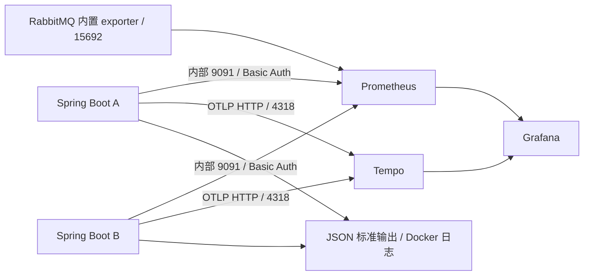

# 可观测性参考

适用版本：Spring Boot 3.5.16、Java 23，以及 `deploy/images.lock.json` 固定的 Prometheus、Grafana、Tempo、RabbitMQ 镜像。操作步骤见 [Day 25 验收指南](../qa/guides/day25-observability-runbook.md)，实际结果见 [验收报告](../qa/reports/day25-observability-test.md)。

## 数据流与访问边界

应用业务端口为 8080，管理端口为内部 9091。`/actuator/health` 仅返回健康状态；`/actuator/metrics` 和 `/actuator/prometheus` 要求独立的 `prometheus` 用户和 `METRICS_PASSWORD`，同一凭据从业务端口访问也被拒绝。默认不向主机发布 9091、OTLP 接收端口和 RabbitMQ exporter。Prometheus、Grafana、Tempo 的主机映射绑定 `127.0.0.1`，Grafana 禁止匿名访问。远程部署需要另行配置 TLS、反向代理和访问控制，不能直接改成公网绑定。

没有新增 Maven 依赖。指标使用现有 Micrometer，HTTP 使用 Spring Boot 的 Micrometer Tracing/OTel bridge，业务与异步边界使用同一 OpenTelemetry Bean 创建 Span。RabbitMQ 的 exporter 已包含在管理镜像中，通过配置启用。

## 指标语义

以下为 Prometheus 实际命名规则。时间单位为秒；`*_seconds_count` 是 Timer 的调用次数，`*_seconds_sum` 是累计耗时。支付和退款统计包括幂等重放请求，不能当作成交量或资金账本。

| Prometheus 名称 | 有限标签 | 统计含义 |
| --- | --- | --- |
| `payment_success_total` / `payment_failure_total` | `reason` 仅失败项 | 原有门票支付调用结果，保持原有语义 |
| `payment_retry_total` / `payment_retry_duration_seconds_*` | `reason=DEADLOCK/LOCK_WAIT_TIMEOUT` | 原有受控数据库重试及整组重试耗时 |
| `ticket_payment_seconds_*` | `result` | 门票支付服务调用耗时，覆盖重试和最终提交/回滚 |
| `product_payment_seconds_*` | `result` | 商品支付服务调用耗时，包含缺货回滚后的旧单关闭 |
| `product_payment_retry_total` | `reason=DATABASE_CONCURRENCY` | 实际开始的商品支付数据库重试 |
| `refund_requested_total` / `refund_success_total` / `refund_failure_total` | 原有 `operation/reason` | 保留原有退款申请/执行入口口径 |
| `ticket_refund_seconds_*` | `policy,result` | 退款处理服务调用，涵盖普通、改期和取消内部退款 |
| `ticket_refund_retry_total` | `policy` | 失败退款重新处理尝试 |
| `product_aftersale_seconds_*` | `result` | 普通及资格联动售后服务调用 |
| `cache_hit_total` / `cache_miss_total` | `cache` | Redis 缓存读取命中/未命中 |
| `cache_db_fallback_total` | `cache` | 所有数据库回源，包含正常冷缓存；**不等于 Redis 故障次数** |
| `cache_invalidation_failure_total` | `cache` | 缓存失效执行失败 |
| `redis_dedupe_rejected_total` | 无业务标签 | Redis 请求竞争提示拒绝 |
| `outbox_pending` | 无业务标签 | `PENDING/CLAIMED/FAILED` 尚未解决的事件数，包含需要人工重放的终态失败 |
| `outbox_oldest_age_seconds` | 无业务标签 | 上述最老事件距 MySQL `created_at` 的时间；空积压为 0 |
| `observability_workload_snapshot_age_seconds` | 无业务标签 | 最近成功刷新数据库指标的时间距现在多久 |
| `observability_workload_refresh_failure_total` | 无业务标签 | 后台刷新失败，失败时保留旧快照 |
| `mq_consume_seconds_*` | `consumer,result` | 一次完整投递处理至 ACK/reject 返回的耗时 |
| `rabbitmq_queue_messages` | broker 提供的固定队列/vhost 等 | RabbitMQ 实际队列深度；`queue=~".*[.]dead"` 为死信队列 |
| `cancellation_batch` | `status` | 共享数据库中的取消批次状态数量 |
| `cancellation_item` | `status` | 共享数据库中的取消任务状态数量 |
| `cancellation_item_process_seconds_*` | `result` | 单项取消处理调用耗时 |

`result` 固定为 `SUCCESS`、`INSUFFICIENT_STOCK`、`LIMIT_EXCEEDED`、`QUALIFICATION_DENIED`、`ORDER_EXPIRED`、`BUSINESS_REJECTED`、`TECHNICAL_FAILURE`、`RETRY`、`DLQ`。后两项仅用于消费者，`RETRY` 表示重试消息已经确认发布；无法确认的重试进入死信处理。正常库存和限购拒绝不标记为技术错误 Span。

`policy` 为 `NORMAL/RESCHEDULE/CANCELLATION/UNKNOWN`。尚未读到退款记录的失败使用 `UNKNOWN`。取消退款加入调用方事务，内层退款调用成功并不单独保证外层提交成功；取消 Item 的外层计时覆盖其事务结束，最终业务结果以数据库为准。

`cache` 为 `activity/seat-layout/product/other`。`consumer` 来自固定 listener 方法名。应用指标同时带固定 `application` 和 `instance`。订单、用户、请求、事件和任务 ID 不作为指标标签。

数据库指标每 15 秒在独立线程刷新，单条 SQL 超时 2 秒；抓取仅访问内存。首次成功刷新前为 NaN；刷新失败不伪装成零积压，同时暴露刷新失败数和快照年龄。积压年龄在刷新间隔内按经过时间增长。两个实例读取同一份数据库：面板对这些 Gauge 使用 `max`，不能相加。

## Trace 与日志

显式业务 Span：`ticket.payment`、`product.payment`、`ticket.refund`、`product.aftersale`、`outbox.publish`、`mq.consume`、`cancellation.item.process`。资格任务还保留 `qualification.task.process` 与 `qualification.after_sale`。

正常退款链路中，`OutboxEventWriter` 在退款事务里保存当前 Span 的 W3C `traceparent`。Relay 从持久化上下文创建 `outbox.publish`；发布消息携带该 Span 的 `traceparent`；消费者显式提取 Header，创建 `mq.consume`。重试保留原始 carrier，形成同一发布 Span 的后续消费分支。为避免自动发送观测覆盖这一持久化上下文，RabbitTemplate/Listener 的自动 Observation 关闭，HTTP 自动观测仍保留。

取消扫描和资格售后恢复从持久化事件查找上下文，并添加 Span Link；保留实际存在的调度父 Span，不把旧事件随意伪装成当前同步父调用。查找失败只计数 `observability_trace_link_failure_total`，不会阻止恢复业务。业务与消息 ID 可用于日志、Span 属性及数据库关联。

没有安装 Java agent 或 JDBC instrumentation，因此不宣称存在自动 MyBatis/SQL Span。服务 Span 包含其 SQL 执行时间；定位具体 SQL 仍需要数据库日志、锁信息和 EXPLAIN。

Docker Profile 输出 Spring Boot 内置 Logstash JSON，统一使用 `timestamp`、`level`、`service`、`instance`。业务完成日志还包含 `traceId`、`spanId`、`requestId`、`businessOperation`、`duration`（毫秒）、`errorCode`，以及必要的数字/UUID 标识。异步步骤没有原 HTTP requestId 时为 `-`，使用 traceId/eventId 关联，不伪造请求 ID。启动和第三方库日志不保证有业务字段。受控异常不导出 Throwable 原文、SQL 参数或消息正文。

采样默认 `TRACING_SAMPLING_PROBABILITY=0.1`，独立验收使用 `1.0`。`TRACING_ENABLED=false` 可用于只启动 core 的环境。不要把全采样验收配置直接用于未经容量评估的生产环境。

## 面板和告警

Compose 读取 `deploy/observability/`，Grafana 自动加载 `LAS Backend Overview`（UID `las-backend-overview`）、Prometheus 与 Tempo 数据源。21 个图表覆盖 HTTP RPS/5xx/p95、支付结果、退款策略、缓存、Outbox、消费重试/死信、取消进度和单实例状态。无业务请求时部分按需注册的交易指标为空，不能将其解释为采集失败。业务验收会实际产生这些数据。

三条开发环境告警：

| 告警 | 条件 | 持续时间 |
| --- | --- | --- |
| `LasInstanceDown` | 某个 `up{job="las-backend"} == 0` | 1 分钟 |
| `LasOutboxOldestAge` | `max(outbox_oldest_age_seconds) > 60` | 30 秒 |
| `LasDeadLetterMessages` | 所有 `.dead` 队列消息数之和大于 0 | 15 秒 |

Prometheus 每 15 秒抓取和计算规则，Firing 时间还受抓取间隔影响。Grafana 的 Firing alerts 图表显示 `ALERTS`，规则由 Prometheus 执行。本次没有安装 Alertmanager，也没有配置邮件、短信或外部消息通知；告警阈值尚未通过正式负载校准。

参考：[Spring Boot 3.5 结构化日志 API](https://docs.spring.io/spring-boot/3.5/api/java/org/springframework/boot/logging/structured/package-summary.html)、[Micrometer Observation 生命周期](https://docs.micrometer.io/micrometer/reference/observation/components.html)。
