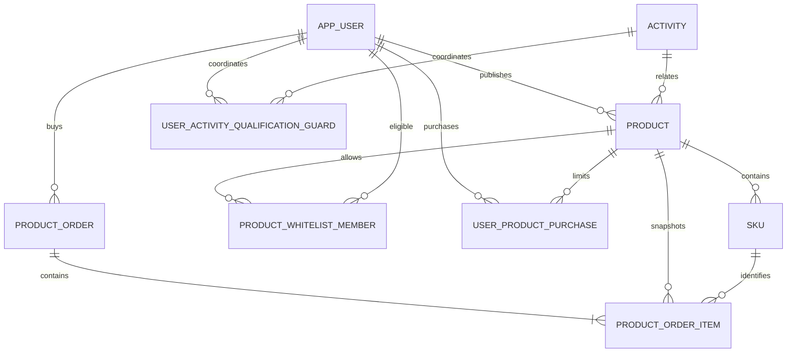

# 商品域设计与冻结清单

日期：2026-11-02。依据 requirements 的 PRD-01～04、ITEM-01～05、RET-01～06、LINK-01～03，以及 schedule 的 F8、Day 14～17、Day 20。

状态：目录切片已实现，后续交易模型仍为设计。最新编码任务明确 ACTIVITY/SESSION 两种持票范围，Product、SKU、独立名单及资格/公开查询已通过 V8 落地，现有模型为 V2.7、20 张业务表、零物理外键。商品订单、支付、售后及资格保护行尚未实现。API 与真实验证见 [商品接口](api/products.md)、[Day 14 验证](day14-products.md)。

## 已明确范围与后续待确认决定

| 决定 | 对话框推荐项 | 另一选择的影响 |
|---|---|---|
| 持票资格范围（后续任务已明确） | 每个 Product 明确选择 ACTIVITY 或指定 SESSION，已实现。 | 最新第 15、16 项明确要求两类范围，不再按原对话框未答处理。 |
| 同发布者订单的活动边界 | 跨 Publisher 固定拒绝；同 Publisher 跨 Activity、多 Product、多 SKU 仍是活动组合推荐方案。 | 同 Publisher 是否同时要求同 Activity 仍待确认；两种活动方案都拒绝跨发布者。 |
| 首次上架后的规则 | 冻结所属活动、资格类型/范围、Product 限购、售后模板；名称描述可编辑。 | 若下架后可修改，需要规则版本、历史快照及待支付订单遇到版本变化的处理，不能直接覆盖旧资格。 |

持票范围按最新任务实施。订单活动边界与未来 Product 核心规则的版本编辑仍待确认，本轮没有实现依赖这些决定的商品订单。SKU 的当前编辑边界已明确：仅从未上架的 DRAFT 商品可创建或完整修改，ON_SALE/OFF_SALE 均拒绝价格及库存配置写入；未提供 Product 核心规则修改入口。记录见 [decisions.md](decisions.md)。

## 领域职责与逻辑关系

Product 表达卖什么、谁发布、关联哪个活动，以及资格、共享限购和售后模板。SKU 表达具体规格、单价和独立库存。Product 不保存一份可以替代 SKU 库存的运行计数。



图中都是逻辑引用，不创建物理 FOREIGN KEY。跨表存在性、发布者归属、作用域一致性由 Service 在业务事务内检查，并由孤儿及资源巡检复核。已被订单或历史引用的 Product、SKU、Activity、用户不通过物理删除破坏历史。

本域共设计七张表：product、sku、product_whitelist_member 已迁移；product_order、product_order_item、user_product_purchase、user_activity_qualification_guard 仍为后续候选。资格配置直接保存在 Product，模板仅使用预设类型；没有为同一配置再建立重复的策略真值表。商品白名单独立于现有活动/场次名单表。

## product 候选字段

| 字段 | 类型与约束 | 语义 |
|---|---|---|
| product_id | BIGINT，PK，自增 | 商品身份。 |
| publisher_id | BIGINT，NOT NULL、正数，逻辑引用 app_user | 当前管理发布者，必须拥有 activity_id 对应活动。 |
| activity_id | BIGINT，NOT NULL、正数，逻辑引用 activity | 单个 Product 只关联一个活动。 |
| name | VARCHAR(100)，NOT NULL、非空白 | 商品名称。 |
| description | VARCHAR(1000)，可空 | 展示说明，不承载任意退款规则表达式。 |
| status | VARCHAR(16)，NOT NULL，默认 DRAFT | 仅 DRAFT、ON_SALE、OFF_SALE。 |
| qualification_type | VARCHAR(24)，NOT NULL | 仅 PUBLIC、TICKET_REQUIRED、PRODUCT_WHITELIST。 |
| qualification_scope | VARCHAR(16)，条件可空 | 持票资格候选取 ACTIVITY 或 SESSION；其余资格类型必须为空。 |
| qualification_session_id | BIGINT，条件可空 | SESSION 范围必须指定属于 activity_id 的场次，其他情况为空。 |
| refund_policy_template | VARCHAR(32)，NOT NULL | 仅 STANDARD_7D、SPECIAL_NO_REASON_RETURN。 |
| refund_policy_version | SMALLINT，NOT NULL，初始 1 | 服务端预设说明及规则的版本，不允许任意规则组合。 |
| purchase_limit | INT，NOT NULL、正数 | 当前账号在整个 Product 的有效数量上限。 |
| first_on_sale_at | DATETIME(3)，可空 | 首次上架的数据库时间；OFF_SALE 不清空。当前 SKU 配置只允许此字段为空的 DRAFT，未来核心规则编辑方式仍待确认。 |
| created_at / updated_at | DATETIME(3)，NOT NULL，数据库生成 | 创建及最后修改时间。 |

必要索引：PK(product_id)、(publisher_id, status, product_id)、(activity_id, status, product_id)、(qualification_session_id, product_id)。主键及逻辑 ID 正数、状态/模板枚举、名称非空白和 purchase_limit > 0 由单行约束保护。

在支持两种持票范围的推荐方案下，资格形态必须完整表达，不能依赖 NULL 比较自动得到正确结果：

| qualification_type | qualification_scope | qualification_session_id |
|---|---|---|
| PUBLIC | NULL | NULL |
| PRODUCT_WHITELIST | NULL | NULL |
| TICKET_REQUIRED | ACTIVITY | NULL |
| TICKET_REQUIRED | SESSION | 非 NULL、正数 |

外层类型检查之外，CHECK 中显式使用 IS NULL / IS NOT NULL。SESSION 属于 Product 活动、活动属于发布者等跨表条件不能由这个 CHECK 保证。持票商品的关联活动必须能产生普通有效 Ticket；FREE 预约和 GIFT 操作都不是持票资格。

## sku 候选字段

| 字段 | 类型与约束 | 语义 |
|---|---|---|
| sku_id | BIGINT，PK，自增 | 规格身份，不因其他规格缺货而替换。 |
| product_id | BIGINT，NOT NULL、正数 | 所属 Product，逻辑引用。 |
| sku_name | VARCHAR(100)，NOT NULL、非空白 | 规格标签，例如“黑色 M”。同 Product 内规范化后唯一。 |
| price | DECIMAL(10,2)，NOT NULL、> 0 | 当前新订单单价。Java 使用 BigDecimal。 |
| total_stock | INT，NOT NULL、>= 0 | 本切片配置的库存基数。售卖、退款不直接修改它。 |
| remains_stock | INT，NOT NULL、0～total_stock | 当前真实可售库存。 |
| status | VARCHAR(16)，NOT NULL，默认 ACTIVE | ACTIVE、INACTIVE；还须 Product 为 ON_SALE 才可购买。 |
| created_at / updated_at | DATETIME(3)，NOT NULL | 数据库时间。 |

必要约束和索引：UNIQUE(product_id, sku_name)、(product_id, status, sku_id)。规格名由服务端 trim，迁移时为唯一比较明确排序规则；不能出现展示同名却被当作另一个库存池的未规范化输入。

黑 M 余量为零、白 L 余量为二十时，黑 M 请求缺货。不能改成白 L，也不能以 Product 汇总库存大于零放行。新订单可展示各 SKU 余量，最终资源竞争在支付时完成。

有成交历史后禁止普通编辑直接覆盖 total_stock/remains_stock。补货和库存盘点不是本轮切片；以后需要带明确增量及历史的操作。SKU 价格或规格展示的编辑不得改写已有订单快照；规格身份及 Product 归属不随编辑改变。

## 独立商品白名单

`product_whitelist_member` 字段为 member_id BIGINT PK、product_id BIGINT NOT NULL、user_id BIGINT NOT NULL、created_at DATETIME(3) NOT NULL。逻辑 ID 为正数，UNIQUE(product_id, user_id)，查询索引 (user_id, product_id)。

Product 的 qualification_type 已明确表示是否启用商品名单，因此不额外建立一张只表达同一开关的 product_whitelist_config。PRODUCT_WHITELIST 且成员为零时全部拒绝；不继承 Activity 或 Session 名单。PUBLIC 忽略商品成员，TICKET_REQUIRED 只检查自己的持票条件，三种类型不隐式 OR 或 AND。

名单可以按当前规则增删；谁有权修改仍沿 Product → Activity 核对 CurrentUserProvider 当前发布者。目标成员 user_id 是受管理账号，不是操作者身份。商品名单变化只影响未来新建及待支付支付，不借此撤销已成交商品。

名单管理锁 Product FOR UPDATE；资格与支付在 Product FOR SHARE 下读取成员当前状态，保持到业务事务结束。空名单的配置事实来自已锁 Product，不尝试锁一条不存在的成员行代替协调。

## 商品订单设计，Day 15 再实现

product_order 主表候选字段：

| 字段 | 类型与约束 | 语义 |
|---|---|---|
| order_id | BIGINT，PK，自增 | 商品订单身份，与 ticket_order 分离。 |
| buyer_id / publisher_id | BIGINT，NOT NULL、正数 | 买家由认证取得；发布者由 SKU → Product 推导，不能由客户端指定。 |
| request_id | VARCHAR(64)，NOT NULL、非空白，明确二进制比较 | 创建业务键，UNIQUE(buyer_id, request_id)。 |
| total_amount | DECIMAL(12,2)，NOT NULL、> 0 | 原成交报价，等于原明细 quantity × unit_price 之和，退款不减写此值。 |
| status | VARCHAR(30)，NOT NULL | PENDING_PAYMENT、PAID、PARTIALLY_REFUNDED、REFUNDED、CLOSED。 |
| created_at | DATETIME(3)，NOT NULL、数据库生成 | 服务端建单时间。 |
| expires_at | DATETIME(3)，数据库生成 | created_at 后十五分钟，支付截止采用 now < expires_at。 |
| paid_at / closed_reason | 条件可空 | 待支付均空；PAID/退款汇总态有 paid_at、无关闭原因；CLOSED 有原因且无 paid_at。 |

必要索引：(buyer_id, created_at, order_id)、(publisher_id, status, order_id)、(status, expires_at, order_id)。跨 Activity 是否允许待对话框确认；无论选择哪种，同单 Product 的 publisher_id 必须完全相同。不允许跨发布者合单，不与 TicketOrder 合并。

product_order_item 候选字段：

| 字段 | 类型与约束 | 语义 |
|---|---|---|
| order_item_id | BIGINT，PK，自增 | 明细身份。 |
| order_id / product_id / sku_id | BIGINT，NOT NULL、正数 | 全部逻辑引用，SKU 必须属于该 Product。 |
| quantity | INT，NOT NULL、> 0 | 原购买数量，不因退款改写。 |
| unit_price | DECIMAL(10,2)，NOT NULL、> 0 | 下单时 SKU 单价快照，退款禁止查询当前 SKU 价格代替它。 |
| product_name_snapshot / sku_name_snapshot | VARCHAR(100)，NOT NULL | 下单展示快照。 |
| activity_id_snapshot | BIGINT，NOT NULL、正数 | Product 对应的关联活动，供历史和联动定位。 |
| qualification_type_snapshot / qualification_scope_snapshot / qualification_session_id_snapshot | 与 Product 同形态约束 | 原资格范围；不能在异步联动时仅依赖可能变化的当前配置。 |
| refund_policy_template_snapshot / refund_policy_version_snapshot | NOT NULL | 原预设模板和版本。 |
| special_policy_acknowledged / policy_acknowledged_at | BOOLEAN 与条件时间 | 特殊模板的必要购买确认由当前买家明确作出，服务端记录时间；普通模板不伪造确认。 |
| refunded_quantity | INT，NOT NULL，默认 0 | 累计实际成功退款数量。 |
| refund_pending_quantity | INT，NOT NULL，默认 0 | 已被有效售后申请占用的数量。 |
| shipped_quantity / received_quantity / returned_quantity / restocked_quantity | INT，NOT NULL，默认 0 | Day 17 履约和回库的数量事实，创建/支付阶段均为零。 |
| created_at | DATETIME(3)，NOT NULL | 数据库生成。 |

UNIQUE(order_id, sku_id)，索引 (product_id, order_id)、(sku_id, order_id)、(activity_id_snapshot, qualification_type_snapshot, qualification_session_id_snapshot, order_id)。同一请求中的重复 SKU 先按 sku_id 合并数量并检查溢出；同 SKU 的确认内容矛盾则拒绝。幂等比较规范化后的 SKU、数量及必要确认，不以总额相同代替载荷相同。

数量约束：0 ≤ refunded_quantity ≤ quantity；0 ≤ refund_pending_quantity ≤ quantity − refunded_quantity；0 ≤ received_quantity ≤ shipped_quantity ≤ quantity；0 ≤ returned_quantity ≤ shipped_quantity；0 ≤ restocked_quantity ≤ refunded_quantity。具体售后申请、明细、退回验收历史在 Day 17 冻结，不以这些累计字段代替操作历史。

订单状态只汇总财务结果。PAID 不等于已发货，REFUNDED 也不等于实物可再售。只退一部分明细/数量时保留其他明细权益，不以一个订单履约状态覆盖混合明细事实。

## 建单不占资源，支付整单竞争

建单流程固定为：认证 → 读取 SKU/Product 和完整关联 → 校验同发布者及已确认活动边界 → 当前上架和资格检查 → 按 Product 汇总数量预检查限购 → 逐 SKU 预检查库存 → 保存主单及全部报价明细。库存不足返回缺货项，用户确认修改后重提；不得静默删项、换规格或建立空单。

建单不扣 remains_stock，不增加 user_product_purchase，也不创建资格保护行来冒充资格凭证。价格、资格及模板快照保存后不重新生成旧单内容。重复键失败必须退出并回滚原事务，再在新事务读取原单；内容相同返回原结果，内容不同返回冲突。

支付在独立 READ_COMMITTED 事务中锁订单，复查截止、账号、当前资格和上架条件。按 Product 汇总占额度，按 SKU 条件扣库存，全部成功才更新 PAID；任一步失败全部回滚。某 SKU 真正缺货时，资源回滚后再独立关闭仍为 PENDING_PAYMENT 的旧单，保留全部旧明细，用户确认新清单后使用新 requestId 建单。

user_product_purchase 采用 PRIMARY KEY(user_id, product_id)，两列 BIGINT NOT NULL、正数，valid_count INT NOT NULL、默认零且非负。可增加 updated_at DATETIME(3) 记录最后变化。没有 user_sku_purchase。

```sql
UPDATE user_product_purchase
SET valid_count = valid_count + :quantity
WHERE user_id = :userId AND product_id = :productId
  AND :quantity > 0 AND valid_count <= :purchaseLimit - :quantity;

UPDATE sku
SET remains_stock = remains_stock - :quantity
WHERE sku_id = :skuId AND product_id = :productId
  AND status = 'ACTIVE' AND :quantity > 0 AND remains_stock >= :quantity;
```

以上为参数化 SQL 设计示意，不是已实现 Mapper。所有条件写入必须影响一行；首次计数初始化采用主键 no-op，不重置原计数。跨 SKU 买黑 M 一件、白 L 一件，对同 Product 只累计两件。实际成功退款按数量恢复 Product 额度，即使退回商品不可再售也恢复额度；SKU 库存则只有满足回库条件才恢复。

巡检分别检查 Product 有效数量和 SKU 可售库存，不能将 valid_count 当作 SKU 销量。候选库存等式为 sku.total_stock = sku.remains_stock + Σ(已支付明细 quantity − restocked_quantity)，包含退款成功但不可再售的扣减部分；未来补货/盘点引入后须扩展此等式。

## 两种售后模板的基础边界

STANDARD_7D 与 SPECIAL_NO_REASON_RETURN 都是项目已批准的普通自主退货模板。SPECIAL 仅限制普通无理由退货，不用于统一拒绝质量问题、失去持票资格或活动取消的特殊处理。

下单前展示服务端预设说明、版本及必要确认。特殊模板缺少明确确认时拒绝创建；保存的模板、版本与确认时间进入订单明细快照，不能在退款时按 Product 当前模板替换。普通七日边界的基准为服务器记录的有效签收/模拟收货时间，精确规则及模拟验收入口留待 Day 17 冻结，本轮不伪称已确定所有售后细节。

未发货合法退款可恢复对应 SKU；已发货须保留退回、验收和可再售事实。退款成功与回可售库存不是同一个条件。商品质量问题等入口不得被两个模板的枚举值整体屏蔽。

## 账号 × 活动资格保护行

候选表 user_activity_qualification_guard：user_id BIGINT NOT NULL、activity_id BIGINT NOT NULL，PRIMARY KEY(user_id, activity_id)；qualification_version BIGINT NOT NULL 默认零、非负；created_at、updated_at 为数据库 DATETIME(3)。没有 cached_eligible、有效票总数或永久授权位。

guard 是稳定的事务锁对象。可以惰性插入，但必须主键 no-op，再 FOR UPDATE，不能重置 qualification_version。一个账号的多活动保护行按 activity_id ASC 获取；通用批处理按 (user_id, activity_id) ASC。从已有门票惰性建立的 version=0 不表示没有票。

商品支付仅对 TICKET_REQUIRED 明细收集受影响活动，在取得全部 guard 后，用 READ_COMMITTED 当前查询重新检查有效 Ticket。活动范围查询通过 Ticket → OrderItem → TicketOrder → Session 校验买家和 activity_id；场次范围再要求 session_id 匹配。有效票要求 status=VALID、正常支付归属，不能把 FREE 预约、GIFT operation 或旧退款票算进去，也不因活动已停售就否认一张仍为 VALID 的票。

票务支付新增 VALID、退款处理 VALID→REFUNDED，以及未来其他有效票变动入口，必须在同一 guard 下完成。每次真正改变有效票集合后，在本事务增加 version 一次；纯幂等重放不加。退款受理只冻结申请，不改变 Ticket 集合，无需为此提前占用 guard。没有把全部写入口接齐时，单独让商品支付锁 guard 不构成并发保证。

具体取锁顺序、惰性初始化位置和未来验证见 [locking.md 的商品计划](locking.md#product-qualification-and-payment-design)。

## 最后一张票退款与商品支付

| 先取得同一 guard 的事务 | 合法执行顺序 | 结果 |
|---|---|---|
| 退票先取得 | 退款当前票并提交 → 商品支付取得 guard 后重新查票。 | 没有合格票，商品支付拒绝，所有 SKU/额度不变。 |
| 商品支付先取得 | 持票检查通过且商品整单提交 → 退票取得 guard 后退款。 | 商品当时合法成交；之后失去资格，必须可靠触发 LINK 售后。 |
| 商品支付失败回滚 | 释放 guard → 退票继续。 | 不存在商品成交，不产生额外库存或限购副作用。 |
| 退款失败回滚 | 释放 guard → 商品支付重新查到仍有效的票。 | 不因失败退票丢失资格；没有虚假的资格变化事件。 |

guard 使判定与写入串行化，但本身不发送消息。尤其“商品先成交、退票随后成功”的顺序，不能仅靠 guard 声称无需联动售后，也不能在退票事务中直接反向锁商品订单。

Day 19/20 的完整可靠路径必须是：退票及 guard version 更新 + 同事务持久化资格变化 Outbox → 提交 → 消费者重新核验当前资格 → 独立商品售后任务。事件至少包含业务事件 ID、user_id、activity_id、受影响 session_id 和 version；不把某一次“无票”布尔值当作永远正确的事实。消费者按每条商品明细的范围快照判断，仍有同范围有效票时不退，PUBLIC 和独立商品名单明细不受影响。

仅在提交后调用一个内存回调或发送 MQ 无法替代持久化事件。Day 16 在联动基础设施未就绪时，只能把此结果描述为支付资格串行化；TICKET_REQUIRED 的生产闭环验收须等 Outbox 和联动任务完成，不能提前宣称退最后一张票后已自动完成商品售后。本轮不提前接入 RabbitMQ 或创建 Outbox 表。

## 分阶段接入与验收清单

下一步发布/SKU/资格切片只围绕以下服务职责实施，不先创建商品订单、支付或售后 Controller：

| 职责 | 事务和权限要求 |
|---|---|
| 创建 Product 草稿 | CurrentUserProvider 当前 ACTIVE 发布者，沿 Activity 检查真实归属；禁止客户端提交 publisherId、状态、创建时间。 |
| 添加 SKU | 锁父 Product 后写 SKU，检查规格唯一、十进制价格和非负初始库存，remains_stock 由服务端按初始配置设置。 |
| 首次上架及重新上架 | 同事务验证 Product 规则形态、活动/场次关联、至少一个合法 ACTIVE SKU、预设模板及说明；条件转换状态。首次上架规则变更边界须先完成 D14-Q3 确认。 |
| 商品白名单维护 | 当前所属发布者，Product 排他锁协调空名单和成员增删；不影响已有成交。 |
| 当前账号资格查询 | 当前账号来自认证，不接受查询参数或正文指定 userId；只返回本次判定及原因，不能作为后续支付凭证。 |
| 公开商品展示 | 展示 SKU、参考库存、独立资格说明及预设售后模板；不泄露商品白名单成员或其他用户持票信息。 |

商品创建与支付的当前资格都必须重新计算；资格查询和创建时的预检查不占用库存或限购。活动的票务 open_time/close_time 不直接充当商品交易窗口。活动取消后的商品停止交易及特殊售后规则随 F11 接入，不能仅以商品 ON_SALE 就绕过已生效的取消约束。

| 阶段 | 需要实现/验证 | 本轮状态 |
|---|---|---|
| 本轮 Day 14 设计 | 实体、约束、状态、资格/订单决定、并发协议与后续测试。 | 两种持票范围由最新任务明确；未来订单及核心规则编辑选择仍待确认。 |
| Day 14 商品切片 | 发布者管理 Product/SKU、上架和独立资格查询；保护行 Schema 与票务写路径接入须另行实现。 | V8 三表及实际接口已实现并验证；guard 未接入。 |
| Day 15 | 多商品建单、报价/规则快照、15 分钟有效期、同键内容比较、不占资源。 | 未实现。 |
| Day 16 | 商品支付整单事务、Product 额度、SKU 库存、共同锁顺序及整事务 retry。 | 计划真实 MySQL 验证。 |
| Day 17 | 分数量履约/售后、签收时间、申请中占用、验收、退款/回库条件。 | 仅冻结本页基础契约，完整售后模型待 F9。 |
| Day 19/20 | 同事务 Outbox、当前资格重检、独立联动任务和恢复。 | 设计接缝，未引入组件。 |

后续增量迁移按实际实现顺序生成，不改写既有迁移，不把余下四张候选表计入当前数据库。V8 仅新增目录三表，所有迁移继续使用 PK、UNIQUE、CHECK、INDEX、NOT NULL 和零物理 FK。

设计验收用例清单如下。当前已运行的目录、资格与 SKU 展示隔离见 [专项报告](day14-products.md)，以下涉及商品订单、支付和联动的内容仍是计划，不计为 PASS：

1. PUBLIC 不继承活动名单；PRODUCT_WHITELIST 空成员拒绝，活动名单中有该用户也不能代替商品成员。
2. ACTIVITY 允许同活动其他场次的 VALID 票；SESSION 只接受指定场次。REFUNDED、GIFT、FREE 均不能提供持票资格。
3. 同 Product 两 SKU 共享限购，黑 M 缺货不能借白 L；跨 Product 分别累计额度。
4. 多 Product/多 SKU 按已批准活动边界组合，跨发布者拒绝；全部明细无效不建空单。
5. 建单前后 SKU、Product 额度不变；相同键相同规范化清单重放原报价，不同清单冲突。
6. 任一 SKU 缺货，支付整单回滚；缺货关闭在回滚后单独完成，失败不覆盖另一个已支付结果。
7. 支付与同一用户最后有效票退款，两种持锁先后各用真实连接和 performance_schema 等待证据验证；商品故障回滚和退票故障回滚后重新对账。
8. ACTIVITY 范围同活动其他场次仍有票时不联动；SESSION 范围只看指定场次；混合订单普通商品不受影响。
9. 退票提交后、事件投递前进程中断仍能补发；重复、乱序及退票后新购票事件必须重检当前资格，不重复退款或回库。
10. SPECIAL 普通无理由规则拒绝不覆盖质量/资格丧失等原因；不可再售退款只恢复 Product 额度，不虚增 SKU 库存。

本轮实际迁移和验证仅覆盖 V8 目录、SKU、独立名单、公开展示与当前资格查询。后续商品交易、保护行、售后和异步测试仍须分别实施，不能把只读资格预览宣称为已完成交易闭环。
