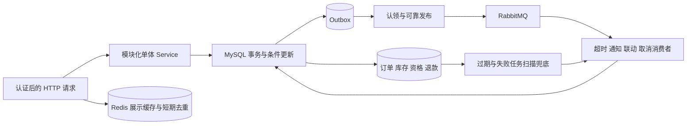

# 限量活动预约与订单系统：30 天开发计划

> 工期：2026-10-14 至 2026-11-12，含首尾，共 30 天。  
> 业务基线：requirements.md Version 1.1、schema.md V2.2。  
> 技术基线：Java 23、Spring Boot 3.5.16、MyBatis Starter 3.0.5、MySQL 8.4.11。  
> 交付形态：模块化单体 Java 后端、可执行 API、Docker 环境、自动化测试、压测与故障恢复证据。  
> 计划投入：218 小时有效工作，日均约 7.3 小时；三个修复窗口计入总工时。  
> 编制日期：2026-10-14。本文是待执行计划，不代表功能、测试或性能已经完成。

## 1. 当前基线与已经完成的内容

### 1.1 本计划实际读取的资料

| 资料 | 已核对内容 | 用途 |
|---|---|---|
| 原会话附件 requirements(1).md | Version 1.1，更新于 2026-10-12；ACT、QUAL、RES、TKT、GIFT、ORD、REF、PRD、ITEM、RET、LINK、CHG、CAN 规则及 AT-01～AT-20 | 业务和验收的真实依据 |
| 原会话最新附件 schema(3).md | V2.2，9 张已设计表，0 个物理 FOREIGN KEY；静态设计，尚未声明真机验证成功 | 已有数据库结构和票务事务依据 |
| 2026-10-13 的 SQL 注释翻译会话 | 完成记录显示生成 schema_en_sql_comments.md，19 个 SQL 代码块，正文与 SQL 逻辑不变 | 优先使用该英文注释版本的交付约定 |
| 原会话学习反馈及本次明确约束 | Task 项目已结项；实际技术版本和学生已掌握能力 | 确定起点与投入方式 |

**来源边界：** 本次能直接读取 requirements(1).md 和 schema(3).md。英文 SQL 版的历史交付路径当前不可读取，因此没有把它标注为“本次已逐字检查的附件”；业务推导以可读取的 V2.2 原稿为准。D1 若有英文版原文件，优先将其作为 SQL 源，并比较除注释外的 SQL 内容。不要把英文注释检查当作建表或事务实测。

已读取原稿的 SHA-256，供项目建档核对：

- requirements(1).md：`908d0c8d8e3659b6479188438e812f0ce4e0169e187374d78342ed826fb03b21`。
- schema(3).md：`3564e763203029d54b49cc85961eec4900e8de975c0c82b191e03ef7b0dc4af9`。

需求 V1.1 原文允许 Redis、MQ 后续演进；本次用户明确要求 30 天交付保留 Redis、MQ，故二者在本计划中均为必交组件。这项技术交付要求不改变原有业务规则。

### 1.2 学生起点

已经掌握 Java 基础、Spring Boot 和 MVC、MyBatis 与 MySQL CRUD、Validation、全局异常处理、`@Transactional`、MockMvc，以及索引和 EXPLAIN 基础。Task 项目已完成事务回滚实验与基础自动化测试，不再为它安排开发。

主项目已有需求基线和核心票务模型。没有可靠完成记录的事项一律先检查：不能把此前“安排了建表和创建订单”理解成已经实现。D1 复用确实完成的代码和证据，不重复开发；省下的时间用于当天回归或下一切片设计。

### 1.3 已设计的九张表与尚缺业务域

| 已设计表 | 职责 |
|---|---|
| app_user | 最小账号身份、USER 与 PUBLISHER、ACTIVE 与 DISABLED |
| activity | 活动类型、发布状态、活动级统一开放和截止时间 |
| activity_session | 场次时间、容量、状态、场次限购、选座模式 |
| session_zone | PAID 与 GIFT 区域、区域票价、规划数量和剩余数量 |
| session_seat | 具体座位、分配优先级、AVAILABLE/SOLD/GIFT_ALLOCATED |
| ticket_order | 创建请求幂等、15 分钟过期、支付与退款汇总状态 |
| ticket_order_item | 购买意图、价格快照、选座模式和非连座选择 |
| ticket | 支付成功后的逐张门票、成交价、有效座位唯一约束 |
| user_session_purchase | 账号 × 场次的当前有效购票计数 |

尚需设计：白名单配置及成员、免费预约及名额、退款申请和明细、赠票库存操作记录、Product/SKU、商品订单和 Product 限购计数、模拟履约与商品售后、持票资格联动、Outbox 与消费记录、改期历史和用户响应、取消处理与批次明细、模拟通知记录。下文新表名称是设计候选，不能声称已经存在于 V2.2。

新增域同样沿用逻辑关联和0物理FK的项目取舍，保留必要的PRIMARY KEY、UNIQUE、CHECK、索引、Service校验和对账。最终表数由各冻结点的实际设计确定，不为了展示表数预先拆表。

### 1.4 必须沿用的业务规则

1. 活动共享 `open_time` 与 `close_time`；发布不等于开放。所有场次容量为正数，不支持不限量。正式发布冻结票价、容量、座位、活动类型、限购及选座模式；普通编辑不能改场次时间。
2. 票务和商品创建订单均不预占库存，票务下单不占座、不生成 Ticket、不占限购额度。下单阶段仍要提前校验库存、资格、限购，支付时全部重检。
3. 订单有效期固定 15 分钟，截止时刻及之后过期。票务停售仅禁止新建订单，停售前的旧单可在独立有效期内支付，但场次仍须未取消、未开始。
4. 票务支付同一事务内完成订单校验、限购计数、区域扣库存、占座、生成 Ticket 和 PAID 状态。失败不能残留局部扣减。
5. 白名单区分未配置与显式空名单；场次配置覆盖活动配置，未配置则继承。名单变更不追溯撤销有效预约或已支付票。
6. 免费预约按账号 × 场次最多一个有效记录；取消可释放名额，重新预约没有优先权。付费限购按账号 × 场次累计，赠票不进入账号购票链。
7. 自主选座和区域自动配座都要实现。自动配座优先连座，用户明确接受后才能使用非连座方案；支付时决定具体座位。
8. 门票支持整笔及逐票部分退款，按原成交价计算。成功退款只恢复实际退票数量对应的库存、座位和限购额度；已取消场次不能再次销售。
9. 商品限购按 Product 累计，所有 SKU 共用额度。多 SKU 支付任一缺货则旧单关闭、全部库存扣减回滚；用户确认调整后创建新单，旧单明细不改写。
10. 已发货商品走模拟退货与验收，未退回不得加库存；验收通过且可以再次销售才恢复 SKU 库存，成功退款按实际数量恢复 Product 额度。
11. 最后一张符合资格的票退回才触发限定商品售后。混合订单中的普通商品不受牵连；门票退款和商品售后分别记录结果。
12. 改期与取消是独立流程。改期保留票和座位，并生成特殊退款窗口与响应历史；取消立即禁止新交易，再按小事务批次自动全额退款和处理预约、赠票、限定商品。

## 2. 30 天交付目标

以下 A～O 全部进入本期，D30 必须能用演示脚本和测试证据复现。

| 编号 | 必交能力 | 首次主要落地 | 最终证据 |
|---|---|---|---|
| A | 用户认证、角色权限、资源归属、禁用用户拦截 | D2 | 登录与 401/403、跨用户和跨发布者测试 |
| B | 活动/场次/区域/座位配置、发布校验、发布后冻结 | D3～D4 | 发布事务、非法配置和配置竞态测试 |
| C | 免费预约、取消、重约、不超额 | D9 | 名额竞争与有效预约唯一性对账 |
| D | 创建票单、两种选座、模拟支付、限购、库存、Ticket | D5～D7 | 跨表事务及并发支付测试 |
| E | 订单过期、未支付取消、缺货关闭 | D7～D8、D19 | 支付与关闭竞争、MQ 超时与扫描兜底 |
| F | 逐票及整单退款、库存/座位/额度恢复 | D10～D11 | 阶梯边界、重复退款、回滚测试 |
| G | 活动/场次白名单和商品独立资格 | D4、D12、D14～D16 | 继承/覆盖/空名单、资格变化测试 |
| H | 赠票区域库存与实际座位基本操作 | D12 | 独立座位池、库存日志及重复操作测试 |
| I | Product/SKU、多商品订单、支付、库存和限购 | D14～D16 | 多 SKU 整单回滚与跨 SKU 限购 |
| J | 商品退款、模拟物流、部分退货与联动售后 | D17、D20 | 未发货/已发货/可再售分支与累计数量对账 |
| K | 多次改期、特殊退款、自动保留、活动/场次取消 | D22～D23 | 窗口、历史、隔离范围与失败批次重试 |
| L | Redis 缓存、去重、缓存一致性和故障降级 | D18 | 命中指标、并发回填、失效恢复测试 |
| M | RabbitMQ、Outbox、消费幂等、重试和死信 | D19～D20 | 至少一次投递下业务仅生效一次 |
| N | Docker、日志、Metrics、Tracing | D1～D2 起步，D24～D25 完整化 | 干净环境启动、仪表盘、跨 HTTP/MQ trace |
| O | 单元/集成/并发测试、压测、故障实验和交付报告 | 每个切片，D26～D30 汇总 | AT-01～AT-20 全通过、原始测试与压测数据 |

交付只做后端/API。外部支付、退款、发货、收货、退回和验收全部模拟。积分、会员、真实支付物流、微服务、Spring Cloud 和 Kubernetes 不进入本次实现；这符合已确认的一期范围。

## 3. 技术组件清单：全部保留

| 组件/能力 | 实现选择与真实用途 | 首次接入 → 完整验收 |
|---|---|---|
| Spring Boot/MVC/Validation/Exception | 维持 3.5.16；每个纵切片有 DTO、业务错误、状态转换和 API | D1 → D26 |
| MyBatis + MySQL | Starter 3.0.5 + MySQL 8.4.11；DDL、显式 SQL、条件更新、真实 InnoDB 实验 | D1 → D28 |
| Spring Security | BCrypt；登录签发短期 JWT，使用 Spring Security 标准编解码与认证链；USER/PUBLISHER 和资源归属 | D2 → D26 |
| 事务与并发安全 | Service 事务、行锁、影响行数、固定锁顺序、死锁及整事务可控重试 | D5～D7 → D28 |
| 持久化幂等 | 唯一请求键、请求载荷匹配、状态条件更新、退款明细/消费记录 | D5 → D28 |
| Redis | 活动详情、座位布局、Product 展示缓存；短期重复提交抑制；提交后失效和恢复补偿 | D18 → D28 |
| MQ | RabbitMQ + Spring AMQP；订单超时触发、通知、持票商品联动、取消处理任务 | D19 → D28 |
| 缓存一致性 | Cache-Aside、提交后删缓存、短 TTL、失效补偿与竞争回填测试；交易校验走数据库 | D18 → D28 |
| 单元/MockMvc/集成测试 | JUnit、必要的 Mockito、Security 测试；真实 MySQL/Redis/RabbitMQ 集成 | D1 起每日 → D26 |
| Docker | Compose 开发依赖、Java 23 应用镜像、环境变量、数据卷、健康检查、双应用实例 | D1 → D24 |
| 日志/Metrics/Tracing | 结构化日志 + Actuator/Micrometer + Prometheus/Grafana + Micrometer Tracing/OTel/Tempo | D2/D7/D19 起 → D25 |
| 压测 | k6；HTTP 业务场景、正确性 SQL、延迟/吞吐/锁等待/资源指标 | D8 小规模 → D27 |
| 故障注入/回滚/恢复 | 测试环境注入事务异常、停依赖、消息重复、进程重启、备份恢复 | D5 起 → D28 |
| 文档与交付 | README、API、架构、Schema、ADR、测试/压测/故障报告、演示与简历材料 | D1 起每日 → D30 |

**MQ 主实现选择 RabbitMQ。** 本项目主要需要任务路由、确认、重试、死信及订单超时触发，RabbitMQ 能直接承载这些流程，便于在单体中观察一次消息怎样驱动一项业务处理。Kafka 的日志重放和流处理能力适用于其他场景，本期不再维护第二套 broker；保留一个完整 MQ 实现已经满足要求。可靠性仍由 Outbox 和业务幂等共同保证。

Nginx 是可选部署增强，仅在 D24 必交任务通过且仍有时间时增加两个应用实例的反向代理、统一入口和 request ID 透传。即使未纳入，也要对两个实例直接发请求验证共享数据库、Redis 和 MQ 下的一致性。Nginx 不替代任何必交组件。

Java 23 在 Spring Boot 3.5.16 官方列出的 Java 17～25 兼容范围内。MyBatis Starter 3.0 系列对应 Boot 3.2～3.5，故沿用当前基线；不因官方首页展示更新大版本而迁移 Boot 4。[Spring Boot 3.5 系统要求](https://docs.spring.io/spring-boot/3.5/system-requirements.html)、[MyBatis Starter 兼容表](https://mybatis.org/spring-boot-starter/mybatis-spring-boot-autoconfigure/)。

## 4. 排期方法与设计冻结点

### 4.1 每天的工作方式

每天都围绕一条能实际调用的业务链推进：补设计 → 编码 → 测试 → 留证据。只创建当天切片需要的 Controller、Service、Mapper 和对象，不先生成全部 CRUD 再补业务。

有效工时含当天学习、设计、开发、测试和文档，不含休息、吃饭及被动等待。以 50～90 分钟工作块安排，一天分两到三个时段；9 小时日只设 D7、D11、D16。表中的时间是预算，不是通过验收的替代品。

每天至少留存一个提交、一组可重复运行的测试、当天关键数据前后对比，以及一段开发记录。修复窗口优先修复失败用例和完成拖延的切片；进度顺利时补边界和报告，不新增业务范围。

### 4.2 按业务域冻结设计

每个冻结点的产物相同：关联和候选表、DDL/迁移、状态机、API 与错误语义、幂等键、锁顺序、时间/金额规则、验收用例。先冻结再写该域业务代码；冻结后发现正确性问题允许带迁移修正，记录原因。

| 冻结点 | 日期 | 编码前必须明确的内容 |
|---|---|---|
| F1：已有票务模型可执行 | D1，10-14 | 九张表 DDL、生成列/约束、时间语义和迁移基线 |
| F2：身份与资源链 | D2～D3，10-15～10-16 | 登录与角色授予、资源归属、发布事务和配置冻结 |
| F3：白名单 | D4，10-17 | 未配置/空配置、继承/覆盖、修改与支付并发的生效点 |
| F4：票务创建与支付 | D5～D6，10-18～10-19 | 请求载荷匹配、两种选座、非连座确认、排序、失败关闭和锁顺序 |
| F5：免费预约 | D9，10-22 | 预约历史、有效预约唯一键、名额扣减/释放、开始时间边界 |
| F6：退款 | D10，10-23 | 申请与逐票明细、阶梯优先级、申请时间、金额舍入、重试和库存恢复 |
| F7：赠票操作 | D12，10-25 | 数量与实际座位、幂等操作日志、释放边界，无领取者字段 |
| F8：商品域 | D14，10-27 | Product/SKU、资格范围、跨商品订单边界、共享限购、售后模板 |
| F9：商品履约和售后 | D17，10-30 | SKU/数量部分退款、处理中数量、收货时间、验收/可再售和质量问题入口 |
| F10：异步基础与联动 | D19～D20，11-01～11-02 | Outbox、消费记录、任务状态、最后有效票判断、发货竞争、通知 |
| F11：改期/取消 | D22，11-04 | 变更事件、受影响快照、响应和特殊退票、取消批次与进度 |

### 4.3 requirements 第 16 节待细化事项怎样落地

以下是实施建议，不是已批准的业务规则。开发相应部分前，在 `docs/decisions.md` 记录项目负责人选择。用户没有确认时，可先实现可配置的数据结构或其他独立任务，不能悄悄把建议写成原需求。

| 原需求待细化项 | 本计划建议 | 最晚冻结 |
|---|---|---|
| 持票商品按活动还是场次验证 | 设计 `qualification_scope`，支持 ACTIVITY 或指定 SESSION；每个商品明确配置，测试两种范围 | D14 |
| 商品订单能否跨活动/发布者 | 建议同发布者可包含多个关联活动的商品；跨发布者订单明确拒绝。此限制须确认，不减少多 Product/多 SKU 能力 | D14 |
| 自动配座确认与同优先级排序 | 下单保存 accept_non_adjacent；候选按 allocation_priority、row_no、seat_no、seat_id 打破同级。支付成功顺序由数据库竞争结果决定，不按 HTTP 到达顺序承诺公平 | D6 |
| 是否允许站席 | 按 V2.2 现有逐票 seat_id 落地固定座位，并确认一期不增加站席模型；不删自主选座或自动配座 | D6 |
| 模拟收货/退货字段与质量问题范围 | 保存服务器签收时间、退回时间、验收结果、可再售标记；质量问题和特殊原因有独立入口，普通模板不能一律拒绝 | D17 |
| 改期与限定周边的额外例外 | 未定新例外前沿用已确认 LINK 一般规则，记录该边界；多次改期逐事件保存响应，重复选择操作在设计中明确 | D20、D22 |
| 通知渠道、失败重试、赠票日志 | 建议数据库模拟站内通知 + RabbitMQ 重试/死信；赠票仅库存操作日志，无领取者绑定 | D12、D19 |

## 5. 30 天总览

| Day | 日期 | 核心主题 | 有效工时 | 阶段/里程碑 |
|---|---|---|---:|---|
| D1 | 2026-10-14 | DDL 真机验证、项目可运行基线 | 6h | 阶段 1；F1 |
| D2 | 2026-10-15 | Security 登录、角色与资源权限、基础日志 | 6h | F2 |
| D3 | 2026-10-16 | 活动/场次/区域/座位与发布事务 | 7h | F2 |
| D4 | 2026-10-17 | 白名单与发布冻结、父子关系校验 | 7h | F3 |
| D5 | 2026-10-18 | 创建票单纵切片与载荷幂等 | 7h | F4 |
| D6 | 2026-10-19 | 支付锁模型、两种配座、事务骨架 | 7h | M1 |
| D7 | 2026-10-20 | 完整模拟支付与并发原子性 | 9h | 阶段 2；核心事务日 |
| D8 | 2026-10-21 | 过期/取消、死锁与可控重试、小规模竞争 | 8h | 并发模型验证 |
| D9 | 2026-10-22 | 免费预约、取消与并发名额 | 7h | F5 |
| D10 | 2026-10-23 | 门票退款设计与阶梯政策 | 8h | F6 |
| D11 | 2026-10-24 | 逐票部分退款和资源恢复 | 9h | 核心退款日 |
| D12 | 2026-10-25 | 白名单变化、赠票库存与专属座位 | 7h | F7 |
| D13 | 2026-10-26 | 缓冲/修复 1：票务与免费预约回归 | 5h | M2 |
| D14 | 2026-10-27 | Product/SKU、商品资格与订单设计 | 8h | 阶段 3；F8 |
| D15 | 2026-10-28 | 多商品订单、资格与价格快照 | 8h | 创建商品订单 |
| D16 | 2026-10-29 | 多 SKU 支付、整单回滚、Product 限购 | 9h | 核心商品支付日 |
| D17 | 2026-10-30 | 模拟物流、部分售后、验收恢复 | 8h | F9 |
| D18 | 2026-10-31 | Redis 缓存/去重/一致性与降级 | 7h | Redis 真实接入 |
| D19 | 2026-11-01 | RabbitMQ、Outbox、超时、通知、追踪 | 8h | F10；MQ 真实接入 |
| D20 | 2026-11-02 | 最后一张票与限定商品联动售后 | 8h | 跨域最终一致性 |
| D21 | 2026-11-03 | 缓冲/修复 2：商品/Redis/MQ 回归 | 5h | M3 |
| D22 | 2026-11-04 | 改期、特殊退款、多次变更与自动保留 | 8h | 阶段 4；F11 |
| D23 | 2026-11-05 | 场次/活动取消、分批退款和恢复重试 | 8h | M4 |
| D24 | 2026-11-06 | 完整 Docker 环境、双实例与持久化 | 8h | 部署验收 |
| D25 | 2026-11-07 | Metrics/Tracing 仪表盘、告警与排障 | 6h | 可观测验收 |
| D26 | 2026-11-08 | 全域集成测试、AT-01～AT-20 与巡检 | 7h | M5；功能冻结 |
| D27 | 2026-11-09 | 并发压测、执行计划与针对性优化 | 8h | 压测报告 |
| D28 | 2026-11-10 | 故障注入、事务回滚、消息与备份恢复 | 8h | 可靠性报告 |
| D29 | 2026-11-11 | 缓冲/修复 3：最终缺陷与受影响复测 | 5h | 发布候选 |
| D30 | 2026-11-12 | 干净环境演示、文档和简历材料 | 6h | M6；最终交付 |

阶段工时：D1～D6 40h；D7～D13 53h；D14～D21 61h；D22～D30 64h。总计 218h。修复窗口 D13、D21、D29 共 15h，已经包含在总计中。

## 6. Day 1～Day 30 逐日任务

### Day 1｜2026-10-14｜把现有设计变成可验证的数据库

**核心任务与投入：6h。** 学习/设计 1h，开发 3h，验收和记录 2h。

**开发：** 核查已有仓库，固定 Java 23、Boot 3.5.16、Starter 3.0.5、MySQL 8.4.11，保存版本卡和依赖树。建立按 identity、activity、ticket 等业务划分的模块化单体及统一异常响应。优先使用英文 SQL 注释源，从 V2.2 提取九张 CREATE TABLE；新库建表不要误执行给旧 V2.1 库用的 ALTER 示例。建立版本化迁移及种子数据，先用 Docker Compose 管理 MySQL，记录镜像确切版本/摘要。复用可证明已完成的代码。

**学习重点：** InnoDB、CHECK、生成列、UNIQUE、没有物理 FK 时的职责边界；MyBatis 连接、时区和 DECIMAL 映射。应用/API 统一输出带偏移的时间，数据库 DATETIME(3) 明确采用 UTC，连接与测试一致。

**开发输出：** 可启动项目、九张表迁移、最小种子数据、版本卡、`docs/db-smoke.md`、README 起始说明。`schema.md` 与迁移同步，SQL 注释采用英文。

**验收证据：** 在真实 MySQL 8.4.11 验证非法活动类型、非法库存、重复 buyer/request_id、created_at+15 分钟、同座位两个 VALID Ticket；后一条被拒绝，原票 REFUNDED 后新 VALID 票可插入。SHOW CREATE TABLE 核对九张表和 0 FK；保存错误码及查询结果。DDL 的 smoke fixture 可用 SQL 插入，不代表实现了支付。

### Day 2｜2026-10-15｜完成可信身份与权限入口

**核心任务与投入：6h。** 学习/设计 1.5h，开发 3h，验收和记录 1.5h。

**开发：** 冻结身份方案，完成注册、登录、当前用户查询。注册只能获得 USER，PUBLISHER 使用受控种子/维护流程授予；请求体不能自授角色。密码经 PasswordEncoder 哈希。用标准 JwtEncoder/JwtDecoder 接入短期 Bearer JWT，不手写签名校验；校验到期、签名和身份。受保护操作重查 ACTIVE。建立发布者角色和资源归属校验入口，后续切片持续补齐。

PUBLISHER也可以以普通买家身份预约、购票和购买商品；消费端不能只允许USER而误拦发布者。资源管理端仍须同时满足PUBLISHER角色和具体资源归属。

**学习重点：** SecurityFilterChain、认证和授权差别、401/403、方法级权限、无状态 Bearer 与 CSRF/CORS 的对应配置。API 仅接受显式 Authorization，不将认证凭据自动放入 Cookie；按该前提配置 CSRF，并写明理由。

**开发输出：** 身份纵切片、CurrentUserProvider、密码/密钥环境变量、Security 配置、HTTP 错误契约；结构化日志包含 requestId、traceId、错误码。接入 Actuator health 和基础 metrics，管理端点受保护。

**验收证据：** MockMvc 开启真实 Security 过滤链：未登录、过期/错误签名、普通用户调用管理接口、禁用用户、伪造 buyerId、角色提升均被拒绝。注册和登录正常，数据库无明文密码，日志不打印密码/JWT。资源归属完整测试随 D3/D5 加入。

### Day 3｜2026-10-16｜跑通活动配置与发布

**核心任务与投入：7h。** 学习/设计 1h，开发 4.5h，验收和记录 1.5h。

**开发：** 做发布者创建活动 → 场次 → 区域 → 座位 → 发布 → 用户浏览这一切片。校验统一开放窗口、至少一场次、start<end、capacity>0、close<=最早 start。PAID 的限购/选座模式必填，FREE 对应字段为 NULL。核对 PAID/GIFT 总规划容量不超场次容量，实际座位数与区域规划吻合。普通浏览仅显示已发布且可公开展示的活动。

**学习重点：** 单行 CHECK 与跨表 Service 校验、根记录锁、事务中发布和并发配置的协调。配置修改与发布采用统一根记录锁/状态条件，防止校验后又被并发修改。

**开发输出：** 活动资源链 API、发布 Service、座位 fixture、权限和状态机图、业务归属校验。

**验收证据：** 发布者 A 不能修改 B 的活动；跨活动的场次/区域/座位 ID 混写拒绝。空场次、超容量、缺座位、非法时间、FREE/PAID 模式错误均发布失败且回滚。并发配置与发布没有“已发布但不完整”的结果。

### Day 4｜2026-10-17｜补白名单并锁住已发布配置

**核心任务与投入：7h。** 学习/设计 1.5h，开发 4h，验收和记录 1.5h。

**开发：** 先冻结白名单配置表和成员表，再实现活动级/场次级名单管理与资格查询。配置记录存在但成员为零表示显式空名单，不能与未配置混淆。未配置场次名单继承活动规则，已配置完全覆盖。管理修改与资格校验使用可协调的配置行/父作用域锁；不能仅靠成员表非空来判断是否配置。完成发布后票价、容量、座位、类型、限购、选座模式冻结。

**学习重点：** 资格规则组合、空值的业务含义、配置更新与交易校验的并发生效点，避免依赖隔离级别中的旧快照。

**开发输出：** 白名单迁移/接口、复用的资格 Service、发布冻结校验、规则决策记录。

**验收证据：** AT-04、AT-16 相关用例通过；未配置/空配置/活动继承/场次覆盖均有证据。并发发布与票价修改不会绕过冻结。支付、预约的资格调用将在各自切片加入，D12 验证名单变化不会撤销已成交记录。

### Day 5｜2026-10-18｜创建票单并保证载荷幂等

**核心任务与投入：7h。** 学习/设计 1h，开发 4h，验收和记录 2h。

**开发：** 完成 `POST /ticket-orders` 与本人订单详情。用户从认证上下文取得；校验活动已发布、创建窗口、场次未取消/开始、当前资格、账号场次限购及可用库存。核对 zone 属于 session、仅 PAID、模式一致，SELECT_SEAT 的每条明细 quantity=1，自动模式保存数量与非连座选择。价格由服务器读取并形成快照。只写票单和明细，不扣库存、不占座、不更新购票计数、不签票。

**学习重点：** `@Transactional` 的 Service 边界、请求规范化、唯一冲突后的事务状态与幂等结果查询。相同 requestId + 相同载荷返回原单；不同载荷返回冲突。可比较已保存意图，或新增规范化载荷摘要并记录迁移，不能只比较总金额。

**开发输出：** Controller/Service/Mapper/DTO 完整切片、创建幂等、订单查询权限、API 文档及故障测试开关。

**验收证据：** 正常/重复/载荷冲突/跨场次/非法 GIFT/窗口边界/越权 MockMvc 用例；并发同 requestId 只产生一单。插入主表或第一明细后注入异常，主表明细均无残留，库存/座位/计数保持原值。不要在已标记 rollback-only 的事务内硬吞唯一异常后继续提交。

### Day 6｜2026-10-19｜冻结支付事务与两种选座

**核心任务与投入：7h。** 学习/设计 2h，开发 3.5h，验收和记录 1.5h。

**开发：** 绘制完整支付序列与所有写路径的锁顺序。按 V2.2 锁订单 → 检查状态/有效期与生命周期 → 当前资格 → 限购行 → zone_id 升序扣减 → seat_id 升序占座 → Ticket → PAID。建立条件更新 Mapper 和限购行安全初始化。实现 SELECT_SEAT 与 AUTO_ASSIGN 的配座组件，按预设优先级寻找同排连续 seat_no，无法连座时必须依据已保存的接受选项。候选选择和实际锁定统一顺序，配置优先级与锁获取顺序分别定义。

**学习重点：** `SELECT FOR UPDATE`、条件 UPDATE、影响行数、索引缩小锁范围、首次计数行竞态。对自动配座先取得区域锁再确定候选，确保候选和库存来自受保护的数据库状态；本期不追求复杂座位优化。

**开发输出：** 支付事务骨架、配座组件和测试、`docs/locking.md`、失败原因/重试契约。冻结固定座位、非连座确认与排序等待细化项。

**验收证据：** 两个数据库连接实际演示行锁等待；条件扣减影响 0 行时不允许继续成交。自动配座正常连座、只剩非连座且接受、拒绝非连座、数量不足均测试。M1 要求基础资源链、Security、创建订单已经可演示；完整支付留 D7 验收。

### Day 7｜2026-10-20｜完成支付的跨表原子性

**核心任务与投入：9h。** 学习/设计 1.5h，开发 5h，验收和记录 2.5h。

**开发：** 完成模拟支付端点，成功时一次提交 user_session_purchase、区域库存、座位、逐张 Ticket 和订单 PAID。每次重试先锁同一订单，已经支付返回原结果，不再扣减；已退款订单不能重新支付。支付资格重检不再强制要求仍在售票创建窗口内。支付必须用数据库时间验证到期及场次开始边界，最终 PAID 条件更新还要防止锁等待跨过有效期。

**学习重点：** 数据库状态与业务幂等、跨表失败回滚、锁等待后的时间重检，数据库时间和应用 Clock 的边界。

**开发输出：** 完整票务支付、Ticket 查询、payment_success/payment_failure 指标和失败原因日志；缺货关闭分支。库存不足导致支付事务回滚后，安全地在独立短事务中条件关闭待支付单；重读并保护订单状态，不能覆盖已支付结果。技术失败如数据库中断不能伪装成业务缺货。

**验收证据：** 最后一张票多个账号竞争最多一单成交；同账号限购 4、两单各 3 张并发支付不超 4；同座位争抢只签一张有效票。分别在计数更新、区域扣减、占座、Ticket 插入、订单更新前后注入异常，对账无局部提交。重复支付不重复扣减；缺货关闭不会与另一请求写出 PAID/CLOSED 冲突结果。

### Day 8｜2026-10-21｜实现过期关闭、取消和事务重试

**核心任务与投入：8h。** 学习/设计 2h，开发 3.5h，验收和记录 2.5h。

**开发：** 实现本人未支付订单取消、数据库过期扫描和分批关闭。过期任务只关闭 PENDING_PAYMENT 且 expires_at<=数据库当前时间的订单，不恢复未占用库存。使用索引与小批次，不整表大事务。实现事务外重试包装，只对明确的死锁/锁等待类错误限次重试整个事务，业务缺货、资格、限购错误不重试。

**学习重点：** 死锁形成、锁等待超时、Spring 代理边界；重试必须在已回滚事务结束后开启新事务，不能同一 rollback-only 事务循环。初始配置最多 3 次总尝试，短退避加随机抖动，记录原因与耗时。

**开发输出：** 关闭 Service、扫描任务、重试组件、死锁实验记录、小规模 k6/并发测试脚本。

**验收证据：** 支付/用户取消/自动关闭并发只产生合法终态；expires_at 精确边界不可支付。AT-08：19:58 下单、20:00 停售，仍可在 20:13 前且场次允许时支付。双事务反向锁实验能复现死锁，修正顺序后复测；至少一次验证重试成功和重试耗尽，库存与 Ticket 均一致。

### Day 9｜2026-10-22｜免费预约直接扣名额

**核心任务与投入：7h。** 学习/设计 1.5h，开发 3.5h，验收和记录 2h。

**开发：** 冻结免费预约表、名额库存表/场次容量计数扩展、有效预约唯一键和历史字段。采用独立预约域，不伪装成零元票务订单。创建时校验 FREE、发布状态、统一窗口、名单和名额；原子扣 1 与有效预约记录同事务。取消在开始前条件失效并释放一次，重新预约新建历史记录且重新竞争。用数据库唯一约束阻止同账号同场次多个有效预约。

**学习重点：** 有效记录唯一性、generated active key 或独立当前记录的取舍、计数和历史对账。预约没有待支付状态，不使用订单 15 分钟规则。

**开发输出：** 免费预约/查询/取消 API、迁移、名额对账 SQL、并发测试。

**验收证据：** AT-01～AT-03；一个活动三场可预约两个不同场次，重复同场不新增。最后一个名额由 20 个不同账号同时 POST，只成功一个，remaining=0、ACTIVE=1；取消后重约无优先权；重复取消只释放一次。主动取消验证 startTime−1ms、startTime、startTime+1ms；扣名额后及取消状态变更后注入异常，整笔事务回滚。复跑入口与记录见 [Day 9 免费预约并发验收](day9-concurrency.md)。

### Day 10｜2026-10-23｜冻结逐票退款与政策时间

**核心任务与投入：8h。** 学习/设计 2h，开发 4h，验收和记录 2h。

**开发：** 补退款申请与逐票明细，保存服务器受理时间、原因、原价、费率、应退金额、处理状态和结果。实现普通退款政策计算与受理接口，不用订单总价平均分摊各张票。按场次开始优先拒绝，再判断统一开售后 48h 免费窗口，再判断距开始 >30d、>14d～30d、>10d～14d、<=10d 档位。支持申请已受理后延迟执行，不能在处理时把合法申请变成失效。

**学习重点：** BigDecimal、精确时间、可注入 Clock、政策优先级、受理和资金/资源生效分离。冻结逐票金额两位小数舍入方式，建议 HALF_UP，记录为实施决定。

**开发输出：** 退款状态机、金额策略、退款申请/明细迁移、API 和表驱动单元测试，为 D11 生效事务准备。

当前受理切片的字段冻结、政策完整结果、服务器 Clock、精确边界、AT-09 四种成交价的受理快照、POST 契约及验证记录见 [Day 10 普通门票退款申请契约](ticket-refunds.md)。受理成功为 PENDING；D11 再负责真正退票和恢复资源。

Day 10 收尾实验使用 200、400、800、1200 四张实际成交价，申请 B + D，按 15% 手续费保存 340、1020 的退款明细，合计 1360。完整必测矩阵、独立错误语义和四项金额／时间决定均已记录；相关退款、安全与预约验证共 172 项通过。

**验收证据：** 48h、30d、14d、10d、场次开始前后分别测精确时点及 ±1ms；开售 48h 以 activity.open_time 计算而非 paid_at。开售窗口内但场次已开始仍拒绝。不同票价的部分退款金额逐票正确，申请时间不可由客户端伪造。

### Day 11｜2026-10-24｜让退款恢复资源且只恢复一次

**核心任务与投入：9h。** 学习/设计 1.5h，开发 5h，验收和记录 2.5h。

**开发：** 在独立退款处理事务中，按与支付协调后的顺序锁订单、计数/区域/座位/逐票记录。只对指定有效票生效，写退款明细、票 REFUNDED、座位 AVAILABLE、zone 恢复、user_session_purchase 减少，更新订单 PARTIALLY_REFUNDED/REFUNDED。使用真实原价和受理时政策，不接受客户端金额。失败记录由结束后的独立事务保存，能安全重试；处理中并发申请不能占同一票两次。

**学习重点：** 退款幂等业务键、申请幂等和“同票只退一次”两层保护、状态条件更新、历史票与新有效票共存。

**开发输出：** 整单/逐票退款、退款查询、失败重试、库存/座位/限购对账与 refund 指标。

**验收证据：** AT-09～AT-10；四张不同价票退指定两张，其余 VALID。相同/不同 requestId 并发退同票均不能重复生效；减计数/改票/释放座位/回库存任一点异常全回滚。退款后同座位可新签有效票；重复重试额度最多恢复一次；已有合法申请跨场次开始仍能处理。

### Day 12｜2026-10-25｜完成名单变化和赠票资源操作

**核心任务与投入：7h。** 学习/设计 1.5h，开发 3.5h，验收和记录 2h。

**开发：** 冻结赠票库存操作及座位明细日志，做有权发布者按数量分配 GIFT 座位并同事务扣库存。若提供释放操作，只释放原操作中仍为 GIFT_ALLOCATED 的座位并记录来源，容量配置不变。赠票无账号绑定、无发放/实名/核销接口、无付费 Ticket。补名单更新与待支付订单/现有预约/门票的回归。

**学习重点：** 配置容量与运行库存的区别、PAID/GIFT 分池、操作日志和座位状态不等于历史。

**开发输出：** 赠票数量操作 API、最小日志、权限/幂等、白名单变化测试和三类容量巡检。

**验收证据：** AT-06；GIFT 座位不能进入公开下单或自动配座，容量不串池，重复操作不多扣。名单删除使待支付单支付资格失效，却不撤销已成功预约/已支付票；取消后重新参与必须按新名单校验。赠票表和接口没有领取者平台账号字段。

### Day 13｜2026-10-26｜缓冲/修复 1 与阶段验收

**核心任务与投入：5h。** 学习/复盘 0.5h，修复 2.5h，验收和记录 2h。

**开发：** 优先补 D1～D12 未通过项，修复权限、票务支付、退款或免费预约缺陷。整理迁移、固定测试数据和锁顺序，不扩展业务。完成票务/免费预约/赠票的孤儿、容量、有效票与限购对账，记录首次完整演示。

**学习重点：** 根据真实失败定位事务/状态机问题，解释区域库存热点和不使用物理 FK 的实际代价。

**开发输出：** M2 候选版本、AT-01～AT-10/AT-16 对应已有切片证据、阶段测试报告与修复记录。

**验收证据：** A～H 已完成链路能够演示；相应关键测试全部通过，重复请求和并发竞争后对账为零差异。未完成项转入明确加时安排，不能以缓冲日为由删模块。

### Day 14｜2026-10-27｜设计并实现 Product/SKU 与资格

**核心任务与投入：8h。** 学习/设计 2h，开发 4h，验收和记录 2h。

**开发：** 冻结 Product/SKU、商品资格关系/白名单、商品订单和明细、user_product_purchase、售后模板基础字段；本日先实现商品发布、SKU 和资格查询这一切片，不先生成所有售后 CRUD。商品归属于发布者并关联活动；每 SKU 独立价格和库存。明确 ACTIVITY/SESSION 持票范围、跨活动/发布者订单边界，展示两种模板和必要确认。

**学习重点：** Product 与 SKU 维度、组合资格、跨域并发。设计数据库中的账号 × 活动资格保护行，协调商品支付与最后有效票退款，避免“商品刚支付，门票退款事件却漏掉该商品”；这是新迁移候选，不是 V2.2 已有表。

**开发输出：** 商品切片、商品域设计/迁移、状态与边界决策、统一锁顺序扩展；将资格保护接入票务支付和退款的必要路径。

**验收证据：** 黑 M/白 L SKU 库存不互换；其他发布者不能编辑商品。公开/商品白名单/活动范围持票/指定场次持票的资格结果分别验证。商品白名单与活动名单互不替代；Product 限购字段不按 SKU 单独定义。

### Day 15｜2026-10-28｜创建真正的多商品订单

**核心任务与投入：8h。** 学习/设计 1h，开发 4.5h，验收和记录 2.5h。

**开发：** 实现购买清单预校验、缺货明细反馈、用户确认清单后的创建订单、详情和本人取消。允许多个 Product 和 SKU，按已冻结的发布者/活动边界校验。合并或拒绝重复 SKU 行时保持明确语义，按 Product 汇总所购数量校验限购。服务器计算成交快照与总金额，创建订单不扣 SKU、不占 Product 额度。应用同样的 15 分钟有效期和持久化请求幂等。

**学习重点：** 用户确认与服务器不得擅自删项、价格快照、明细规范化及事务整体性。

**开发输出：** 商品订单创建/查询/取消、缺货错误结构、API 示例、MockMvc 和创建集成测试。

**验收证据：** AT-11；缺货不自动替换规格、不自动删商品、不生成空单。同请求同清单返回原单，不同清单冲突。创建库存/额度不变；逐项资格和上架规则通过，多明细插入失败全回滚。取消只关闭未支付订单。

### Day 16｜2026-10-29｜完成多 SKU 的一次性成交

**核心任务与投入：9h。** 学习/设计 1.5h，开发 5h，验收和记录 2.5h。

**开发：** 实现商品模拟支付：锁订单、检查时间/状态/当前商品资格和上架规则、取得资格保护行、按 Product 汇总数量更新账号额度、按 sku_id 升序条件扣库存、更新 PAID。任一明细失败全部回滚。缺货旧单通过安全条件关闭保留全部历史明细；反馈缺货项，用户确认新清单后使用新 requestId 建新单，不修改旧单。接入 D8 的过期扫描和受控事务重试。

**学习重点：** 多资源固定锁顺序、同 Product 跨 SKU 计数、整个事务重试，商品支付与票务停售窗口分离。

**开发输出：** 商品支付、Product 限购计数、缺货关闭/重下单契约、并发和事务故障测试。

**验收证据：** AT-12～AT-13；先扣 SKU A 后 SKU B 缺货，A 恢复原值、订单无成交、旧单最终关闭。跨两个 SKU 已买 2 件不能继续购买同 Product；不同订单并发不能超限。重复支付不二次扣库存，票务停售不会自动禁止独立商品交易。

### Day 17｜2026-10-30｜完成模拟履约与数量级售后

**核心任务与投入：8h。** 学习/设计 1.5h，开发 4.5h，验收和记录 2h。

**开发：** 冻结并实现商品履约、售后申请和明细、申请中数量及累计成功退款数量。模拟发货/收货/退回/验收分离，售后按 SKU 明细与数量处理。未发货合法退款可立即恢复对应 SKU；已发货先进入退货，验收通过且可再售才回库存，退款成功才恢复 Product 额度。履约与退款是独立事实，混合订单不得仅用订单一个状态代表所有明细。发货与未发货退款需争用同一受保护履约记录。

**学习重点：** 部分退款数量上限、处理中数量防重、状态机、收货服务器时间和七日模板边界。SPECIAL 模板只影响普通无理由退货，不拦截质量问题、失去持票资格等特殊原因。

**开发输出：** 两种预设售后策略、模拟履约/验收 API、部分退款、失败重试、SKU 库存与 Product 额度巡检。

**验收证据：** AT-14；买 3 件，两申请各退 2 件不能累计成功 4 件。重复验收/退款不重复释放；未退回/验收失败/不可再售不加可售库存。不可再售但退款成功时额度按规则恢复。七日时间边界、发货和退款竞争、混合明细未退款项保持有效均通过。

### Day 18｜2026-10-31｜给已跑通的业务加入 Redis

**核心任务与投入：7h。** 学习/设计 1.5h，开发 3.5h，验收和记录 2h。

**开发：** Compose 加入 Redis，给公开活动详情、座位布局和 Product 展示加 Cache-Aside。库存若展示缓存必须标注只是参考，支付、预约、退款的最终校验仍读 MySQL。设计 key、TTL、空值短缓存；先配置展示缓存约 30s 加抖动。数据库提交后删除相关 key，删除失败登记可重试失效任务并由扫描补偿；D19 纳入可靠异步基础。用 SET NX EX 做短期重复提交抑制，值带唯一令牌、释放时核对所有者，数据库仍为最终幂等防线。

**学习重点：** 缓存命中、穿透、热点回填、读写竞争、提交后失效；TTL 到期不代表业务操作已经结束。Redis 去重遇到占用返回可重试/处理中，不编造成功结果。

**开发输出：** 缓存策略、失效任务及回填竞争保护、去重封装、命中/降级 metrics 和 Redis 故障测试。

**验收证据：** 发布、商品编辑/下架、名单展示或活动变更后缓存能更新；没有未提交数据进入缓存。复现“旧值查询在更新前开始，更新后才写回”的竞争并验证最终收敛边界。停 Redis、key 过期、去重释放失败时数据库库存/幂等仍正确；回源有超时和并发保护，不能无限压数据库。

### Day 19｜2026-11-01｜让 RabbitMQ 驱动真实异步工作

**核心任务与投入：8h。** 学习/设计 2h，开发 4h，验收和记录 2h。

**开发：** 冻结并建立 outbox_event、consumer_process 和模拟通知记录。创建票单/商品单、退款等事务写业务数据及对应技术 Outbox，不改变不预占库存原则。Outbox relay 用短事务认领/租约，网络发布不长期持数据库锁；publisher confirms + mandatory return 确认后才推进发送状态。消费者提交业务效果和消费记录后 ACK，失败限次重试再进入死信，暴露状态查询与受控重放。

**学习重点：** 至少一次投递、生产者确认和消费者确认分别保证哪段链路、提交后事件回调的丢消息窗口、Outbox 崩溃重发及消费幂等。

**开发输出：** RabbitMQ Compose、交换机/持久队列/路由、超时 TTL+DLX 触发队列、模拟订单/退款通知、Outbox/消费幂等与重放接口。通过事件头传播 trace context，首次展示 HTTP → Outbox 发布 → MQ 消费追踪。

为首次追踪同时提供最小Tempo/OTLP接收配置，D24统一进完整Compose、D25补仪表盘与排障；不能等到D25才开始验证消息上下文传播。

**验收证据：** 创建订单触发真实过期消息，消费者重查 MySQL 状态和 expires_at，再调用统一关闭 Service。原数据库扫描仍兜底；消息不保证精准定时。模拟支付/退款通知可查询；重复消息只产生一条业务通知，broker 停机业务与 Outbox 能提交、恢复后可投递。业务提交前崩溃没有事件，提交后发送前崩溃能够补发。

### Day 20｜2026-11-02｜通过 MQ 完成持票商品联动

**核心任务与投入：8h。** 学习/设计 1.5h，开发 4.5h，验收和记录 2h。

**开发：** 门票退款事务在资格保护下确定受影响范围，写资格变化 Outbox；商品支付在同一保护顺序下校验资格并提交。消费者按商品配置的活动/场次资格重新核验，生成独立联动任务。还有符合条件的票时不售后；失去最后有效票时，只处理该范围限定商品。未发货自动按明细取消/模拟退款；已发货生成模拟退货任务，等待退回和验收。普通商品及未受影响限定商品保持交易。

**学习重点：** 跨域最终一致性、当前状态重检、重复/乱序消息、资格变化与商品支付/发货的竞态。不在门票退款事务中同时锁商品订单；用独立任务避免大事务和反向锁。

**开发输出：** ticket-qualification-changed 消费者、联动售后状态/查询/重试、最后有效票检查、对应 metrics/trace、集成测试。

**验收证据：** AT-15；退部分票仍符合资格不触发，退最后一张触发，混合订单普通商品不退。覆盖商品支付与最后一张票退款并发、退款事件与新票事件乱序、发货与联动竞争。重复消费不会重复退款或加库存，失败联动不回滚已经成功的门票退款，恢复后结果可对账。

### Day 21｜2026-11-03｜缓冲/修复 2 与异步链验收

**核心任务与投入：5h。** 学习/复盘 0.5h，修复 2.5h，验收和记录 2h。

**开发：** 补 D14～D20 遗留缺陷，尤其多 SKU 整单失败、部分售后累计数量、资格联动、缓存旧值、Outbox/ACK 窗口。整理商品状态机和消息契约。修复窗口不把 Redis、MQ 降格为仅启动容器。

**学习重点：** 用数据库对账、消息积压和业务处理记录区分“同步提交正确”与“异步尚未收敛”。

**开发输出：** M3 版本、AT-11～AT-15 报告、Redis/MQ 演示、故障重试记录。

**验收证据：** I、J、L、M 正常主链和失败重试可演示；缓存/Redis故障不改变交易正确性。停止消费者产生积压，恢复后任务与通知收敛，消费幂等表与业务结果一致，没有无记录的永久失败。

### Day 22｜2026-11-04｜实现有历史的改期流程

**核心任务与投入：8h。** 学习/设计 2h，开发 4h，验收和记录 2h。

**开发：** 冻结场次变更事件、受影响票/用户快照、逐事件响应、公告和特殊退款字段，再实现专门改期 API。保存原时间、新时间、原因、操作人、公告时间与事件 ID；票和原座位继续保留。截止为 min(公告+7×24h, 新场次开始)。受影响用户可确认保留或申请无手续费全额退款，确认过仍可在窗口内申请；未选择到期自动保留，明确 AUTO_RETAINED 而非 USER_CONFIRMED。扫描兜底和消息通知共用事件记录。

新起止时间仍须通过start<end及活动统一窗口的跨表约束校验；不能在改期时绕过ACT规则或借普通编辑偷偷改开售时间。

**学习重点：** 事件历史、受影响范围快照、窗口与申请受理时间、多次改期互不覆盖。复用退款效果事务，只替换适用政策与退款原因；普通编辑接口仍不能改时间。

**开发输出：** 改期/响应/特殊退款 API、公告模拟通知、自动保留任务、多次事件查询，取消批次设计供 D23 使用。明确多窗口并存时的政策选择与同票仅退一次。

**验收证据：** AT-17～AT-18；截止 ±1ms、提前的新场次开始、已确认后退款、未选择自动保留、再次改期均通过。改期前购票者与改期后新购票者的受影响资格区分；不回写前次响应。窗口到期不封禁普通退款或后续改期资格，开始后拒绝新主动申请，此前合法申请能继续执行。

### Day 23｜2026-11-05｜取消立即停交易，再分批处理

**核心任务与投入：8h。** 学习/设计 1.5h，开发 4.5h，验收和记录 2h。

**开发：** 实现取消指定场次及整个活动，保存原因/操作人/时间/任务进度。取消入口先在短事务中落取消状态和 Outbox，使新预约/票单及待支付支付立即禁止；之后分页生成处理明细并经 MQ 执行小事务。关闭待支付票单、使有效预约与赠票失去参与效力，未退款有效门票自动全额模拟退款，触发限定商品既定售后。已结束历史和其他正常场次不受影响；普通公开商品不无条件退款。

**学习重点：** 业务禁止状态和账面库存分离、批次游标/认领租约、幂等任务键、状态入口与下游补偿拆分。取消入口持生命周期锁时不同时逐单锁订单，避免与支付锁顺序成环。

**开发输出：** 取消 API、batch/job/item 进度查询与重试、取消生效/处理完成区分、MQ 流程和对账 SQL。

**验收证据：** AT-19～AT-20；只取消指定场次，其他场次能正常交易。失败一笔退款不阻塞全批次、可追溯重试，不多退。退款恢复账面库存后取消场次仍不可售；并发支付/预约与取消有明确合法先后结果。取消免费场次、赠票、整个活动及限定商品已发货分支都有证据。

### Day 24｜2026-11-06｜让完整项目在干净环境启动

**核心任务与投入：8h。** 学习/设计 1.5h，开发 4.5h，验收和记录 2h。

**开发：** 完整化 Dockerfile 与 Compose：Java 23 应用、MySQL 8.4.11、Redis、RabbitMQ、Prometheus、Grafana、Tempo。提供 core 和 observability profiles，必交验收时全部运行；锁定依赖版本和镜像标签/摘要。用环境变量管理数据库、JWT 和 broker 凭据，提交 .env.example。加入卷、健康检查、启动等待、日志/资源约束和双应用实例配置。

**学习重点：** 镜像构建、容器网络、应用与依赖就绪、数据卷、迁移和备份。Compose 启动顺序不能替代就绪检查。

**开发输出：** 一键启动/停止/初始化说明、部署拓扑、双实例请求脚本、备份/恢复脚本和运维最小手册。可选 Nginx 只在当天必交验收完成后增加。

**验收证据：** 新目录/新库从迁移启动成功；重启容器数据仍在；配置缺失能明确失败。两个应用实例并发处理同 requestId/支付/退款/MQ 任务没有重复生效。检查容器内实际 Java/MySQL 版本，数据库/Redis/broker 管理端口不作为公开 API 暴露。

### Day 25｜2026-11-07｜把故障变成可定位的数据

**核心任务与投入：6h。** 学习/设计 1.5h，开发 3h，验收和记录 1.5h。

**开发：** 在 D2/D7/D19 已有观测上补齐支付、退款、库存冲突、限购拒绝、缓存命中、事务重试、Outbox oldest age、消费重试/DLQ、取消处理进度指标。Prometheus 采集、Grafana 展示，Micrometer Tracing 使用 OTel bridge/OTLP 到 Tempo。给关键 Service/发布/消费补 span，MQ header 显式传播并验证；不要假定 MyBatis/JDBC 已自动生成 SQL span。

**学习重点：** 日志、Metrics、Tracing 分工；低基数标签；异步上下文传播和采样。订单 ID/requestId 写日志和 trace，不放入指标标签。

**开发输出：** 仪表盘、可导入配置、告警条件与排障说明；至少一条 HTTP → MQ → 售后 trace 和关联日志。

**验收证据：** 注入库存不足、MQ 重试、缓存不可用可在图表/trace 定位；积压和死信可见。健康/管理端点有权限和网络边界，日志无密码/token。模拟告警条件实际达到阈值，记录发现与恢复时间，不只保存静态截图。

### Day 26｜2026-11-08｜用需求矩阵冻结功能

**核心任务与投入：7h。** 学习/分析 1h，修复/补测 3.5h，验收和记录 2.5h。

**开发：** 按第 8 节逐项跑 AT-01～AT-20，补原编号之外的权限、两种选座、金额/时间和重复消息用例。真实 MySQL 8.4.11 + Redis + RabbitMQ 运行；可用 Testcontainers，已有 Compose fixture 也要版本一致且隔离。运行所有孤儿、容量、状态、限购、价格和退款对账。修正实际失败用例，冻结业务范围和 API，后续只做缺陷修复/必要优化。

**学习重点：** 单元测试和真实数据库集成验证的边界、测试事务不能掩盖真实提交、并发测试可重复性。

**开发输出：** M5 版本、完整测试报告、用例→规则→方法→数据证据映射、未通过清单。

**验收证据：** 20 个原编号全部通过，无“未测即通过”。用独立连接/真实提交测多事务竞争；不能靠单元 mock 声称验证锁。所有对账差异为零，真实失败原因可定位，核心缺陷未清零则不进入正式性能结论。

### Day 27｜2026-11-09｜测业务吞吐并解释瓶颈

**核心任务与投入：8h。** 学习/设计 1.5h，压测/优化 4h，验收和报告 2.5h。

**开发：** 使用 k6 跑免费名额竞争、票务最后库存/同座竞争、同账号多单限购、多 SKU 支付和只读缓存场景。先暖机，再 10/50/100 并发分档，按机器余量增加；混合请求和重复请求单独标注。采集 p50/p95/p99、请求吞吐、业务成功率、预期拒绝、技术错误、数据库锁等待、连接池/CPU/内存、缓存命中、MQ积压。根据慢 SQL/EXPLAIN/锁等待选择一项明确瓶颈优化。

**学习重点：** 请求率与成功成交吞吐不同、持续负载与抢库存突发不同、锁热点不能只靠删 FK 消失。优化短事务、索引或批次大小，不绕过库存、限购和资格校验。

**开发输出：** k6 场景、fixture/reset、原始输出、仪表盘证据、压测报告、优化前后同条件对比。

**验收证据：** 压测结束执行正确性 SQL，超卖/重复座位/超限/局部成交/重复恢复均为 0。正常有效请求的参考目标为本机 50 并发、p95<1s、非预期技术错误<1%；这是 D27 验收参考而非事先宣称性能。库存抢购的业务拒绝单列，达不到目标须报告瓶颈与实测边界。

### Day 28｜2026-11-10｜验证出错后怎样恢复

**核心任务与投入：8h。** 学习/设计 1.5h，故障实验 4h，验收和报告 2.5h。

**开发：** 在隔离测试库运行第 12 节故障清单：事务分段异常、MySQL连接中断/锁等待、Redis停机与缓存失效失败、RabbitMQ停机、消息重复/乱序/ACK前崩溃、Outbox confirm后崩溃、取消批次单项失败、消费者租约超时、应用进程重启。用数据库备份恢复到独立新库，不在唯一数据卷上做破坏性实验；重新部署并对账。验证版本回退脚本对数据库迁移的兼容性。

**学习重点：** 业务回滚、重试和补偿区别；“提交结果未知”须先查幂等状态，不能盲目当作未执行。模拟通知/退款有持久结果，重放不能产生第二次效果。

**开发输出：** 故障报告，每项含注入位置、预期、日志/trace、最终状态、恢复步骤和实际恢复耗时；备份恢复记录。

**验收证据：** 同步资源无局部提交，恢复后 Outbox/异步任务可收敛，死信能受控重放，取消场次不再售票。记录备份时点后的可能数据损失范围和恢复耗时，不把学习环境备份称为零数据丢失。所有实际运行的实验均有对账结果。

### Day 29｜2026-11-11｜缓冲/修复 3 与发布候选

**核心任务与投入：5h。** 学习/分析 0.5h，修复 2.5h，验收和记录 2h。

**开发：** 根据 D26～D28 的失败修核心缺陷，优先库存、座位、限购、金额、权限、状态机和消息恢复。修复之后只复测受影响场景及必要全量回归；如果改变支付/退款锁顺序或缓存策略，重跑对应并发与故障实验。删除测试 profile 以外可触达的故障开关，整理最终迁移、依赖和配置。

**学习重点：** 用可复现失败推动修复，避免靠增加日志或吞异常伪装通过。

**开发输出：** 发布候选标签、缺陷关闭清单、更新后的真实报告、演示数据和脚本。

**验收证据：** 原失败用例转为通过；没有未处理的核心正确性/权限缺陷。报告引用最终提交或说明性能结果对应哪个提交；不拿优化前的数据替最终版本背书。

### Day 30｜2026-11-12｜交付可以复现和讲清楚的项目

**核心任务与投入：6h。** 文档/表达 2h，演示准备 2h，最终验收 2h。

**开发：** 从干净环境按 README 启动，跑认证、发布、免费预约、两种票务支付/退款、赠票、多 SKU/售后、限定联动、改期/取消演示。完成 README、OpenAPI/Apifox 集合、架构/状态机/锁文档、Schema/迁移、测试/压测/故障报告与运行手册。保存 release tag 和对应提交；用真实数据写项目简历条目和 5～8 分钟演示提纲。

**学习重点：** 解释业务正确性、选型取舍与证据局限，能说明失败路径和一次真实排障，不背空泛技术名词。

**开发输出：** M6 发布版、完整文档与报告、演示脚本/录屏或 API 步骤、简历素材。

**验收证据：** 第 14 节 checklist 全部核对，第三人能按 README 复现启动和测试。简历只写实际跑过的负载和结果；RabbitMQ/Redis/Tracing 均有真实业务演示。若必交项尚未完成，明确标记未达成并增加投入，不把缺项包装成一期外功能。

## 7. 里程碑与验收门槛

| 里程碑 | 截止 | 必须展示的结果 | 进入下一阶段的门槛 |
|---|---|---|---|
| M1：项目与票单基础 | D6，10-19 | 九张表真机验证、认证、发布配置、名单、创建订单、配座组件/支付设计 | 已有功能测试通过；下单不占任何资源；已有 Schema 实测问题已修正 |
| M2：票务与预约闭环 | D13，10-26 | 模拟支付、两种选座、过期/取消、免费预约、逐票退款、赠票 | A～H 完整；相应 AT 场景和并发/回滚测试通过；计数/库存/座位零差异 |
| M3：商品与异步闭环 | D21，11-03 | 多 SKU 支付、模拟物流/售后、限定商品联动、Redis、RabbitMQ | AT-11～AT-15 通过；Outbox/ACK/重试可演示；依赖故障不破坏数据库正确性 |
| M4：活动生命周期闭环 | D23，11-05 | 多次改期、特殊全额退票、自动保留、场次/活动取消 | AT-17～AT-20 通过；失败批次可追溯重试；没有超大退款事务或取消后再次售票 |
| M5：工程与全域验收 | D26，11-08 | Docker 双实例、Metrics/Tracing、全域测试、巡检 | AT-01～AT-20 全部通过；无核心正确性/权限缺陷；干净环境可启动 |
| M6：最终交付 | D30，11-12 | 最终版本、真实压测/故障报告、演示和简历材料 | 全部必交组件/业务已实现；报告与代码版本对应；第三人可以复现 |

**硬门槛：** 不超卖、不超额、不重复有效座位、不超限、金额/退款数量正确、权限不越界、重复效果为零、关键事务无局部提交、所有一期业务有可运行入口。异步任务在可恢复依赖恢复后能完成或明确进入可查询失败状态，不能静默丢失。

**测量目标：** 吞吐、p95 和恢复耗时在固定环境中测量。参考性能目标未达到时，需要瓶颈分析和实测报告；不能编造通过，也不能为了指标取消数据库校验。项目的求职价值来自可复现结果和对问题的解释，不靠预先写一个高 QPS 数字。

## 8. 必测业务矩阵：对应原 AT-01～AT-20

下面沿用附件中的编号，不重新定义含义。自动化用例可有多个方法对应同一个 AT 编号。

| 需求编号 | 原情景与必验结果 | 首次安排 | 测试层次与证据 |
|---|---|---|---|
| AT-01 | 同活动三个场次，可预约两个不同场次；同场最多一个有效预约 | D9 | MockMvc + MySQL 集成；[三场夹具、两场预约与重复拒绝](day9-concurrency.md) |
| AT-02 | 免费场次剩一名额，20 个不同账号同时 POST，恰好成功一条，remaining=0、ACTIVE=1 | D9 | 20 个独立事务同时竞争；[并发测试与名额对账](day9-concurrency.md) |
| AT-03 | 取消释放一名额，重约重新竞争、无优先权 | D9 | [原用户及另一账号分别胜出、历史保留](day9-concurrency.md)；重复取消只释放一次 |
| AT-04 | 显式空名单拒绝；未配置按继承或公开执行 | D4、D12 | 单元组合规则 + 集成配置/成员查询；变更并发测试 |
| AT-05 | 限购4，同账号两笔各3张待支付票单并发支付，累计有效票不超4 | D7 | 两订单并发，计数与有效票数一致；未支付不占限购 |
| AT-06 | 赠票区域座位不能公开出售，无赠票领取者账号记录 | D12 | GIFT操作/公开选座集成；区域/座位/日志与字段检查 |
| AT-07 | 支付时最后库存被他人取得，失败旧票单关闭、无局部扣减 | D7 | 最后一票竞争；订单终态与全部相关资源前后快照 |
| AT-08 | 19:58下单、20:00停售、有效期到20:13，旧单在其有效期内仍可支付 | D8 | 时间集成测试；20:13时拒绝，场次开始/取消仍拦截 |
| AT-09 | 4张不同票价，指定退2张，按各票原价和档位退款 | D10～D11 | 金额单元 + 退款集成；保留票有效、部分退款状态 |
| AT-10 | 两请求重复退同票，金额/座位/库存/额度只恢复一次 | D11 | 相同和不同requestId并发；退款明细与对账SQL |
| AT-11 | 黑M缺货不替换成白L，用户确认调整清单后再创建 | D15 | MockMvc错误语义、旧请求/确认请求记录及SKU库存 |
| AT-12 | 多SKU支付一项缺货，旧单关闭、全扣减回滚，新单重新核验 | D16 | 故意让后一SKU不足；旧/新订单ID、明细、金额和库存快照 |
| AT-13 | 同Product跨SKU合计限购2，再买任一SKU不能成交 | D16 | 单元聚合 + 同账号多单并发；Product计数而非SKU计数 |
| AT-14 | 已发货部分退款走退回/验收，未退回前不增加库存 | D17 | 状态机集成；按数量部分退货、重复验收与不可再售分支 |
| AT-15 | 退掉最后符合资格的有效票触发限定礼盒售后，普通商品不退 | D20 | MySQL+MQ集成；还有票/最后票、未发货/已发货、混合明细 |
| AT-16 | 正式发布后改票价/容量/座位拒绝，改时间只走改期 | D3～D4、D22 | MockMvc+并发发布/修改；普通PATCH不能绕过专门流程 |
| AT-17 | 改期七日特殊退款，截止min(公告+7d,新开始)，零手续费 | D22 | Clock策略 + MySQL受理/执行；精确截止、确认后仍可退 |
| AT-18 | 未确认到期自动保留，不能伪装用户主动确认 | D22 | 扫描/消息重复执行；AUTO_RETAINED和USER_CONFIRMED分开 |
| AT-19 | 取消指定场次，其他正常场次不受影响 | D23 | 状态/处理范围查询；预约、票单、门票、赠票和其他场次 |
| AT-20 | 自动退款某笔失败可查且安全重试，不多退、不重新售票 | D23、D28 | 故障注入/死信重放；批次进度、失败原因与最终对账 |

另外必须补这些原编号未完整覆盖的测试，不能只满足20行表面场景：

- 身份与权限：跨账号预约/订单/退款，跨发布者活动/商品，禁用用户，伪造角色和金额。
- 配置与时间：统一窗口、容量正数、售票close与最早start、服务器时区、截止时刻、锁等待跨有效期。
- 两种选座：重复指定座位、跨区域座位、优先级、同排连座、接受/拒绝非连座、自动配座库存与座位数量不一致。
- 退款政策：48h和30/14/10天的所有边界；提交前后跨开始时间；原价、费率、舍入及订单部分退款汇总。
- 商品售后：STANDARD_7D、SPECIAL_NO_REASON_RETURN、质量问题与特殊原因、收货边界、累计数量、可再售/不可再售、发货竞态。
- 资格变化：活动/场次/商品名单分别变化；持票资格的两种范围；商品支付与最后票退款并发；新票恢复资格时的乱序事件重检。
- 生命周期：整个活动取消、已结束历史、免费场次取消、赠票失效、多个改期事件和重叠窗口，普通退票与特殊退票适用政策。
- 工程可靠性：Redis故障、MQ重复/乱序/重试耗尽、Outbox租约、双实例、提交结果未知、备份恢复、孤儿记录巡检。

## 9. 并发、幂等与一致性专项验收

### 9.1 不变量与对账口径

| 不变量 | 核对方式 | 必须达到的结果 |
|---|---|---|
| 免费名额 | 可用名额 + 当前占用数 = 场次容量；另按场次取消状态判断参与效力 | 不超额、不为负，同账号同场次最多1个有效记录 |
| 公开票库存 | PAID zone 的 remains_amount + SOLD座位数 = total_amount；SOLD与VALID票一一对应 | 无超卖、无库存/座位/票差异 |
| 赠票库存 | GIFT zone 的 remains_amount + GIFT_ALLOCATED座位数 = total_amount | 不串公开池、不超规划量，取消后状态不产生入场效力 |
| 有效座位 | GROUP BY seat_id统计VALID票；与seat状态和zone归属连接核对 | 每座位最多1张VALID票；历史REFUNDED不删 |
| 账号场次限购 | user_session_purchase有效计数 = 该账号该场次未退款VALID票数 | 0<=有效数<=场次限购，没有负数或多恢复 |
| 商品库存 | 初始/补入库存 - 成功支付数量 + 未发货退款回库 + 验收可再售回库 | 等于实时SKU库存；不可再售退款不加库存 |
| Product限购 | 成功购买数量 - 成功退款数量，跨全部SKU汇总 | 等于user_product_purchase计数，不按SKU独立放宽 |
| 退款数量/金额 | 原交易数量、申请中数量、累计成功退款数量、逐票/逐明细金额 | 不超过实际购买；同票只退款一次，金额按成交快照 |
| 订单状态 | 主单/明细/Ticket/退款及履约事实联合核对 | 无扣减却未支付、无已支付却局部缺货、无退款状态与效果矛盾 |
| 逻辑关联 | LEFT JOIN检查缺失父行、跨活动/场次/区域/发布者归属 | 正常测试结束孤儿与归属差异为0 |

SKU 不能只靠剩余数推断售后事实，需保存可核对的支付/库存变动与回库记录。账面库存恢复和允许销售分开判断：取消场次可能有正数库存，但交易入口仍禁止。

### 9.2 统一锁顺序与生命周期门禁

V2.2 的“订单 → 限购 → 区域 → 座位 → Ticket”是起点。D6、D14、D20、D22 必须把新增域纳入 `docs/locking.md`，记录实际 SQL、访问索引、锁模式和理由。

建议统一次序如下，具体细节在相应冻结点验证：

1. 锁本次处理的订单/预约业务记录，验证状态；不在一个事务里同时处理多个域的多个订单。
2. 按固定顺序校验并取得必要的账号、活动/场次生命周期和资格配置保护。热门生命周期记录优先用合适的共享锁门禁；取消/禁用/名单修改用协调的更新锁。不能每笔支付无条件排他锁整个活动。
3. 按活动ID顺序取得账号资格保护行，协调持票资格与商品支付。多活动商品单需要统一排序，不使用仅限单JVM的锁。
4. 原子更新账号场次计数或按Product ID升序更新商品限购计数。
5. 按zone_id或sku_id升序取得/更新库存，再按seat_id升序占用或释放座位。
6. 写逐票/退款/售后效果、订单汇总及业务操作/Outbox记录，提交。

免费预约首次创建时可能还没有预约行，应先按场次门禁/名额行的固定次序协调，再靠有效预约唯一约束防重；不能用“查不到就没有锁”绕过串行化。

取消入口只在短事务中锁生命周期并写取消状态/事件，不一边持该锁一边逐单等待订单锁。取消后的逐单退款再按统一交易次序执行。限定商品联动也不在门票退款事务中锁商品订单，避免形成反向锁和超大事务。

固定顺序减少死锁，但不能宣称彻底消除死锁。统一索引、短事务和受控重试必须同时存在；MySQL 官方也要求关注事务顺序、索引与死锁处理。[MySQL 8.4 死锁处理](https://dev.mysql.com/doc/refman/8.4/en/innodb-deadlocks-handling.html)。

### 9.3 时间、失败关闭与退款的细节

- 交易时钟：支付锁等待结束后重新取数据库时间；资源变动之后、最终PAID条件更新时再校验expires_at及场次开始。客户端时间无效，MQ触发时刻也不决定支付合法性。
- 创建窗口：新票单使用activity的 `[open_time, close_time)`；旧单支付用自己的 `[created_at, expires_at)` 和场次状态。停售不是旧单立即失效的理由。
- 缺货关闭：支付写入失败必须先完整回滚，再安全条件关闭仍待支付的订单；外层协调必须重读终态，不能吞回滚异常后继续提交，也不能覆盖另一请求已形成的PAID。D7/D16为这段间隙设计并发测试，必要时增加持久化尝试标识或事务保存点方案，先冻结再实施。
- 技术失败：锁等待、断连、broker不可用与业务缺货分开。断连导致提交结果未知时，用业务幂等键查询事实后决定是否重试。
- 退款受理：保存服务器申请时间及当时适用政策/变更事件。合法受理之后的异步处理不重新按处理时间取消资格；同票被普通/特殊/取消流程竞争退款仍只能生效一次。

普通门票退款政策表必须按下列顺序执行，费率作用于被退门票原成交价：

| 优先级 | 条件 | 手续费/结果 |
|---:|---|---|
| 0 | 申请时对应场次已开始 | 拒绝普通主动退票 |
| 1 | 统一正式开售后48h窗口内，尚未开始 | 0%，退100% |
| 2 | 距开始>30d | 0%，退100% |
| 3 | 14d<距开始<=30d | 15%，退85% |
| 4 | 10d<距开始<=14d | 40%，退60% |
| 5 | 距开始<=10d，且不适用前面的48h规则 | 拒绝普通主动退票 |

48h窗口的精确端点按统一截止规则在F6记录并测试，不能按自然日或paid_at计算。改期/取消政策有独立原因和适用入口，不能直接套普通阶梯手续费。

### 9.4 幂等分层与验收规模

| 操作 | 数据库最终防线 | Redis/MQ的位置 |
|---|---|---|
| 创建票务/商品订单 | 用户+requestId唯一；规范化载荷匹配；原结果查询 | Redis可抑制重复提交，但锁失效不产生第二单 |
| 支付 | 锁订单、合法状态条件更新、一次资源效果 | Redis不是支付成功依据；重试先查数据库 |
| 免费预约/取消 | 当前有效唯一键、状态条件变更、一次名额效果 | 不靠缓存计数决定能否预约 |
| 逐票退款 | 申请键/效果键、票状态及退款明细防重复 | MQ重试复用原业务键；Redis不能替代成功记录 |
| 商品部分售后 | 明细累计/处理中数量受保护、原申请与效果记录 | 联动消息产生独立任务，不重复预留退款数量 |
| 赠票操作 | 发布者操作请求键+原座位操作明细 | 重试不能重新挑另一批座位扣库存 |
| 改期/取消 | 变更事件ID、取消处理明细唯一键、逐项结果 | 重复消息不新增同一次变更或重复退款 |
| MQ消费 | consumerName+eventId唯一；业务效果与成功消费记录同事务 | eventId只防同事件，业务键还要防不同事件重复效果 |

每个资源竞争测试先用20～50个并发请求，重复至少5轮；压测再按D27提高。保存初始fixture、请求结果分类与最终SQL。不以“所有HTTP都返回200”作为并发成功标准，库存不足/超限等合法拒绝也要统计。

## 10. Redis 与 MQ 的引入时机和职责边界

### 10.1 先数据库正确，再演进



D1～D17先证明MySQL的库存/资格/退款正确性。D18让缓存承担实际读场景和短期去重。D19加入可靠消息，D20落地跨域联动，D22/D23复用基础设施承载改期/取消。Docker、日志和测试从第一阶段开始，不在最后三天补课。

### 10.2 Redis的责任

| 场景 | 推荐方式 | 明确边界 |
|---|---|---|
| 活动详情、座位布局、Product展示 | Cache-Aside，短TTL与抖动，空值更短TTL | 公开展示缓存；资格、库存、退款、付款终态不以缓存为准 |
| 更新后的失效 | 数据库提交后删缓存，失败写持久任务、扫描重试，D19复用Outbox | 回滚不发送失效后的错误业务数据；缓存允许有界陈旧 |
| 并发旧值回填 | 缓存generation/tombstone与原子校验，失效时递增并删除；或经测试证明等价的版本策略 | 仅afterCommit删一次不能证明绝无旧值回填 |
| 重复提交抑制 | SET NX EX，短租约、所有者令牌、原子校验释放 | 仅减少重复工作；不能证明支付/退款只执行一次 |
| Redis不可用 | 有限超时，跳过可选去重，受控回源，业务仍靠数据库 | 保护连接池/回源并发，不能无限重试Redis或数据库 |

初始展示TTL设30s、抖动最多5s，回源查询预算约2s；正常失效争取1s内收敛，失效失败时用“查询最大耗时+TTL”说明陈旧上界并实际测试。缓存generation保留期要大于回源和缓存寿命，避免旧请求拿到被删除的版本标识重新回填。若无法证明该边界，缩小缓存内容并修复方案，不能缓存交易资格后假装强一致。

Redis的SET支持NX和过期参数，这里仅使用成熟的基础能力，不依赖最新命令选项。[Redis SET文档](https://redis.io/docs/latest/commands/set/)。

### 10.3 RabbitMQ的责任

| 消息/任务 | 生产点 | 消费效果 | 数据库兜底 |
|---|---|---|---|
| order-expiry-trigger | 创建待支付订单时Outbox | 到期后尝试条件关闭票单/商品单 | 每30～60s扫描过期待支付单，支付接口直接检查到期 |
| payment/refund-notification | 支付/退款成功事务Outbox | 写模拟站内通知与处理结果 | 失败通知可查，按事件/渠道防重复 |
| ticket-qualification-changed | 门票有效性变化事务Outbox | 重检当前资格，触发限定商品售后 | 持久联动任务、next_attempt_at和对账 |
| session-rescheduled | 改期公告事务Outbox | 公告通知、受影响范围处理与窗口任务 | 变更事件和响应记录、到期扫描 |
| session/activity-cancelled | 取消生效事务Outbox | 分批预约/赠票失效、关单、全额退款和联动 | batch/item进度，失败明细重试与分页扫描 |
| cache-invalidation | 影响展示的更新事务/持久失效任务 | 删对应key并防旧值回填 | TTL与失效任务扫描，不让缓存控制交易 |

可靠发布和消费规则：

1. 数据库业务与Outbox同事务。仅使用“事务提交后直接发消息”会留下进程崩溃后的丢事件窗口，不能替代Outbox。
2. Relay按数据库租约认领，发布时用唯一eventId、持久消息、持久队列、publisher confirms与mandatory返回处理。确认成功后更新发送状态；确认丢失或进程崩溃可重发。
3. 消费者在同一数据库事务中提交业务效果和成功消费记录，然后ACK。提交成功但ACK丢失会重投，重复读取原结果而非重复执行。
4. 失败在已结束的事务外记录，限次退避；不可恢复失败进入可查询FAILED/DLQ。提供有权限的重放/重试入口，保留原eventId/业务键。不要无限requeue毒消息。
5. 不依赖全局消息顺序。消费者读取数据库当前状态、事件版本和处理记录，过时事件不能覆盖新的业务事实；需要顺序的局部流程另有版本/条件更新。
6. 本机单broker验证的是应用可靠发布/幂等/重启恢复，不宣称已证明多节点高可用。必须记录部署拓扑与已测故障范围。

生产者确认和消费者ACK分别覆盖发布侧与消费侧，不能相互替代。[RabbitMQ确认机制](https://www.rabbitmq.com/docs/confirms)。

订单超时使用TTL+DLX作为触发机制，不要求安装延迟插件。初版可用固定15分钟队列；发送晚于订单创建时可能晚触发。若改用剩余时间的每消息TTL，需考虑队头阻塞。**消息到达不等于订单恰好到期，也不等于必须关闭。** 消费者重查MySQL时间/状态，数据库扫描兜底，以支付接口的直接检查保证到期不能支付。TTL与死信行为参见[官方TTL说明](https://www.rabbitmq.com/docs/ttl)。

异步正常负载下先以5s内启动处理为参考，依赖恢复后60s内发现可重试任务为参考；实际批量完成时间按订单数量记录。最终一致性必须有状态查询、失败记录、重试和对账，不能只写“消息最终会到”。

## 11. 测试策略与证据要求

| 测试层次 | 主要内容 | 安排 | 使用真实依赖的要求 |
|---|---|---|---|
| Unit | 退款政策/金额、资格组合、配座候选、Product数量聚合、状态转换 | 每切片，重点D6/D10/D17/D22 | 不用mock证明行锁、库存原子性或数据库唯一约束 |
| MockMvc | Validation、错误语义、认证角色/资源权限、幂等冲突、API状态 | 每个端点，D26汇总 | Security过滤器不能为了通过测试而关闭 |
| Integration | Mapper/DDL、真实事务、生成列/UNIQUE/CHECK、跨表回滚、Redis/MQ流程 | D1起每切片 | MySQL 8.4.11；Redis/RabbitMQ版本固定，不以H2替代MySQL锁实验 |
| Concurrency | 最后库存、同座、同账号限购、重复退款/取消、首次计数初始化、资格/发货竞争 | D6～D8/D9/D11/D16/D20/D23 | 多线程独立连接独立提交；用barrier协调，不靠随机sleep伪造并发 |
| Load | 稳定/突发/热点、多实例、缓存读、重复请求，性能与业务结果分类 | D8小规模，D27正式 | k6+固定fixture+资源监控+最终SQL对账 |
| Failure | 回滚点、断连、停依赖、消息重投/乱序、进程崩溃、恢复与重放 | D5/D7/D11/D19起，D28集中 | 只在隔离环境；同时保存恢复后的业务数据证据 |

时间策略用可注入Clock做单元边界测试；支付集成验证数据库权威时钟，可通过fixture设置created_at/场次时间或短等待构造边界，不修改全机时钟。测试中所有状态推进经过真实提交，避免测试方法自带事务回滚掩盖业务提交情况。

建议项目交付路径如下。它们是未来项目文件清单，不代表本次已经生成了这些实现文件：

```text
README.md
docs/requirements.md
docs/schema.md
docs/architecture.md
docs/decisions.md
docs/locking.md
docs/state-machines.md
docs/api/openapi.yaml
docs/api/apifox-collection.json
docs/reports/test-report.md
docs/reports/load-report.md
docs/reports/failure-report.md
docs/runbook.md
docs/demo.md
src/main/resources/db/migration/
tests/fixtures/
tests/sql/invariants.sql
tests/sql/orphans.sql
tests/load/
tests/failure/
deploy/compose.yaml
deploy/Dockerfile
deploy/.env.example
deploy/observability/
```

报告至少记录：规则/AT编号、用例、fixture、执行环境和依赖版本、代码提交、执行方式、预期、实际结果、关键SQL前后值、失败原因与修复。压测另记录原始输出和指标时间范围，故障报告另记录注入/恢复步骤与实际耗时。不要用截图替代可复现脚本，不把尚未执行的计划填成“已通过”。

## 12. Docker、Observability、压测与故障计划

### 12.1 部署与观测渐进安排

| 时点 | 部署/观测交付 |
|---|---|
| D1 | MySQL Compose、版本/迁移可复现 |
| D2 | 结构化HTTP日志、请求关联、health与基础metrics |
| D7～D11 | 支付/退款/冲突/重试业务指标，早期并发观测 |
| D18 | Redis服务与缓存命中、回源/降级指标 |
| D19～D20 | RabbitMQ、Outbox、积压/重试/DLQ指标和首条跨MQ trace |
| D24 | Java23应用镜像、完整Compose、双实例、数据卷/备份/健康检查 |
| D25 | Prometheus/Grafana/Tempo配置、完整链路/告警与排障 |
| D27～D28 | 负载/故障过程的日志、metrics、trace与SQL联合证据 |

在Boot 3.5体系使用Micrometer Observation连接业务指标与追踪；异步线程和MQ传播需要显式检查。日志、metrics与trace各自有独立验收，不把一个traceId字符串当作Tracing已实现。[Spring Boot 3.5可观测说明](https://docs.spring.io/spring-boot/3.5/reference/actuator/observability.html)。

Compose采用健康检查和依赖就绪条件，同时让应用有有限的连接重试。仅按顺序启动容器不能证明MySQL已经能处理SQL。[Docker Compose启动与就绪说明](https://docs.docker.com/compose/how-tos/startup-order/)。

### 12.2 压测工作表

| 场景 | 初始数据/请求 | 正确性硬验收 | 性能观察 |
|---|---|---|---|
| 免费抢名额 | 容量100；更多不同账号同时创建，另测只剩1名额 | 有效总数<=100，同账号同场最多1，有效数/余量吻合 | 成功与名额不足分别统计、锁等待 |
| 票务热点库存 | 一个PAID区100座位；预建不占库存的票单后突发支付 | 成交票<=100，SOLD/VALID/余量一致 | 支付成功吞吐、区域热点、连接池 |
| 同座位竞争 | 不同账号订单指向一个实际座位 | 最多1张VALID票，其余无局部扣减 | 状态冲突延迟与重试 |
| 同账号限购 | 限购4；不同requestId并发支付多订单 | 有效累计<=4，计数与票一致 | 账号计数热点、拒绝原因 |
| 多SKU整单 | 两个或更多SKU，一项只剩少量/缺货 | 旧单整单失败，没有其他SKU局部扣减 | 锁顺序与SKU热点、整单延迟 |
| 商品共享限购 | 一个Product两个SKU、多单并发 | 跨SKU有效购买数不超Product额度 | Product计数竞争 |
| 重复操作 | 同/不同实例重复创建/支付/退同票/售后验收 | 业务效果不重复，原结果可查询 | 去重命中与数据库兜底代价 |
| 缓存读 | 同活动/Product详情，冷缓存与热缓存各测 | 展示最终收敛，交易校验不依赖缓存 | 命中率、MySQL查询下降、p95 |
| 异步取消 | 多笔票单与不同履约商品，取消后消费 | 处理范围正确、不多退、取消后不可售 | Outbox积压、处理速度、失败恢复时间 |

正式压测需记录CPU型号/核数、内存、操作系统、Docker资源配额、JVM堆、应用实例数、连接池、MySQL配置、所有依赖版本、数据规模、并发/请求率、持续时间和commit。每档建议2分钟暖机、5分钟稳定负载；抢库存另用一次性突发场景并重置数据重复运行。不要用已售罄后的快速拒绝接口抬高“成交QPS”。

优化只针对已定位问题：慢SQL缺索引则比较EXPLAIN和同条件耗时；事务过长则移走非数据库操作；批量处理阻塞则调整批次/消费并发。记录前后指标和正确性对账，不能预先承诺提升倍数。

### 12.3 故障注入和恢复矩阵

| 故障 | 注入位置/方式 | 应有结果 | 恢复与证据 |
|---|---|---|---|
| 创建订单中断 | 主单或第一个明细后异常 | 单/明细都回滚，不扣任何资源 | 新请求/原requestId按真实状态处理，查询无残留 |
| 支付阶段异常 | 限购、库存、占座、签票、PAID前后 | 关键资源同事务回滚，无局部成交 | 结束失败事务后按幂等状态重试；前后SQL |
| 退款阶段异常 | 票状态、座位释放、库存/额度恢复点 | 不残留局部释放，失败可查询 | 原申请安全重试，最终只退款/恢复一次 |
| 死锁/锁等待 | 测试连接反向锁/长持锁 | 失败事务完整回滚，限次整事务重试 | retry指标/日志、重试耗尽错误与最终对账 |
| MySQL断连 | 事务处理中或提交结果返回前 | 未提交无效果；未知结果先查事实 | 连接恢复、通过幂等键查询后处理，不双扣 |
| Redis停机/失效失败 | 缓存读、提交后删缓存、去重锁超时 | 受控回源，数据库交易正确 | 缓存恢复/失效任务重试，旧值收敛时长 |
| MQ停机 | 已提交Outbox尚未发布 | 业务和Outbox都在，不能静默丢消息 | broker恢复后relay补发，积压指标回落 |
| confirm后relay崩溃 | broker已收但Outbox未标记SENT | 重发可能产生重复event | 消费结果只生效一次，Outbox最终推进 |
| 提交后ACK前消费进程崩溃 | 效果/消费记录已提交 | broker重投，读取原结果 | 不重复通知/退款，trace和业务键可关联 |
| 重复/乱序/毒消息 | 重投旧事件、无效消息、处理异常 | 旧事件不覆盖新状态；失败有限重试/DLQ | 有权限重放，持久失败记录和任务状态 |
| 取消批次单项失败 | 指定退款项抛异常/停消费者 | 其他项可继续，场次保持停止交易 | 分项重试/租约回收、进度与AT-20对账 |
| 应用重启/备份恢复 | 双实例重启，备份恢复到新库 | 幂等记录/业务数据持久，租约可接管 | 干净重启、对账、恢复耗时及备份时点说明 |

技术事务回滚、业务退款补偿、应用版本回退、数据库备份恢复是不同动作，分别记录。MySQL DDL迁移不能假定可以通过普通事务回滚；采用向后兼容迁移/前向修复，必要时用经过演练的备份恢复。容器重新启动也不能替代业务对账。

## 13. 进度风险与压缩策略

### 13.1 实际风险与应对

| 风险 | 检查时间 | 处理方式 |
|---|---|---|
| 一期业务量大，学生第一次实现并发/异步 | M1/M2/M3，提前发现而非D29 | 218h基准、三个修复窗口；关键难点有独立学习和实验日 |
| V2.2尚未真机落DDL或生成列语法失败 | D1 | 先修源Schema与迁移，保存真实错误；不堆后续CRUD掩盖问题 |
| requirements §16待细化阻塞实现 | 对应F4/F8/F9/F10/F11前 | 提前列决策、推荐方案、确定最晚时间；先做独立任务，不能私自改变已确认规则 |
| 每个新域都陷入几天纯设计 | 各冻结点 | 限定当天设计预算，冻结当前纵切片；后续域到对应日再设计 |
| Security/Redis/MQ接入占用时间超预期 | D2/D18/D19 | 使用框架标准能力、只维护一个MQ，模拟外部通知；保留核心用法和故障验证 |
| 支付/退款锁顺序不同或资格竞态 | D6/D11/D14/D20 | 一份锁文档管理全域，独立事务并发实验；最后票和商品支付使用数据库保护 |
| Docker/观测堆到最后 | D1/D2/D7/D19 | 依赖和基础日志提前；D24/D25做完整化和可复现交付 |
| 无FK导致孤儿或维护脚本绕过Service | 每次迁移及D13/D21/D26/D28 | 逻辑校验、必要索引、数据不物理级联删除、巡检/对账/权限控制 |
| 压测环境不足或未达参考性能 | D24/D27 | 记录机器边界，分档测量，优先正确性、解释真实热点，不伪造高并发结论 |
| 已实现功能存在未测失败路径 | 每个切片 | 每日证据和专项矩阵，不等功能完成才测试；修复日处理真实失败 |

### 13.2 允许的工期压缩

1. 先使用15h修复窗口吸收延误；其本来就是工程任务，不额外减少模块。
2. 对确实缺口，在原5～8h日适度加1～2h，单日有效工作上限10h；不连续多日靠熬夜填满10h。最多额外安排约12h作为风险储备，基准仍是218h。
3. 调整独立任务顺序。例如等待镜像构建/压测时整理API和报告；商品设计进行时同步补票务回归。设计与实现按业务交错，不把两个关键事务同时粗糙完成。
4. 固定只做后端，用OpenAPI/Apifox和脚本演示；无需定制UI、海报、复杂前端管理台。
5. 用框架认证、一个MQ、预设两类售后模板、模拟支付/物流/站内通知和简单座位策略，减少外围接入与装饰。
6. 可暂不做可选Nginx、自定义仪表盘视觉、复杂座位优化、非必要管理搜索/报表。必需业务仍有API入口与证据。

### 13.3 明确不能压缩的范围

- 不能删除免费预约、付费票务、两种选座、逐票/商品部分退款、赠票专属资源、名单、商品SKU/多明细、模拟履约/联动、改期或取消。
- 不能删除Security、Redis、MQ、事务、行锁/条件更新/固定顺序/死锁重试、幂等、缓存一致性、测试、Docker、日志/Metrics/Tracing、压测或故障恢复实验。
- 不能把支付前不占库存改成“下单预占”，把商品缺货改成部分成交，把已发货退款改成立即回库存，把改期改成普通PATCH，或把取消写成删除活动。
- 不能以“Redis有锁”“消息只来一次”“只有一台应用”替代数据库约束与事务；不能把已有一期核心内容重新标注为第二期。

D13若票务正确性未通过，先借用额外工时修复；D21若商品/异步闭环未通过，立即消耗储备并冻结所有装饰；D26若核心AT仍失败，D27～D29优先修复并保留必要压测/故障时段。若储备仍不足，坦诚报告未达成项和剩余工作，不能用删组件或编造证据宣称30天交付完成。

## 14. 30 天结束时的简历级成果 checklist

### 14.1 可运行与业务完整性

- [ ] Java 23、Boot 3.5.16、MyBatis Starter 3.0.5、MySQL 8.4.11基线可核对，完整Docker环境能从干净目录启动。
- [ ] 模块化单体按业务组织；没有为了架构名词拆微服务或引入Kubernetes。
- [ ] Security认证、角色、资源归属、禁用账号生效；买家/发布者来自可信身份。
- [ ] 活动统一窗口、场次容量、发布校验、冻结配置、PAID/GIFT分池和两种选座全部实现。
- [ ] 免费预约、取消、重约与历史记录正确，并发不超额。
- [ ] 下单不预占；支付时限购、库存、座位、Ticket和订单一次提交；15分钟、停售旧单和关闭原因正确。
- [ ] 门票整笔/逐票部分退款按阶梯和原价计算，资源/额度恢复仅发生一次。
- [ ] 活动/场次名单继承、覆盖、未配置/空配置及当前资格重检正确。
- [ ] 赠票管理数量、实际座位与操作日志，无领取者绑定或公开库存转换。
- [ ] Product/SKU、多商品单、Product共享限购、多SKU整单失败/旧单关闭/新单确认完整。
- [ ] 两种售后模板、模拟发货/收货/退回/验收、数量级部分退款与可再售规则完整。
- [ ] 最后有效票触发限定商品联动，混合订单普通商品不牵连，跨域结果独立。
- [ ] 多次改期、原座位保留、特殊窗口、主动/自动保留和历史完整。
- [ ] 场次/活动取消立即禁交易，分批全额退款、预约/赠票失效、限定商品处理可查询重试。

### 14.2 工程验证与交付材料

- [ ] Redis用于真实缓存和短期去重；旧值回填/失效失败/停机有验证，数据库仍是最终依据。
- [ ] RabbitMQ用于真实异步业务；Outbox、confirm、消费ACK、幂等、有限重试、DLQ及重放有证据。
- [ ] 统一锁顺序、条件UPDATE影响行数、死锁/锁等待与整事务重试已实测。
- [ ] 无物理FK的架构取舍写明不是通用最佳实践；Service校验、索引、孤儿巡检、对账和维护风险控制齐全。
- [ ] 单元/MockMvc/真实集成/并发测试可运行，AT-01～AT-20全部映射并通过。
- [ ] 结构化日志、业务metrics、Prometheus/Grafana和真实跨HTTP/MQ trace可演示。
- [ ] 双实例请求验证过幂等与共享数据库一致性，不依赖单JVM锁。
- [ ] 压测报告包含环境、fixture、脚本、原始数据、p95/p99、成功成交/业务拒绝/技术错误、热点分析和零差异对账。
- [ ] 故障报告包含真实回滚/重启/消息恢复/DLQ重放/备份恢复与实际耗时，明确已测边界。
- [ ] README、API、架构、Schema/迁移、状态机/锁、测试/压测/故障报告、运行手册和演示完整。
- [ ] release tag/commit与报告对应；测试注入开关只在隔离profile可用；仓库不含真实密钥或token。

### 14.3 简历和面试表达

完成之后用实际结果组织三条简历事实：

1. 用模块化单体实现限量活动预约、票务及周边多SKU订单；说明两种选座、逐票退款、限定售后与改期/取消的业务深度。
2. 用MySQL条件更新、行锁、固定顺序、持久化幂等及事务重试保证库存/座位/账号额度一致；引用实际并发用例和对账结果。
3. 用Redis缓存、RabbitMQ+Outbox、Docker及可观测组件完成异步联动和恢复；引用真实负载档位、延迟及故障恢复证据。

可以准备四个讲解：为什么下单不占库存；为什么仅查COUNT不能防并发超限；为什么Outbox和消费幂等都需要；为什么退款恢复库存不等于取消场次又可售。性能数字只在D27之后填写，未测前保留空位。

## 15. 资料核对与使用边界

本计划于2026-10-14做了适量官方资料核对，目的仅是验证技术基线和机制安排。业务仍以requirements V1.1、Schema V2.2与本次用户约束为准，没有用招聘模板替换附件。没有核验本次实时招聘岗位数量，故不据旧会话招聘引用宣称当前市场数据。

| 官方资料 | 用于核对的范围 |
|---|---|
| [Spring Boot 3.5系统要求](https://docs.spring.io/spring-boot/3.5/system-requirements.html) | Java23与Boot3.5.16兼容范围 |
| [MyBatis Starter兼容表](https://mybatis.org/spring-boot-starter/mybatis-spring-boot-autoconfigure/) | Starter3.0与Boot3.2～3.5组合 |
| [MySQL 8.4死锁处理](https://dev.mysql.com/doc/refman/8.4/en/innodb-deadlocks-handling.html) | 锁顺序、索引、短事务与重试安排 |
| [Redis SET](https://redis.io/docs/latest/commands/set/) | NX与过期参数，仅作短期抑制能力 |
| [RabbitMQ确认机制](https://www.rabbitmq.com/docs/confirms) | publisher confirms与consumer ACK责任区别 |
| [RabbitMQ TTL](https://www.rabbitmq.com/docs/ttl) | 超时触发与队头/过期行为，不替代数据库到期校验 |
| [Boot3.5可观测](https://docs.spring.io/spring-boot/3.5/reference/actuator/observability.html) | Micrometer Observation与追踪、上下文传播 |
| [Docker Compose启动顺序](https://docs.docker.com/compose/how-tos/startup-order/) | healthcheck与service_healthy就绪条件 |

以上是技术机制参考，不是30天执行完成证明。商品特殊售后模板保留附件的法定权益边界，本计划不新增法律结论或真实商业支付/物流承诺。

