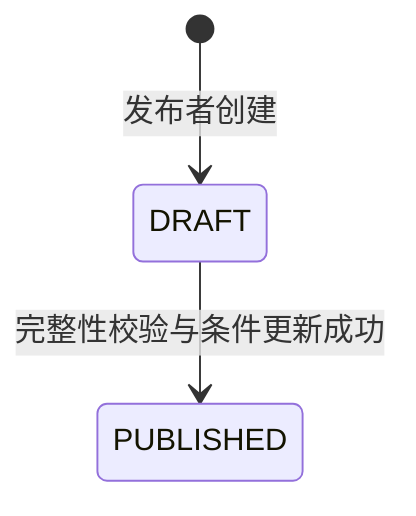
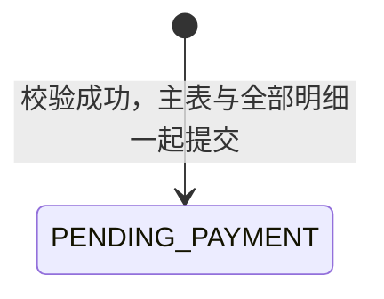
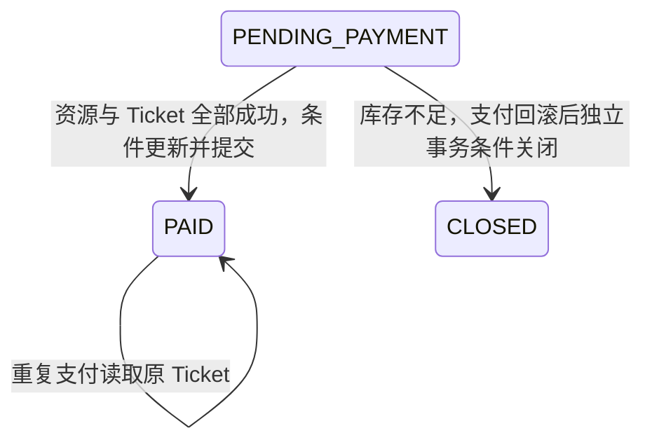
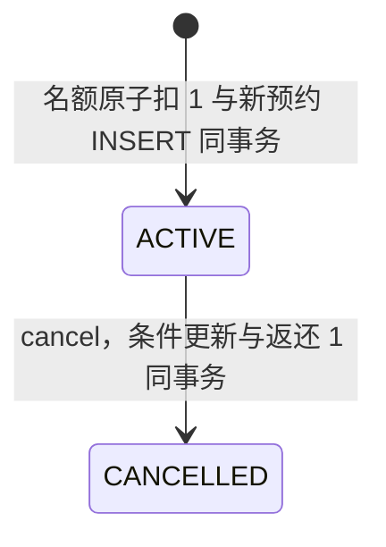
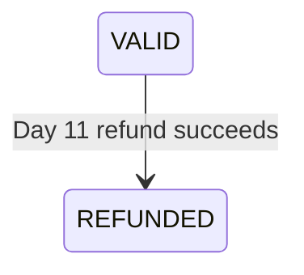
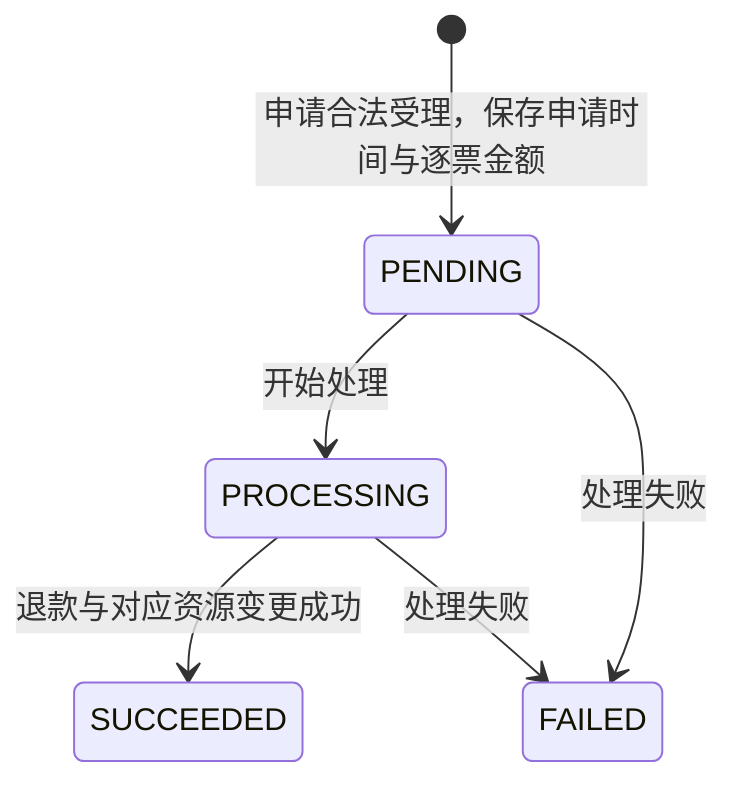

# 活动、白名单、票单、预约与退款状态机

本页记录业务状态、操作限制与已冻结 Schema 的接入边界。资格通过表示通过账号、归属和名单校验，不代表已满足交易状态、时间、库存或限购条件。

## Activity 生命周期

当前应用实现的状态转换如下：

发布事务取得 Activity 根记录排他锁，校验配置后执行仅匹配 `DRAFT` 的条件更新，并要求影响一行。失败时事务回滚，活动保持原状态。

| Activity 状态 | 核心配置新增 | 白名单维护 | 当前应用状态 |
|---|---|---|---|
| `DRAFT` | 所属发布者可新增 Session、Zone、Seat | 所属发布者可维护 | 创建与发布前配置已实现 |
| `PUBLISHED` | 拒绝，`409 ACTIVITY_NOT_DRAFT` | 所属发布者可维护 | 发布与公开查询已实现 |
| `CANCELLED` | 拒绝 | 拒绝，`409 WHITELIST_NOT_EDITABLE` | 数据库状态已定义，取消业务流程尚未实现 |
| `FINISHED` | 拒绝 | 拒绝，`409 WHITELIST_NOT_EDITABLE` | 数据库状态已定义，结束业务流程尚未实现 |

重复发布 `PUBLISHED` 活动返回 `409 ACTIVITY_ALREADY_PUBLISHED`。发布不改变 `open_time` 或 `close_time`，也不表示当前已开售。公开查询只要求 `PUBLISHED`，不会因为当前时间早于 `open_time` 而隐藏活动。

## 发布后的核心配置冻结

| 字段或操作 | `PUBLISHED` 后的普通修改 |
|---|---|
| `activity.type`、`open_time`、`close_time` | 冻结 |
| `activity_session.capacity`、`max_tickets_per_user`、`seat_mode` | 冻结 |
| `session_zone.price`、`total_amount` | 冻结 |
| Seat 行列、座位编号、分配优先级及座位增删 | 冻结 |
| `activity_session.start_time`、`end_time` | 冻结，后续变更必须走专用改期流程 |
| 活动、场次白名单配置和成员 | 允许所属发布者维护 |

当前未开放通用核心配置编辑入口，普通编辑请求返回 `404` 或 `405`。已有配置新增入口在同一事务的 Activity 根记录锁后检查 `DRAFT`。后续新增普通编辑入口也必须遵守该规则。

Day 22 才实现专用改期流程。当前没有改期 API，也没有通过改期修改时间的成功路径。Session 的 `SCHEDULED`、`FINISHED`、`CANCELLED` 是数据库已定义的状态，当前配置创建使用 `SCHEDULED`，后续结束与取消流程尚未实现。

## 白名单配置状态

以下三种状态由配置行和成员行共同表达，不新增独立状态字段：

| 配置状态 | 数据库事实 | 资格语义 |
|---|---|---|
| 未配置 | 没有对应 `whitelist_config` 行 | 场次继承活动规则，活动也未配置则公开 |
| 显式空名单 | 配置行存在，成员数为零 | 无账号通过，不回退到上级名单 |
| 非空名单 | 配置行存在且至少有一个成员 | 仅名单成员通过，场次配置完全覆盖活动配置 |

操作按以下规则改变配置状态：

| 当前状态 | 操作 | 结果 |
|---|---|---|
| 未配置 | PUT 配置 | 显式空名单 |
| 未配置 | POST 成员或 DELETE 成员 | `404 WHITELIST_NOT_CONFIGURED`，不创建配置 |
| 已配置 | 重复 PUT 配置 | 保留配置 ID 和全部成员 |
| 显式空名单 | 添加首个成员 | 非空名单 |
| 非空名单 | 删除最后一个成员 | 显式空名单，保留配置行 |
| 已配置 | DELETE 配置 | 同一事务删除成员和配置，恢复未配置状态 |
| 未配置 | DELETE 配置 | 保持未配置，返回 `204` |

取消场次配置恢复活动继承，取消活动配置不删除已有场次配置。两级都未配置时，公开规则适用于满足基础条件的登录账号。发布者及活动所有者也不能绕过显式空名单。

所有配置状态转换先取得所属 Activity 根记录锁，确认归属及状态为 `DRAFT` 或 `PUBLISHED`。终态拒绝同样适用于重复 PUT、重复 DELETE 等幂等操作。

## 名单变更与已有交易

白名单变化只约束未来资格行为，不产生门票或预约的状态转换。已支付门票与已成功预约不因删名单而自动失效。待支付订单在支付时调用 `QualificationService.checkAgain`，取消或退款后重新参与也重新检查当前名单。

这段规则是后续交易实现的约束，实际预约、支付及已成交记录的完整回归属于后续阶段。当前已验证资格重查与名单修改的事务协调，具体边界见 [架构与阶段验收](architecture.md)。锁顺序见 [locking.md](locking.md)，六项名单决策见 [decisions.md](decisions.md#whitelist-semantics)。

## 票单创建与未占用资源

当前票单 HTTP API 实现创建、创建幂等重放、本人详情与模拟支付。创建写入如下：

创建失败时主表与明细全部回滚，不留下部分订单。数据库生成 `created_at`，并由存储生成列计算 `expires_at = created_at + 15 minutes`，`paid_at` 为 `NULL`。

| 操作或事件 | 订单与资源结果 |
|---|---|
| 新请求创建成功 | 订单为 `PENDING_PAYMENT`，只新增主表及明细 |
| 相同幂等键、相同购买意图 | 读取原单当前状态，不新增订单、不续期、不重置状态 |
| 相同幂等键、不同购买意图 | `409 IDEMPOTENCY_CONFLICT`，原单不变 |
| 到达 `expires_at` | 已存过期时间不变；当前尚未实现自动关闭状态转换 |
| 到达活动停售时间 | 拒绝创建新单，不将已创建订单自动关闭 |
| 名单变化 | 不修改既有订单，后续支付重新检查当前资格 |
| 本人查询详情 | 只读取，不修改订单、明细或资源 |
| 他人查询详情 | `403 ORDER_ACCESS_DENIED` |

创建前后的 `session_zone.remains_amount`、Seat 状态、有效购票计数与 Ticket 数量均不变。不存在的计数行仍不存在，已有计数行也不被改写。创建成功没有取得资源所有权。

支付已实现 PAID 转换，以及明确缺货时的 CLOSED 转换。数据库还定义 `PARTIALLY_REFUNDED`、`REFUNDED`，当前不实现退款转换。创建 `requestId` 不能替代支付状态条件更新。完整决策见 [ADR-004](decisions.md#adr-004下单不预占与支付时数据库权威)，接口与错误见 [票单 API](api/ticket-orders.md)及[支付 API](api/ticket-payments.md)。

## 票单支付与缺货关闭

内部资源组件已支持限购原子增加、PAID Zone 余量条件减少，以及 Seat 从 `AVAILABLE` 条件变为 `SOLD`。这些操作必须加入调用方事务，任一失败时整体回滚；失败的条件 UPDATE 不触发资源变化。连座不满足且未接受非连座时，也不保留之前的额度或库存变化。

资源组件返回明细与实际 Seat 的对应关系，由 `TicketIssuanceService` 按原明细单价签发 VALID Ticket。`TicketPaymentTransactionService` 在同一事务中完成限购、库存、Seat、Ticket 与最终 PAID 更新，全部成功后提交。

待支付分支要求 `created_at <= now < expires_at` 且场次仍未开始。到达活动停售时间只阻止新单创建，旧单只要仍有效即可支付。名单变化、额度不足、座位冲突及过期等拒绝只回滚本次尝试；仅明确库存不足按 ORD-05 关闭。

缺货关闭事务重新锁单。如果另一个请求已经提交 PAID，则返回原支付结果，不写 CLOSED；关闭先提交时，等待的支付读取 CLOSED 并拒绝。技术异常不会触发缺货关闭。

过期判断与关闭状态转换是不同事件。Day 8 已实现定时过期扫描、主动取消及事务外技术重试；三条路径围绕同一订单行协调。验证与当前范围见 [Day 8 并发说明](day8-concurrency.md)。退款在后续阶段实现。

## 免费预约状态机

V4 定义 `free_reservation` 与 `free_session_quota`，创建与取消 API 已按[预约事务契约](free-reservations.md)接入。成功创建即 ACTIVE 并占用一份名额；取消只返还一次，重新预约 INSERT 新记录。

预约只有 ACTIVE、CANCELLED 两个状态。取消保留原行并写 cancelled_at。重新预约新建另一条 ACTIVE 记录，不存在旧 CANCELLED 行恢复为 ACTIVE 的业务路径。当前有效唯一键只覆盖 ACTIVE，允许同账号同场次保留多次取消历史。

用户主动取消必须早于场次开始，只在 ACTIVE 条件更新影响一行时返还名额；重复取消不再返还。记录的 ACTIVE 状态也不能替代场次生命周期检查，场次取消后的系统失效处理按后续专用流程实现。

创建中的名额扣减与 INSERT、取消中的状态变更与返还均在同一事务。中途异常回滚全部变更。状态机、唯一性、重约无优先权的验证见 [Day 9 免费预约验收](day9-concurrency.md)。

## Ticket 退票状态

Ticket 的退票转换在 Day 11 的实际退款成功事务中执行：

Day 10 只负责建立并接受合法申请。即使已计算 refundAmount，选中的 Ticket 也保持 VALID。Seat、Zone 库存与购票限购计数只在 Day 11 的生效事务中恢复。

| 对象 | Day 10 合法申请提交后的状态 |
|---|---|
| Refund Request | PENDING |
| Refund Item | PENDING |
| Ticket，包括申请中的票 | VALID |
| Seat | SOLD |
| Zone remains | 申请前的原值 |
| user_session_purchase.valid_count | 申请前的原值 |
| Ticket Order | 原支付状态，不由申请接口转换 |

## 门票退款申请与逐票明细

Day 10 申请接口创建 PENDING 主申请及 PENDING 逐票明细。下图定义后续处理路径，PROCESSING、SUCCEEDED、FAILED 的执行入口由 Day 11 实现：

受理成功不改变 Ticket 的 VALID 状态，也不恢复库存、座位或限购。后续处理使用持久化的 requested_at、original_price、fee_rate、refund_amount，不按执行时刻重新判断原申请政策。FAILED 明细须保存 failure_reason，并释放同票处理中唯一键；历史保留。

一张申请对应多条逐票明细，每张 Ticket 独立记录成交价与退款结果。Schema、锁顺序、幂等规则见 [退款申请契约](ticket-refunds.md)，请求与响应见 [退款 API](api/ticket-refunds.md)。
