# 活动、白名单、票单、预约与退款状态机

本页记录业务状态、操作限制与已冻结 Schema 的接入边界。资格通过表示通过账号、归属和名单校验，不代表已满足交易状态、时间、库存或限购条件。

## 商品目录与商品订单状态

Day 15/16 已实现待支付商品订单、模拟支付、缺货关闭和过期扫描。V11 已实现订单明细级模拟发货/收货、售后申请和事务退款。Product 的 DRAFT/ON_SALE/OFF_SALE 与 SKU 配置由目录 API 管理。

| 对象 | 状态转换 | 语义 |
|---|---|---|
| Product | DRAFT → ON_SALE → OFF_SALE；OFF_SALE → ON_SALE | API 已实现，首次上架时间保留；上架要求父活动 PUBLISHED 且至少一项 ACTIVE SKU。 |
| SKU | 创建为 ACTIVE；Schema 也允许 INACTIVE | 当前没有上下架 SKU 状态切换 API；只允许 DRAFT Product 下创建/修改价格和初始库存，已上架或下架 Product 都拒绝配置写入，零库存可展示。 |
| ProductOrder | 创建 → PENDING_PAYMENT | Day 15 只创建此状态。`created_at` 由数据库生成，`expires_at = created_at + 15 分钟`，`paid_at = NULL`；服务端计算 `total_amount` 并从 SKU → Product 推导 `publisher_id`。 |
| ProductOrder | PENDING_PAYMENT → PAID | 商品资格、Product 共享限购、所有 SKU 库存和最终数据库期限检查成功后，同一事务扣减库存、增加限购并更新 `paid_at`。价格取订单明细快照。 |
| ProductOrder | PENDING_PAYMENT → CLOSED | 任一 SKU 缺货时，支付事务先全部回滚，再由新事务重锁并关闭，原因 `OUT_OF_STOCK`。过期扫描按数据库时间条件关闭，原因 `EXPIRED`。 |
| ProductOrder | PAID → PARTIALLY_REFUNDED → REFUNDED；PAID → REFUNDED | V11 冻结按成功退款数量汇总的转换；不改写原价或购买数量。处理 Service 已实现，成功效果与售后状态同事务提交。 |

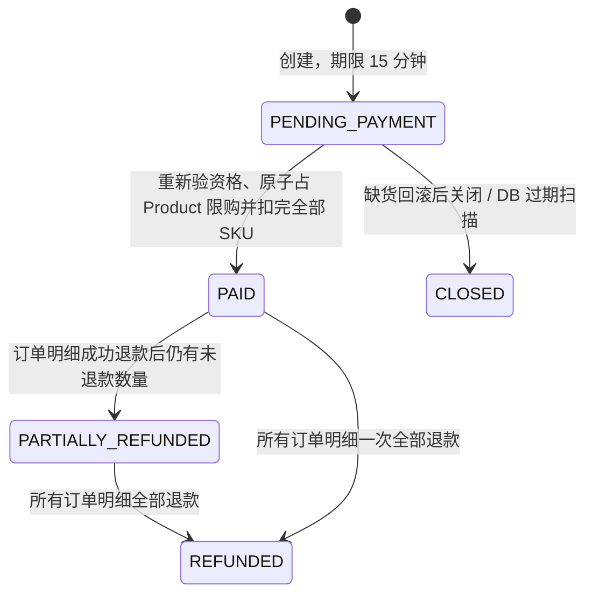

模拟支付只接受认证买家和订单 ID。Ticket 限定商品在账号 × Activity Guard 内重新查询有效 Ticket；SESSION 范围限定到指定场次。同一 Product 的所有 SKU 共用一条有效购买计数，多个 Product 按 ID 升序更新，多个 SKU 按 ID 升序扣减。订单已 PAID 时重复请求返回原结果，不再产生资源变化。达到 `expires_at` 本身不会自动改变状态，必须由支付拒绝或独立过期扫描事务关闭。

ProductOrder 的财务状态不代表已发货、已收货或可再售。V11 将履约事实与退款事实分开保存在订单明细及售后记录中，不能把 `REFUNDED` 直接解释为 SKU 已恢复库存。

售后模板本身不是交易状态：STANDARD_7D、SPECIAL_NO_REASON_RETURN 都不能变成一个覆盖所有原因的“永不可退”状态。商品成功支付会扣减 SKU 余量、增加 Product 购买计数。订单明细保留购买时资格范围和 Guard 版本。最后一张有效票退款后，资格联动由独立 Outbox 事件处理。

## 商品履约与售后申请

履约状态和累计数量保存在 `product_order_item`。一对一的履约表会重复已有明细，因此 V11 不另建 `product_fulfillment`。支付成功时，明细处于 `UNSHIPPED`，发货和收货时间为空。服务端按数据库时间记录首次发货和首次收货。

| 状态 | 数量条件 |
|---|---|
| `UNSHIPPED` | `shipped_quantity = 0`，`received_quantity = 0`。 |
| `SHIPPED` | `shipped_quantity > 0`，`received_quantity = 0`。 |
| `RECEIVED` | `received_quantity = shipped_quantity > 0`。 |

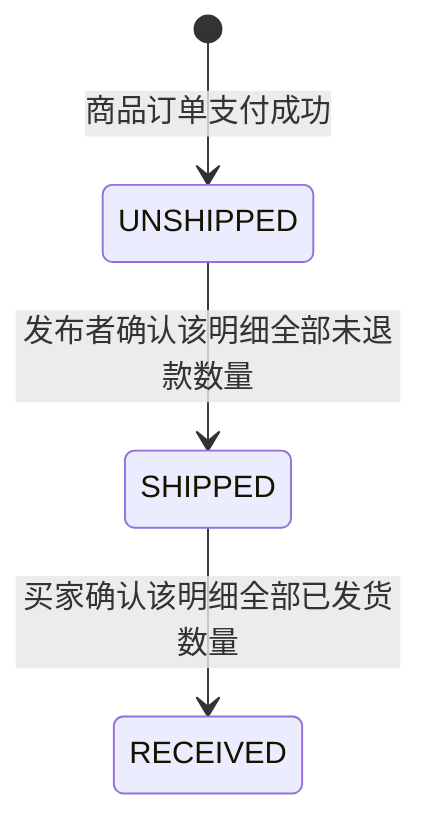

发货数量、收货数量必须满足 `0 <= received_quantity <= shipped_quantity <= quantity`。模拟发货、收货各按明细一次确认全部对应数量，避免一个时间字段错误代表多批不同时间的商品。`shipped_at`、`received_at` 由数据库写入，接口不接受客户端时间。重复发货/收货因当前状态不匹配而拒绝。发货、收货和退款都先锁定同一 ProductOrder 与订单明细行。

商品售后申请保存 `PENDING`、`PROCESSING`、`SUCCEEDED` 或 `FAILED` 状态：

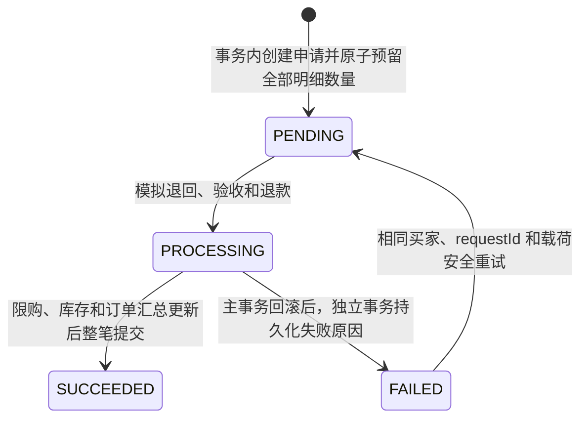

`PENDING` 和 `PROCESSING` 只在同一 `READ_COMMITTED` 主事务内存在。各明细按 `order_item_id ASC` 用条件更新增加 `refund_pending_quantity`，且必须影响一行；数据库同时检查 `0 <= refunded_quantity + refund_pending_quantity <= quantity`。Java 不能先查询剩余数量后无条件写入。成功时同一事务把预留数转成已退款数；任一步失败都会回滚主事务的申请、资源及数量变更，随后新事务保留 `FAILED` 申请、明细与失败原因，但不占用退款数量。只有同一幂等键和完全相同载荷可以重试失败记录；已提交的成功重放返回原结果。申请资格校验阶段被拒绝的请求不创建失败记录。

`NO_REASON` 只可使用 `STANDARD_7D`，要求明细已收货、模拟验收允许再次销售，且数据库当前时间位于 `[received_at, received_at + 7 days)`。时间窗口按经过 168 小时计算，等于到期时刻即拒绝。`SPECIAL_NO_REASON_RETURN` 只拒绝普通无理由退货；`QUALITY_PROBLEM`、`TICKET_QUALIFICATION_LOST`、`ACTIVITY_CANCELLED` 仍能表达和受理。资格事件 Consumer 会为 `TICKET_QUALIFICATION_LOST` 创建联动任务并重查当前资格；取消引起的资格丧失沿用 `TICKET_QUALIFICATION_LOST` 联动，不对所有商品直接使用 `ACTIVITY_CANCELLED` 整单退款。`returned_at` 由数据库记录。

相同买家、`request_id` 和相同订单/明细/数量/原因/模拟验收输入返回原结果；载荷不同返回幂等冲突。不同请求键的并发申请由订单明细锁、原子条件更新及数据库 `CHECK` 共同限额。事务未提交时重试不会产生重复退款。

未发货且符合条件的数量可直接模拟退款。已发货商品必须先由买家确认收货，再模拟退回和验收；只有退回且验收通过、`is_resalable = TRUE` 的数量可恢复 SKU 库存。退款成功都会按数量恢复 Product 限购，不可再售商品也会恢复限购。验收结果取 `NOT_REQUIRED`、`PENDING`、`PASSED` 或 `FAILED`；尚未验收时 `is_resalable` 为空。`simulateInspectionPassed` 与 `simulateResalable` 分别表达验收是否通过及通过后是否可再售；二者都只是本地模拟输入，不表示真实仓储事实。

售后订单状态只按成功退款数量汇总。一次申请可包含多个订单明细，但所有明细必须属于同一订单；商品请求幂等由 `UNIQUE(buyer_id, request_id)` 保护，申请内重复的 `order_item_id` 由唯一键拒绝。

## 持票资格变化与联动售后任务

Ticket 退款事务在 `(buyer_id, activity_id)` 资格保护行内完成逐票退款、增加资格版本并写入 `TICKET_QUALIFICATION_CHANGED` Outbox。事件包含买家、活动、场次、退款、发生时间和资格版本。事件不记录资格永久丧失的结论。

消费者以 `consumer_process` 防止同一事件重复登记任务。消费者按 `product_order_item_id` 查询匹配的商品明细，持有同一资格保护行后重新查询当前 Ticket。`ACTIVITY` 范围检查活动内所有场次；`SESSION` 范围只检查配置场次。新票若已恢复资格，消费者跳过售后。

联动任务每个商品明细最多一条。未发货明细复用 `ProductAfterSaleService` 完成模拟退款、SKU 条件回库和 Product 限购恢复。已发货明细进入 `WAITING_RETURN`；买家收货后，任务扫描器再次检查资格，再复用该 Service 模拟退回及验收。混合订单按 `order_item_id` 处理，不改变普通商品明细。当前仍有有效票时，任务进入 `SKIPPED`；后续再次失去资格时，消费者重开同一任务。

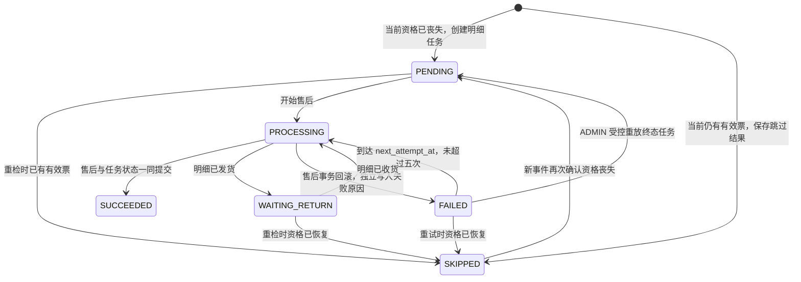

任务创建与 `consumer_process` 在一个事务内提交。每个售后任务在独立事务中提交。消费者在任务处理返回后 ACK；若消费者在任务提交后、ACK 前崩溃，重复投递会找到已有任务并安全重放。任务失败时，独立事务保存失败原因和 `next_attempt_at`；扫描器最多尝试五次，最终状态保持可查询。若同一明细已有其他售后数量预留，任务保持 PENDING 并延后检查，不能把预留中数量误判为已退款完成。

售后任务可由 `GET /admin/ticket-qualification-after-sale-tasks/{taskId}` 查询状态和失败原因。达到五次后的终态 FAILED 只能由 ADMIN 调用 `POST /admin/ticket-qualification-after-sale-tasks/{taskId}/replay` 重置为 PENDING；执行时仍重新检查资格、订单明细和履约状态。该入口不会重置 Ticket 退款或绕过 `ProductAfterSaleService` 的数量保护。

商品支付和 Ticket 退款都先锁各自订单，再按 `(buyer_id, activity_id)` 顺序锁资格保护行。消费端先按 `ProductOrder.order_id` 升序锁定全部候选订单，再获取同一 Guard。Ticket 退款事务不锁 ProductOrder。商品支付持有保护行时重查指定范围内的有效票，然后才扣 SKU。退款提交后消费者持有同一保护行重查资格，因此旧事件不能覆盖新票已经恢复的资格。

## Activity 生命周期

当前应用实现的状态转换如下：

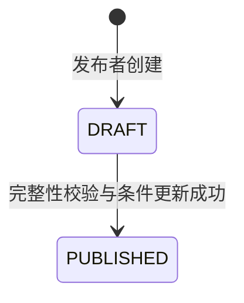

发布事务取得 Activity 根记录排他锁，校验配置后执行仅匹配 `DRAFT` 的条件更新，并要求影响一行。失败时事务回滚，活动保持原状态。

| Activity 状态 | 核心配置新增 | 白名单维护 | 当前应用状态 |
|---|---|---|---|
| `DRAFT` | 所属发布者可新增 Session、Zone、Seat | 所属发布者可维护 | 创建与发布前配置已实现 |
| `PUBLISHED` | 拒绝，`409 ACTIVITY_NOT_DRAFT` | 所属发布者可维护 | 发布与公开查询已实现 |
| `CANCELLED` | 拒绝 | 拒绝，`409 WHITELIST_NOT_EDITABLE` | Day 23 已实现同步取消门禁和异步分项处理 |
| `FINISHED` | 拒绝 | 拒绝，`409 WHITELIST_NOT_EDITABLE` | 数据库状态已定义，结束业务流程尚未实现 |

重复发布 `PUBLISHED` 活动返回 `409 ACTIVITY_ALREADY_PUBLISHED`。发布不改变 `open_time` 或 `close_time`，也不表示当前已开售。公开查询只要求 `PUBLISHED`，不会因为当前时间早于 `open_time` 而隐藏活动。

## 发布后的核心配置冻结

| 字段或操作 | `PUBLISHED` 后的普通修改 |
|---|---|
| `activity.type`、`open_time`、`close_time` | 冻结 |
| `activity_session.capacity`、`max_tickets_per_user`、`seat_mode` | 冻结 |
| `session_zone.price`、`total_amount` | 冻结 |
| Seat 行列、座位编号、分配优先级及座位增删 | 冻结 |
| `activity_session.start_time`、`end_time` | 冻结，后续变更必须走专用改期流程 |
| 活动、场次白名单配置和成员 | 允许所属发布者维护 |

当前未开放通用核心配置编辑入口，普通编辑请求返回 `404` 或 `405`。已有配置新增入口在同一事务的 Activity 根记录锁后检查 `DRAFT`。后续新增普通编辑入口也必须遵守该规则。

Day 22 已提供 `POST /publisher/sessions/{sessionId}/reschedules`。仅所属发布者可对 PUBLISHED 活动中尚未开始的 SCHEDULED 场次改期；成功后场次仍为 SCHEDULED，Ticket 和 Seat 不变。FINISHED、CANCELLED 拒绝改期。Day 23 已实现取消入口与批次；正常结束的业务入口仍按后续计划推进。

## 白名单配置状态

以下三种状态由配置行和成员行共同表达，不新增独立状态字段：

| 配置状态 | 数据库事实 | 资格语义 |
|---|---|---|
| 未配置 | 没有对应 `whitelist_config` 行 | 场次继承活动规则，活动也未配置则公开 |
| 显式空名单 | 配置行存在，成员数为零 | 无账号通过，不回退到上级名单 |
| 非空名单 | 配置行存在且至少有一个成员 | 仅名单成员通过，场次配置完全覆盖活动配置 |

操作按以下规则改变配置状态：

| 当前状态 | 操作 | 结果 |
|---|---|---|
| 未配置 | PUT 配置 | 显式空名单 |
| 未配置 | POST 成员或 DELETE 成员 | `404 WHITELIST_NOT_CONFIGURED`，不创建配置 |
| 已配置 | 重复 PUT 配置 | 保留配置 ID 和全部成员 |
| 显式空名单 | 添加首个成员 | 非空名单 |
| 非空名单 | 删除最后一个成员 | 显式空名单，保留配置行 |
| 已配置 | DELETE 配置 | 同一事务删除成员和配置，恢复未配置状态 |
| 未配置 | DELETE 配置 | 保持未配置，返回 `204` |

取消场次配置恢复活动继承，取消活动配置不删除已有场次配置。两级都未配置时，公开规则适用于满足基础条件的登录账号。发布者及活动所有者也不能绕过显式空名单。

所有配置状态转换先取得所属 Activity 根记录锁，确认归属及状态为 `DRAFT` 或 `PUBLISHED`。终态拒绝同样适用于重复 PUT、重复 DELETE 等幂等操作。

## 名单变更与已有交易

白名单变化只约束未来资格行为，不产生门票或预约的状态转换。已支付门票与已成功预约不因删名单而自动失效。待支付订单在支付时调用 `QualificationService.checkAgain`，取消或退款后重新参与也重新检查当前名单。

这段规则是后续交易实现的约束，实际预约、支付及已成交记录的完整回归属于后续阶段。当前已验证资格重查与名单修改的事务协调，具体边界见 [架构与阶段验收](architecture.md)。锁顺序见 [locking.md](locking.md)，六项名单决策见 [decisions.md](decisions.md#whitelist-semantics)。

## 票单创建与未占用资源

当前票单 HTTP API 实现创建、创建幂等重放、本人详情与模拟支付。创建写入如下：

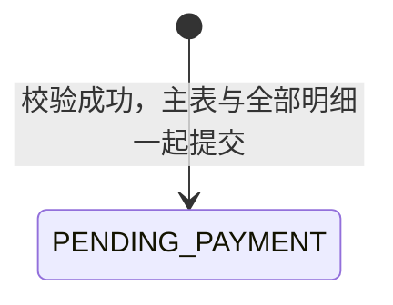

创建失败时主表与明细全部回滚，不留下部分订单。数据库生成 `created_at`，并由存储生成列计算 `expires_at = created_at + 15 minutes`，`paid_at` 为 `NULL`。

| 操作或事件 | 订单与资源结果 |
|---|---|
| 新请求创建成功 | 订单为 `PENDING_PAYMENT`，只新增主表及明细 |
| 相同幂等键、相同购买意图 | 读取原单当前状态，不新增订单、不续期、不重置状态 |
| 相同幂等键、不同购买意图 | `409 IDEMPOTENCY_CONFLICT`，原单不变 |
| 到达 `expires_at` | 已存过期时间不变；Outbox 延迟消息及数据库扫描器条件关闭仍待支付的订单，不能覆盖 PAID |
| 到达活动停售时间 | 拒绝创建新单，不将已创建订单自动关闭 |
| 名单变化 | 不修改既有订单，后续支付重新检查当前资格 |
| 本人查询详情 | 只读取，不修改订单、明细或资源 |
| 他人查询详情 | `403 ORDER_ACCESS_DENIED` |

创建前后的 `session_zone.remains_amount`、Seat 状态、有效购票计数与 Ticket 数量均不变。不存在的计数行仍不存在，已有计数行也不被改写。创建成功没有取得资源所有权。

支付已实现 PAID 转换，以及明确缺货时的 CLOSED 转换。数据库还定义 `PARTIALLY_REFUNDED`、`REFUNDED`，当前不实现退款转换。创建 `requestId` 不能替代支付状态条件更新。完整决策见 [ADR-004](decisions.md#adr-004下单不预占与支付时数据库权威)，接口与错误见 [票单 API](api/ticket-orders.md)及[支付 API](api/ticket-payments.md)。

## 票单支付与缺货关闭

内部资源组件已支持限购原子增加、PAID Zone 余量条件减少，以及 Seat 从 `AVAILABLE` 条件变为 `SOLD`。这些操作必须加入调用方事务，任一失败时整体回滚；失败的条件 UPDATE 不触发资源变化。连座不满足且未接受非连座时，也不保留之前的额度或库存变化。

资源组件返回明细与实际 Seat 的对应关系，由 `TicketIssuanceService` 按原明细单价签发 VALID Ticket。`TicketPaymentTransactionService` 在同一事务中完成限购、库存、Seat、Ticket 与最终 PAID 更新，全部成功后提交。

出票事务在 Activity/Session 与当前资格配置检查后，取得 `(buyer_id, activity_id)` Guard，再进入票务限购及资源锁；新 Ticket 与 Guard 版本增加同事务提交。退款处理也在恢复限购、Zone、Seat 和 Ticket 前取得同一 Guard，并在 Ticket 成功退款后增加版本。商品支付在 Guard 内读取真实有效票；版本字段只用于追踪购买与资格变化的先后，不代替资格查询。

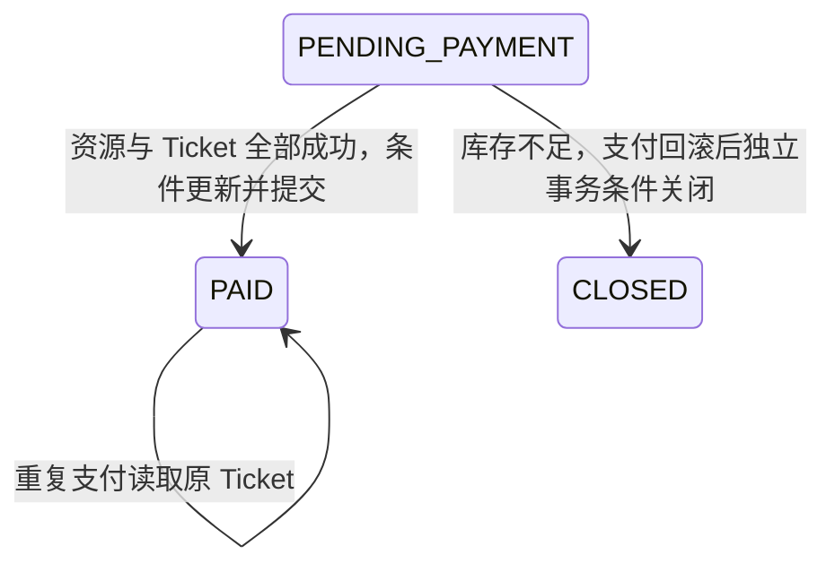

待支付分支要求 `created_at <= now < expires_at` 且场次仍未开始。到达活动停售时间只阻止新单创建，旧单只要仍有效即可支付。名单变化、额度不足、座位冲突及过期等拒绝只回滚本次尝试；仅明确库存不足按 ORD-05 关闭。

缺货关闭事务重新锁单。如果另一个请求已经提交 PAID，则返回原支付结果，不写 CLOSED；关闭先提交时，等待的支付读取 CLOSED 并拒绝。技术异常不会触发缺货关闭。

过期判断与关闭状态转换是不同事件。Day 8 已实现定时过期扫描、主动取消及事务外技术重试；三条路径围绕同一订单行协调。验证与当前范围见 [Day 8 并发说明](../qa/guides/day8-concurrency.md)。退款状态转换见下文。

## 免费预约状态机

V4 定义 `free_reservation` 与 `free_session_quota`，创建与取消 API 已按[预约事务契约](free-reservations.md)接入。成功创建即 ACTIVE 并占用一份名额；取消只返还一次，重新预约 INSERT 新记录。

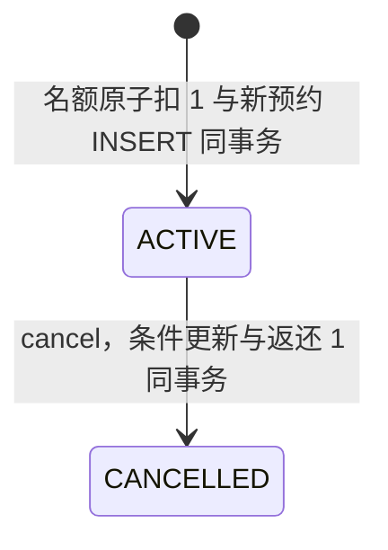

预约只有 ACTIVE、CANCELLED 两个状态。取消保留原行并写 cancelled_at。重新预约新建另一条 ACTIVE 记录，不存在旧 CANCELLED 行恢复为 ACTIVE 的业务路径。当前有效唯一键只覆盖 ACTIVE，允许同账号同场次保留多次取消历史。

用户主动取消必须早于场次开始，只在 ACTIVE 条件更新影响一行时返还名额；重复取消不再返还。记录的 ACTIVE 状态也不能替代场次生命周期检查，场次取消后的系统失效处理按后续专用流程实现。

创建中的名额扣减与 INSERT、取消中的状态变更与返还均在同一事务。中途异常回滚全部变更。状态机、唯一性、重约无优先权的验证见 [Day 9 免费预约验收](../qa/guides/day9-concurrency.md)。

## Ticket 退票状态

Ticket 的退票转换在 Day 11 的实际退款成功事务中执行：

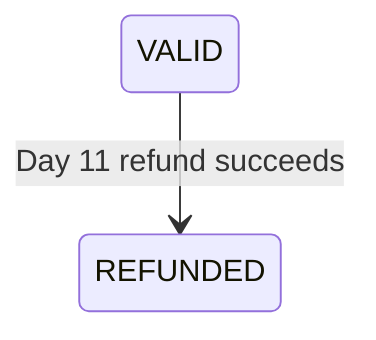

Day 10 只负责建立并接受合法申请。即使已计算 refundAmount，选中的 Ticket 也保持 VALID。Seat、Zone 库存与购票限购计数只在 Day 11 的生效事务中恢复。

| 对象 | Day 10 合法申请提交后的状态 |
|---|---|
| Refund Request | PENDING |
| Refund Item | PENDING |
| Ticket，包括申请中的票 | VALID |
| Seat | SOLD |
| Zone remains | 申请前的原值 |
| user_session_purchase.valid_count | 申请前的原值 |
| Ticket Order | 原支付状态，不由申请接口转换 |

## 门票退款申请与逐票明细

Day 10 申请接口创建 PENDING 主申请及 PENDING 逐票明细。Day 11 处理入口在同一事务内执行 PROCESSING 与 SUCCEEDED：

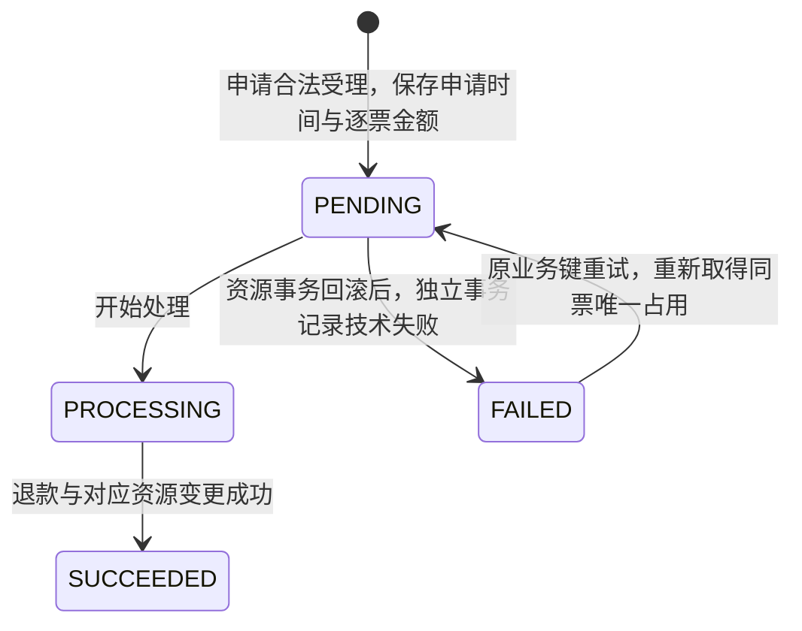

受理成功不改变 Ticket 的 VALID 状态，也不恢复库存、座位或限购。后续处理使用持久化的 requested_at、original_price、fee_rate、refund_amount，不按执行时刻重新判断原申请政策。FAILED 明细须保存 failure_reason，并释放同票处理中唯一键；历史保留。

一张申请对应多条逐票明细，每张 Ticket 独立记录成交价与退款结果。Schema、锁顺序、幂等规则见 [退款申请契约](ticket-refunds.md)，请求与响应见 [退款 API](api/ticket-refunds.md)。

当前模拟处理的 `PROCESSING` 与 `SUCCEEDED` 在同一个事务内。业务拒绝使事务回滚，直接返回领域错误。数据库技术异常先完整回滚，再由独立短事务将主申请及明细从 `PENDING` 标为 `FAILED`，保存 `TECHNICAL_FAILURE` 与明细失败原因。记录前重新读取状态，不覆盖其他处理已提交的成功。

处理已经在事务中进入 PROCESSING 后发生技术失败，语义上同样进入 FAILED。实际写入先回滚暂态 PROCESSING，使已提交状态恢复 PENDING，再由独立事务写 FAILED，因此图中不表示从失败事务直接提交 PROCESSING → FAILED。

技术失败可用原 `refundId` 重试。原 `FAILED` 明细恢复 `PENDING` 时重新取得同票唯一占用，金额与申请时间不变；其他申请已占用时拒绝并保留失败状态。`PROCESSING` 和其他原因的 `FAILED` 返回 `REFUND_NOT_PENDING`。成功重放保持原处理时间与结果。

订单在同一事务中按剩余 `VALID` Ticket 数汇总：

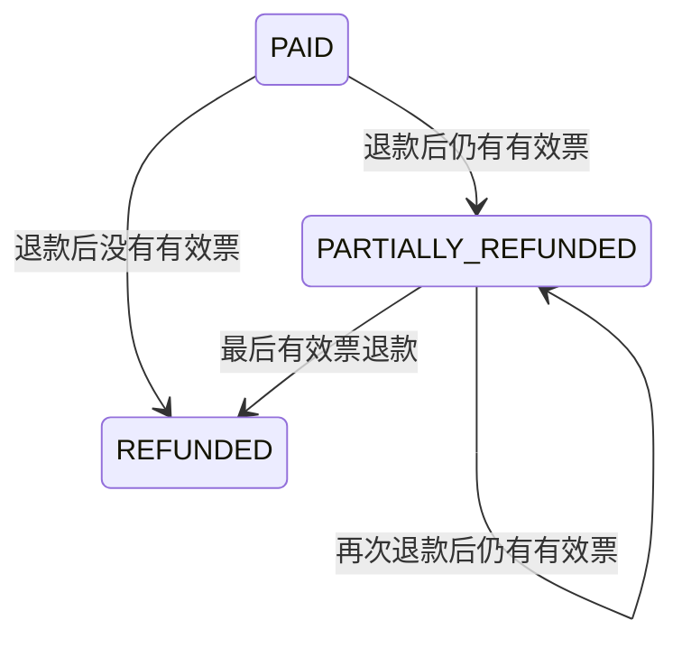

## GIFT 座位与操作历史

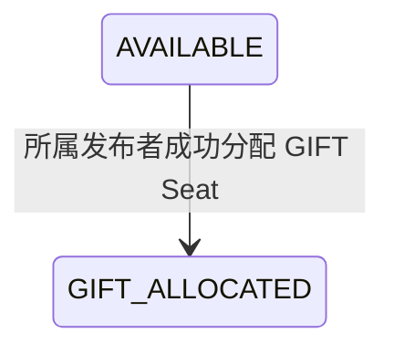

同一事务将选中的 Seat 转为 GIFT_ALLOCATED、Zone remains_amount 减少 N，并提交一条 SUCCEEDED 操作与 N 条 Seat 明细。total_amount 是规划容量，分配不会修改它。GIFT 不生成普通 Ticket，不修改账号场次购票额度。

操作历史只有 ALLOCATE / SUCCEEDED，状态仅随完整事务提交后可见。中途异常全部回滚，不留下已成功但资源不完整的历史。相同请求重放读取原结果，不触发 Seat 状态转换。当前未实现 RELEASE，也没有 GIFT_ALLOCATED → AVAILABLE 的业务入口。

## 按事件保存改期响应

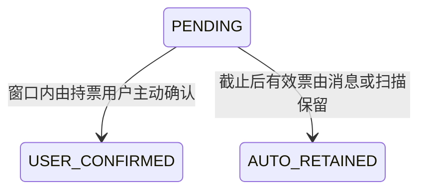

USER_CONFIRMED 保存 responded_at 和 source=USER。AUTO_RETAINED 保存 auto_retained_at 和 source=MQ 或 DEADLINE_SCAN，responded_at 必须为空。重复处理不重写首次时间。

退款是独立的 ticket_refund_request 状态机。USER_CONFIRMED 不阻止窗口内特殊退款，退款成功也不清除确认历史。PENDING 表示未选择，不能单独用它判断门票有效性；已经退款或有有效退款申请的票不执行自动保留。自动保留不更新 Ticket、Seat 或订单。

每次改期生成新事件、新快照和新响应。旧响应保持可查。特殊退款请求必须指定事件，按照该事件的快照和窗口受理；同票所有原因共用唯一退款占用约束。已受理申请在截止后仍沿用原报价执行，当前场次开始后不接受新主动申请。

## Day 23 取消与后续处理

Activity / Session 的 CANCELLED 是终态；账面库存恢复不改变该状态。同步取消只表示业务门禁生效，批次尚可处于 PENDING 或 PROCESSING。

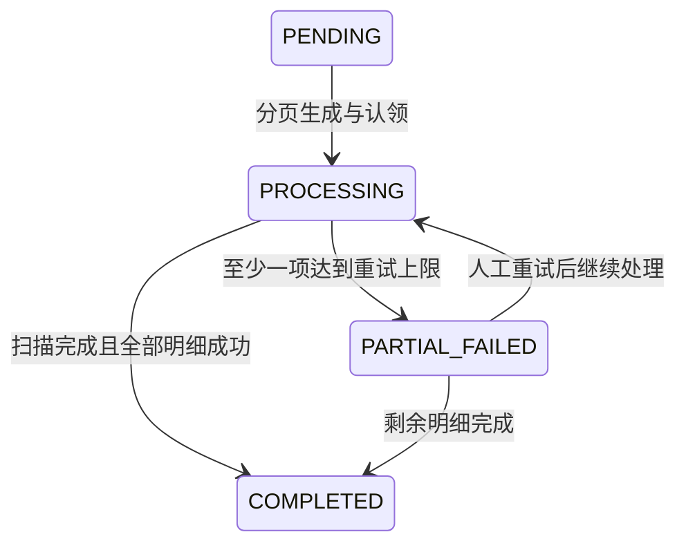

明细 PENDING / RETRY_PENDING → PROCESSING → SUCCEEDED；失败进入 RETRY_PENDING，单轮最多 5 次，之后 FAILED。租约过期可用新令牌接管，旧令牌不能提交效果。人工重试仅重置本轮次数，累计 attempt_count 保留。SUCCEEDED 不重开。

FREE 仍采用 ACTIVE → CANCELLED 并恢复一次名额。赠票采用 GIFT_ALLOCATED → GIFT_CANCELLED，分配历史保留且座位不转入公开池。入口的有效参与判定同时检查生命周期，因此不等待后台落资源状态才失效。

取消前成功的普通退款保持历史；尚未成功的普通或改期申请以 FAILED / CANCELLATION_SUPERSEDED 结束，原金额和改期响应不改写。新取消申请为零手续费全额退款。限定商品独立跟踪售后；取消批次的 COMPLETED 不代表 WAITING_RETURN 商品已退回。
